# Idlewright

**Silnik i panel do budowania przeglądarkowych gier idle.** Serwer liczy postęp gracza także wtedy, gdy gracza nie ma. Wszystko, z czego składa się gra (przedmioty, świat, liczby, słowa, wygląd, samouczek, misje, płatne dodatki), jest treścią, którą operator zmienia w panelu i publikuje jako paczkę, bez udziału programisty. Jedna instalacja prowadzi wiele gier, każdą na własnej domenie, z własną marką, treścią i graczami.

Pierwsza gra zrobiona na Idlewright to **RideIdle**: wyścigowa gra idle, w której gracz odbudowuje wraki, ulepsza auta w warsztacie i wysyła je na tory.

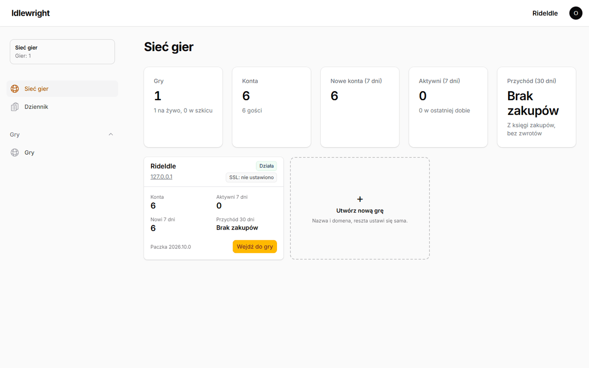

> **Skąd nazwa.** Angielskie *wright* to twórca, jak w *playwright* (autor sztuk) albo *shipwright* (budowniczy statków). Idlewright to ten, kto robi gry idle.

**Spis treści:** [Co daje silnik](#co-daje-silnik) · [Gra RideIdle](#gra-rideidle) · [Instrukcja obsługi panelu](#instrukcja-obsługi-panelu) · [Typowe zadania](#typowe-zadania) · [Dla programistów](#dla-programistów) · [Stan i co dalej](#stan-i-co-dalej)

## Co daje silnik

- **Postęp liczony przez serwer.** Klient wysyła tylko intencje („wyślij auto na tor”), a wynik liczy serwer czystą funkcją na liczbach całkowitych. Gracz wraca po godzinach i zastaje rozliczony czas, awarie, nagrody i misje.
- **Treść jako dane.** Przedmioty, świat, reguły i teksty leżą w dokumentach JSON ze schematami, w plikach repozytorium albo w bazie.
- **Bezpieczna publikacja.** Każda zmiana jest najpierw szkicem. Paczka ze szkiców przechodzi walidację i bramki symulatorów ekonomii, torów i misji, a dopiero potem operator ją uruchamia. Złą paczkę cofa się jednym kliknięciem.
- **Wiele gier w jednej instalacji.** Każda gra ma własną domenę z certyfikatem, markę, stronę startową, treść i konta graczy. Panel przełącza się między grami.
- **Inny świat bez zmiany kodu.** Model gry (sloty i statystyki) i słownik (słowa aplikacji) są danymi, więc gra o statkach może mieć „kadłub” tam, gdzie gra o autach ma „opony”.
- **Wspólna aplikacja gracza.** Jedna aplikacja web (PWA, działa też jako ikona na telefonie) obsługuje wszystkie gry i pyta serwer o nazwę, kolory i ikony gry swojej domeny.
- **Pięć języków od pierwszego dnia:** polski, angielski, francuski, niemiecki i brazylijski portugalski, w grze i w panelu.
- **Panel, który się tłumaczy.** Każde pole ma opis, przykład i zakres, a każda strona krótki przewodnik.

## Gra RideIdle

<p>
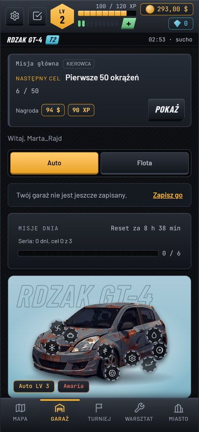
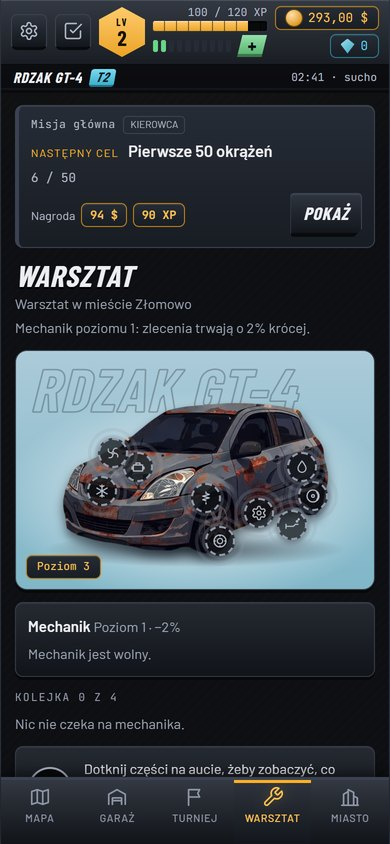
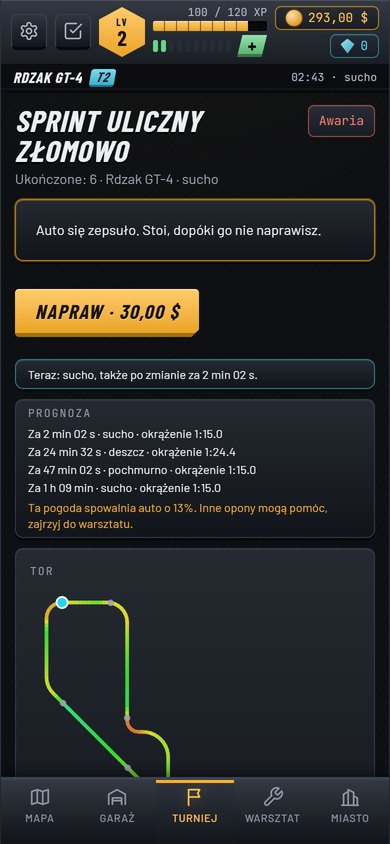
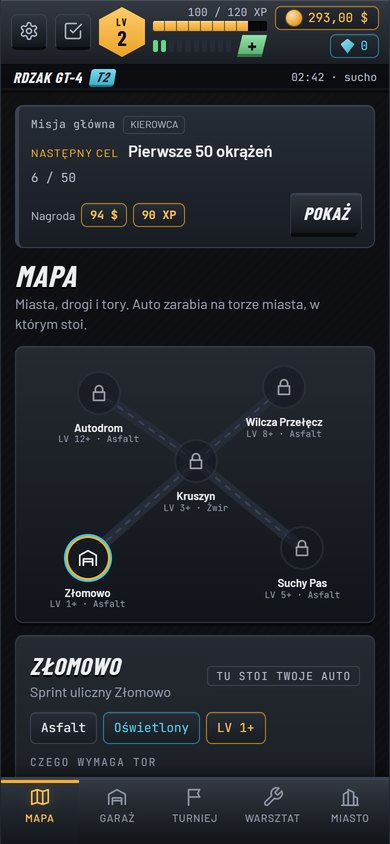
</p>
<p>
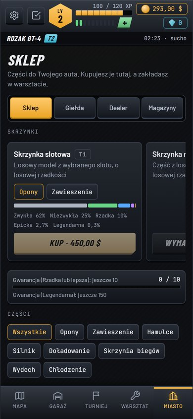
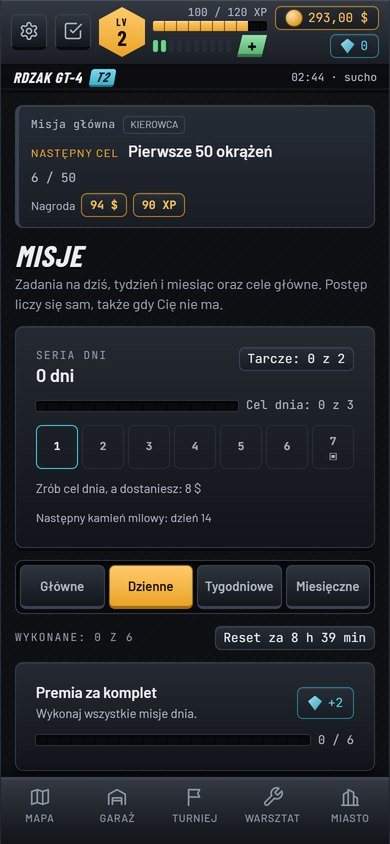
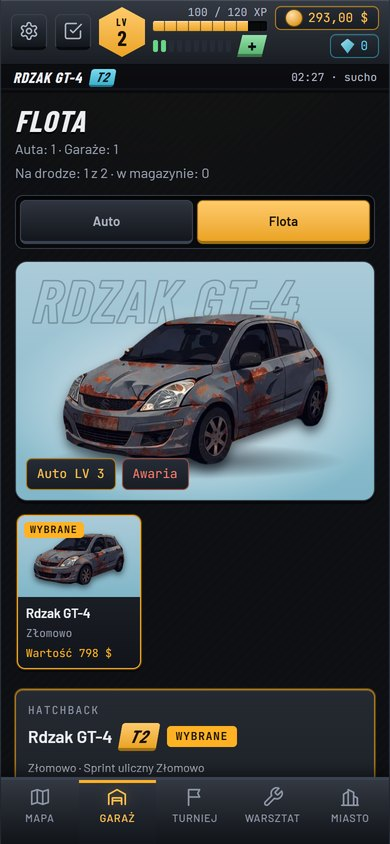
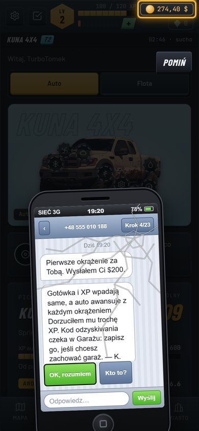
</p>

Co jest w grze (stan `main` na 2026-11-02; szczegóły w [`docs/api-runs.md`](docs/api-runs.md) i [`docs/web-run.md`](docs/web-run.md)):

- **Bieg:** auto jeździ okrążenia toru bez udziału gracza; paliwo, awarie, naprawa i holowanie, siedem botów i nagroda za pozycję, zegar gry z nocą, pogoda, nawierzchnie i opony.
- **Tory:** 15 torów w pięciu miastach (sprint, standard, dystans). Długość toru wyznacza czas okrążenia, paliwo, wypłatę i XP, a narysowana nitka toru pozwala liczyć okrążenie modelem fizycznym.
- **Auta i warsztat:** 23 auta i 74 części, silniki, napęd FWD/RWD/AWD, rzadkość, afiksy i bonusy części, ulepszanie, łączenie i transmutacja części, przebieg, kondycja i serwis, warsztaty z mechanikami w każdym mieście.
- **Świat i rynek:** mapa i podróże (także przyspieszone, z ryzykiem policji), garaże w miastach, limit aut aktywnych, giełda, dealer, skrzynki, sprzedaż aut, magazyny, zlecenia poboczne (kursy z ludźmi albo ładunkiem).
- **Powroty:** samouczek prowadzony SMS-ami (23 kroki), misje główne, dzienne, tygodniowe i miesięczne, seria dni, podsumowanie nieobecności.
- **Płatne funkcje:** waluta RideCoin, kończenie timerów od razu, automatyczne tankowanie, konto VIP, przepustka. Rdzeń płatności kartą działa na dostawcy testowym; prawdziwy Stripe nie jest podłączony.
- **Konto:** gracz zaczyna jako gość i może zabezpieczyć konto e-mailem, Google, Facebookiem albo Apple; regulamin, polityka prywatności, kopia i usunięcie danych ([`docs/konto.md`](docs/konto.md), [`docs/prawo.md`](docs/prawo.md)).

## Instrukcja obsługi panelu

Panel jest pod adresem `/admin`: lokalnie `http://127.0.0.1:8000/admin`, na serwerze na osobnym hoście (na przykład `admin.raceidle.cerasusdigital.pl`, patrz [`deploy/README.md`](deploy/README.md)). Język panelu ustawia `ADMIN_LOCALE` (domyślnie polski). Zrzuty poniżej pochodzą z lokalnej instalacji z grą RideIdle i sześcioma graczami testowymi.

### Jak zmiana trafia do gry

Żadna zmiana w panelu nie trafia do graczy od razu. Droga jest zawsze ta sama:

1. **Szkic.** Zapis formularza (auto, część, Studio, Świat, Słownik i inne) robi szkic. Szkic jest sprawdzany schematem, więc nie da się zapisać czegoś, czego gra nie umie przeczytać. Nagłówek każdej strony mówi, czy jest szkic („Brak szkicu: to jest to, co ma gra”).
2. **Zmiany do publikacji.** Jedna strona zbiera wszystkie szkice gry i pokazuje, co zmienią: gdzie, było, będzie.
3. **Paczka.** „Zrób paczkę z szkiców” składa szkice w paczkę i puszcza ją przez bramki symulatorów. Paczka, która nie przejdzie, nie powstaje.
4. **Uruchomienie.** „Uruchom” robi z gotowej paczki żywą treść gry. Wcześniejsze paczki zostają, więc cofnięcie to uruchomienie poprzedniej.

Pod każdym formularzem, w którym coś zmieniono, a czego jeszcze nie zapisano, pojawia się **pasek zmian** z listą „pole: było → będzie” i przyciskami „Cofnij” i „Cofnij wszystko”.

### 1. Wejście do panelu i role

- Konto administratora zakłada się poleceniem na serwerze: `php artisan admin:create ty@example.com --role=publisher`. Hasło jest pokazane raz. Przy pierwszym logowaniu panel każe ustawić aplikację uwierzytelniającą (na przykład Google Authenticator) i pokazuje kody odzyskiwania; od tej pory każde logowanie wymaga hasła i kodu.
- **Role:** `editor` ogląda wszystko i robi szkice; `publisher` dodatkowo robi i uruchamia paczki, importuje paczki z pliku, widzi dziennik i pobiera listę graczy.
- **Dostęp do gier:** domyślnie administrator pracuje we wszystkich grach. Można go ograniczyć do wybranych, z osobną rolą w każdej: `--game=statki:publisher`. Gry i domeny zakłada tylko administrator wszystkich gier.
- Zmiana roli, wyłączenie konta, nowe hasło, zgubiony telefon: `php artisan admin:update ADRES --role=… | --deactivate | --reset-password | --reset-mfa`.

### 2. Sieć gier


Strona główna panelu. Liczby całej instalacji (gry, konta, nowe konta, aktywni, przychód) i kafel każdej gry: status, domena, stan certyfikatu SSL, konta, aktywni, przychód z 30 dni i numer żywej paczki. **„Wejdź do gry”** przełącza panel na tę grę; to samo robi przełącznik z nazwą gry w prawym górnym rogu. Wszystko w menu „Treść” dotyczy gry, w której panel właśnie pracuje.

### 3. Nowa gra

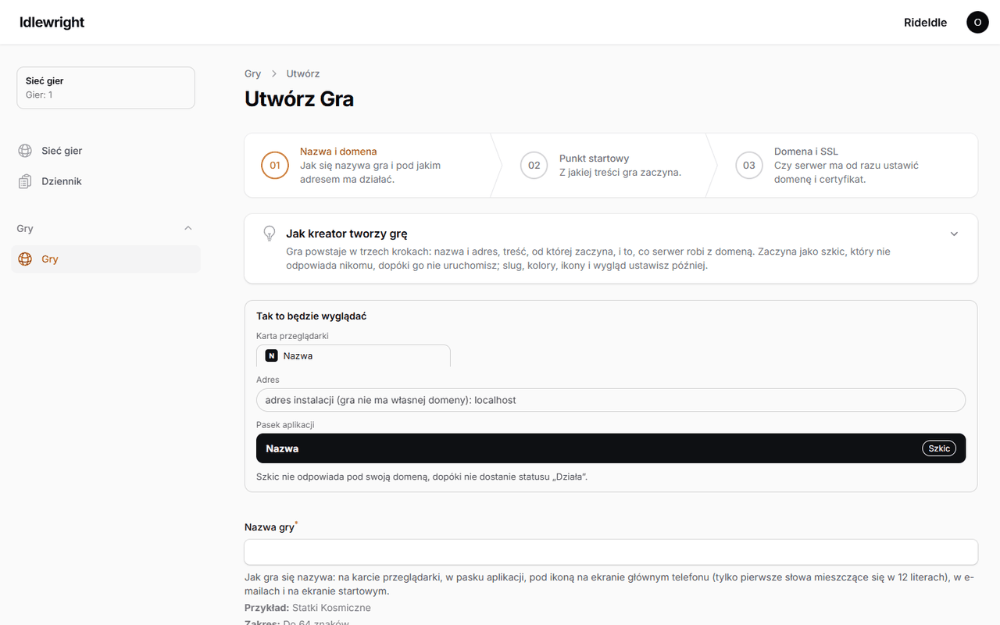

„Utwórz nową grę” na stronie sieci otwiera kreator w trzech krokach:

1. **Nazwa i domena:** nazwa, slug (robi się sam z nazwy i potem się nie zmienia), domena, język i kolor. Podgląd obok pokazuje kartę przeglądarki i pasek aplikacji nowej gry.
2. **Punkt startowy:** „Gra samochodowa (szablon)” (gra dostaje treść RideIdle do przerobienia), „Kopia innej gry” (jej żywa paczka) albo „Bez treści” (pusta gra, której nie da się uruchomić, dopóki nie dostanie paczki).
3. **Domena i SSL:** „Sprawdź DNS” porównuje rekord A domeny z adresem serwera; przełącznik zleca serwerowi ustawienie domeny i certyfikatu zaraz po utworzeniu gry.

Ikony gry ustawia się potem w edycji gry (menu „Gry”). Rekord A domeny musi wskazywać na serwer, zanim zlecisz certyfikat.

### 4. Przegląd gry, domena i SSL

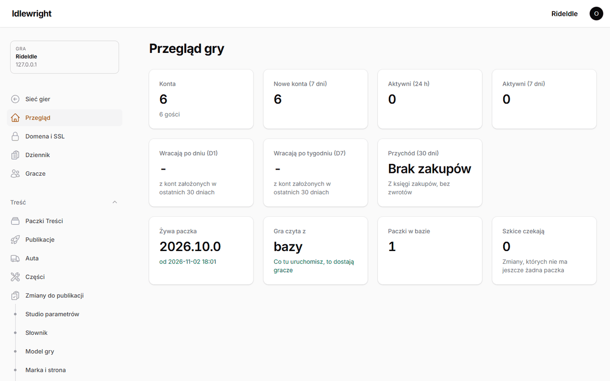

**Przegląd** to strona główna gry: konta, nowe konta, aktywni z doby i tygodnia, powroty po dniu i po tygodniu (D1, D7), przychód, numer żywej paczki, skąd gra czyta treść (pliki albo baza) i ile szkiców czeka.

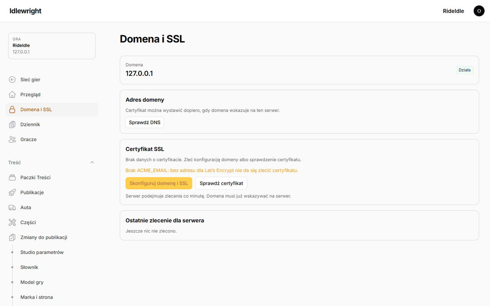

**Domena i SSL:** „Sprawdź DNS”, „Skonfiguruj domenę i SSL” i „Sprawdź certyfikat”. Panel niczego nie uruchamia na serwerze sam; zapisuje zlecenie, które serwer wykonuje w ciągu minuty, a wynik (log, kod wyjścia, data końca certyfikatu) wraca na tę stronę.

### 5. Marka i strona

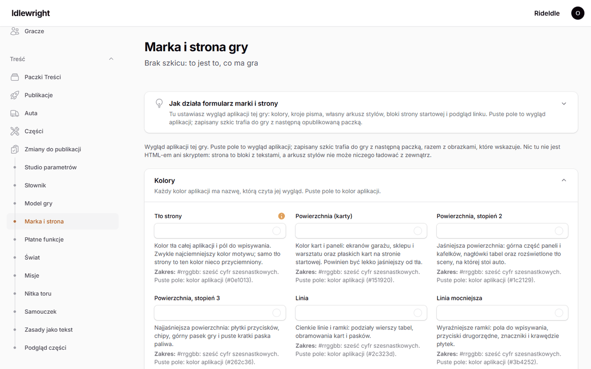

Wygląd gry dla graczy: kolory aplikacji (tło, powierzchnie kart, linie i inne), czcionki, własny arkusz CSS (oczyszczany z niebezpiecznych rzeczy), bloki strony startowej i podgląd linku, który widać po wklejeniu adresu gry w komunikatorze. Każde pole mówi, gdzie w aplikacji widać zmianę. Jak wszystko inne, marka trafia do graczy z paczką.

### 6. Auta i części

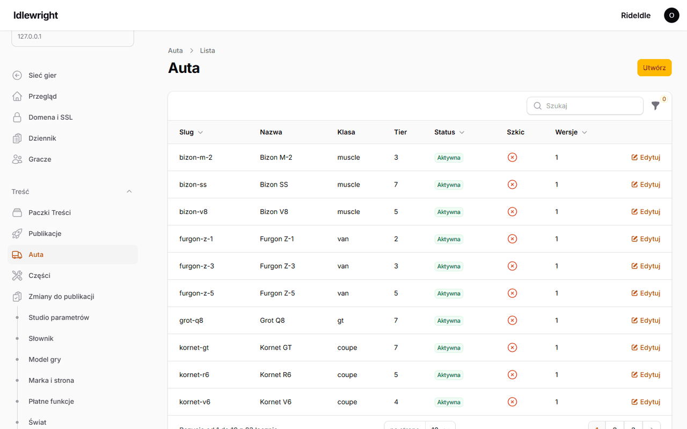

Listy aut i części mają slug, nazwę, klasę albo slot, tier, status, znak szkicu i liczbę wersji, z wyszukiwaniem i filtrami. **„Utwórz”** zaczyna nową definicję.

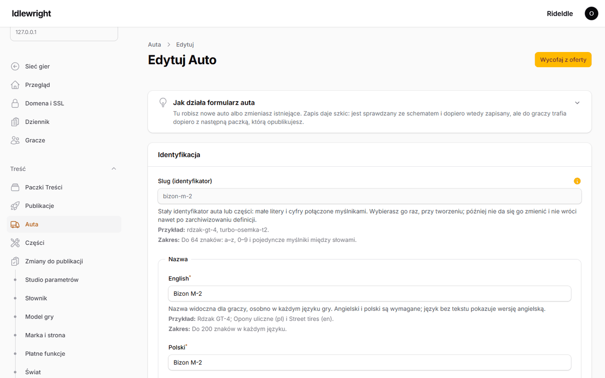

Formularz ma przy każdym polu opis tego, co pole zmienia w grze, przykład i dozwolony zakres. Nazwy i opisy wpisuje się w pięciu językach (angielski i polski są wymagane, reszta bez tekstu pokazuje angielski). Obrazek auta albo części wgrywa się w tym samym formularzu. **„Zapisz”** robi szkic. Akcje u góry strony:

- **Odrzuć szkic:** wraca do tego, co ma gra.
- **Wycofaj z oferty:** przedmiotu nie da się już kupić ani wylosować, ale gracze, którzy go mają, dalej go używają. **Przywróć do oferty** odwraca to.
- **Zarchiwizuj:** usuwa przedmiot z kolejnych paczek; działa tylko wtedy, gdy nikt go nie używa.
- **Usuń szkic:** tylko dla definicji, która nigdy nie była opublikowana.

Slug (identyfikator) wybiera się raz, przy tworzeniu, i potem się go nie zmienia.

### 7. Świat i nitka toru

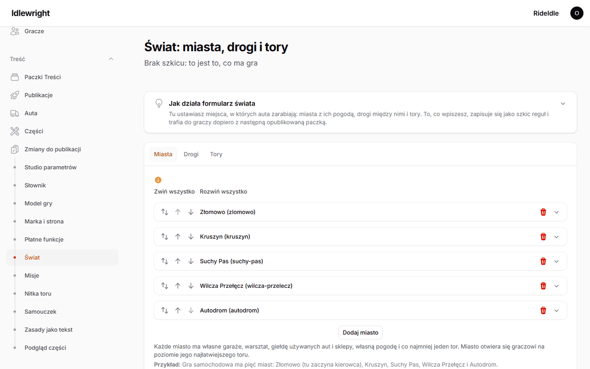

**Świat** ma zakładki Miasta, Drogi i Tory. Miasto ma własną pogodę, garaże, warsztat i rynek, co najmniej jeden tor i punkt na mapie, który klika się i przeciąga; otwiera się graczowi na poziomie swojego najłatwiejszego toru. Droga łączy dwa miasta i ma długość, a tor ma rodzaj, długość, prędkość odniesienia i nawierzchnię. Kolejność zmienia się strzałkami przy każdej pozycji.

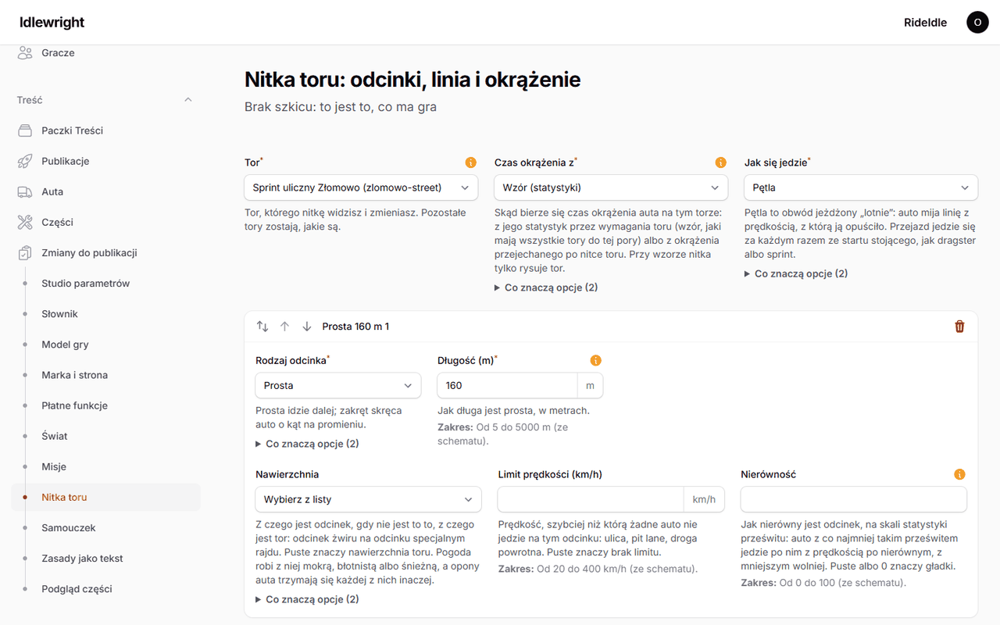

**Nitka toru** to rysunek toru z odcinków (prosta, zakręt i inne), każdy z długością, nawierzchnią, limitem prędkości i nierównością. Strona pokazuje linię toru z góry i pozwala wybrać, czy czas okrążenia liczy wzór statystyczny, czy jazda po nitce.

### 8. Studio parametrów i zasady jako tekst

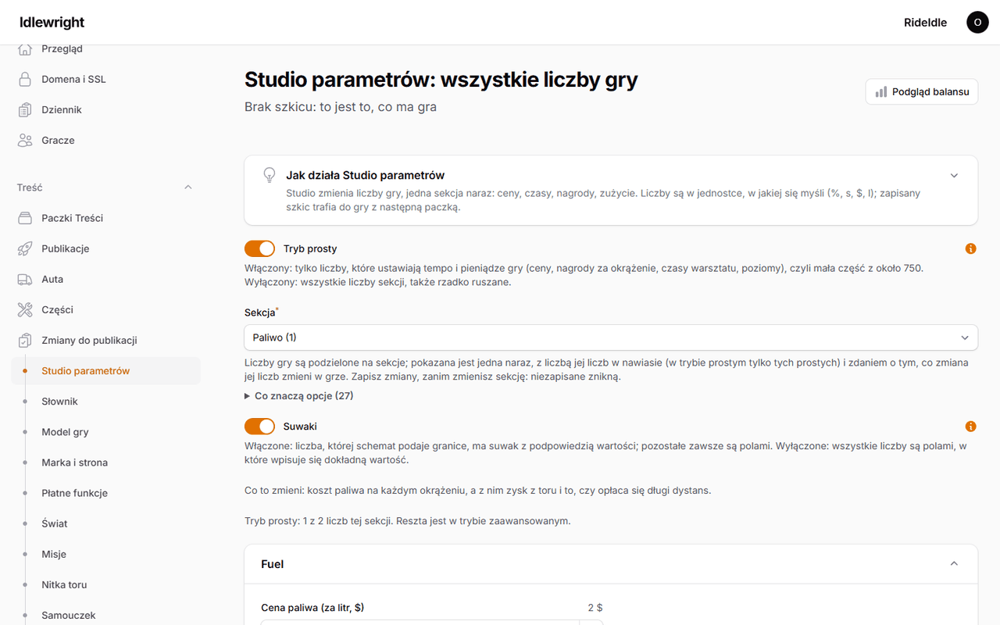

**Studio** zbiera wszystkie liczby gry (około 750 w 24 sekcjach): ceny, czasy, nagrody, zużycie. Liczby są w jednostkach, w jakich się o nich myśli (%, s, $, l). **Tryb prosty** (domyślnie włączony) pokazuje tylko liczby, które ustawiają tempo i pieniądze gry. Każda sekcja ma zdanie „Co to zmieni”, a **„Podgląd balansu”** pokazuje skutek dla ekonomii, zanim zrobisz paczkę. Zmień jedną sekcję i zapisz, zanim przejdziesz do następnej.

**Zasady jako tekst** (menu „Treść”) to tryb zaawansowany: cały dokument reguł jako JSON, dla zmian, których formularze jeszcze nie obsługują.

### 9. Słownik i model gry: inny świat bez kodu

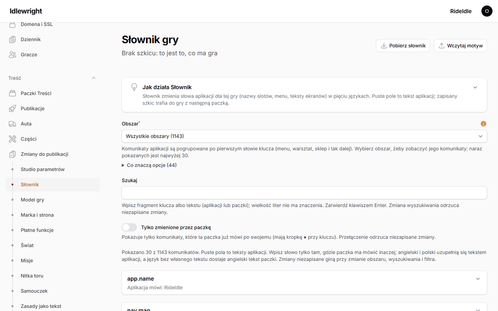

**Słownik** zmienia słowa aplikacji gry (nazwy slotów i statystyk, menu, zdania ekranów) osobno w każdym języku. Filtr obszaru i wyszukiwarka pomagają znaleźć tekst, a „Tylko zmienione przez paczkę” pokazuje to, co gra mówi inaczej niż aplikacja domyślna. **„Pobierz słownik”** zapisuje słownik do pliku, a **„Wczytaj motyw”** wczytuje gotowy zestaw słów (przykład: [`content/themes/ships.json`](content/themes/ships.json), statki zamiast aut).

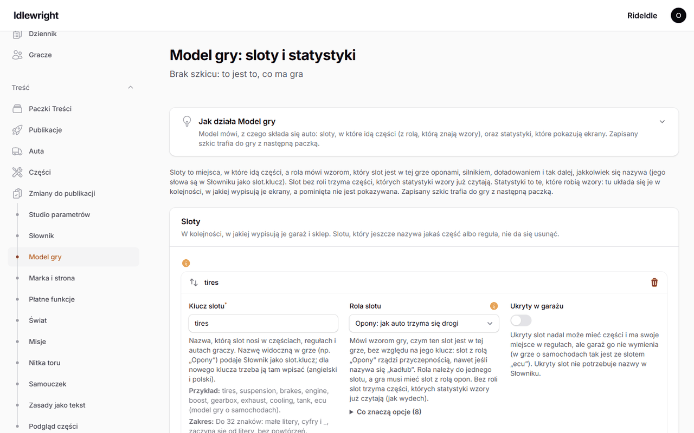

**Model gry** opisuje sloty i statystyki: klucz, rolę i to, czy slot jest ukryty w garażu. Kod gry pyta o rolę slotu, nie o jego nazwę, więc slot „kadłub” z rolą opon jeździ tak, jak opony.

### 10. Samouczek, misje i płatne funkcje

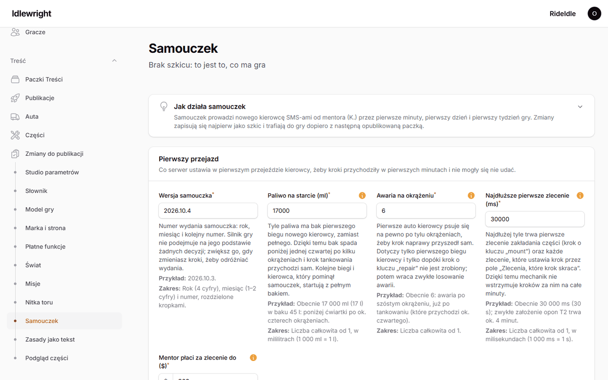

**Samouczek:** ustawienia pierwszego przejazdu (paliwo na starcie, okrążenie, na którym psuje się pierwsze auto, najdłuższe pierwsze zlecenie warsztatu) i kroki. Krok ma fazę, numer nadawcy, warunek początku i końca, podświetlony element ekranu, do dwóch SMS-ów w pięciu językach, przycisk odpowiedzi i nagrodę (gotówka, XP, część, garaż w mieście).

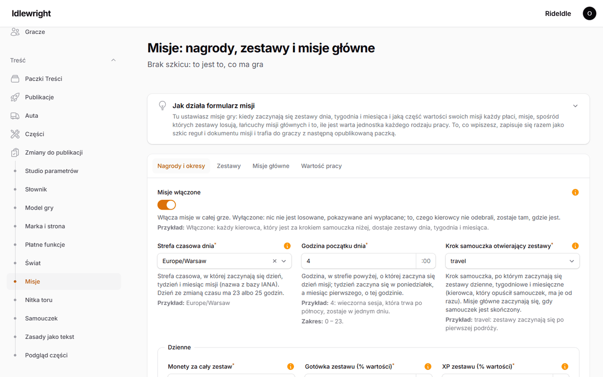

**Misje:** zakładki „Nagrody i zestawy”, „Zestawy”, „Misje główne” i „Wartość pracy”: strefa czasowa i godzina resetu, wielkość zestawów dziennych, tygodniowych i miesięcznych, nagrody i bonus za komplet. Przy publikacji bramka sprawdza, czy nagrody misji nie psują ekonomii (`missions:budget`).

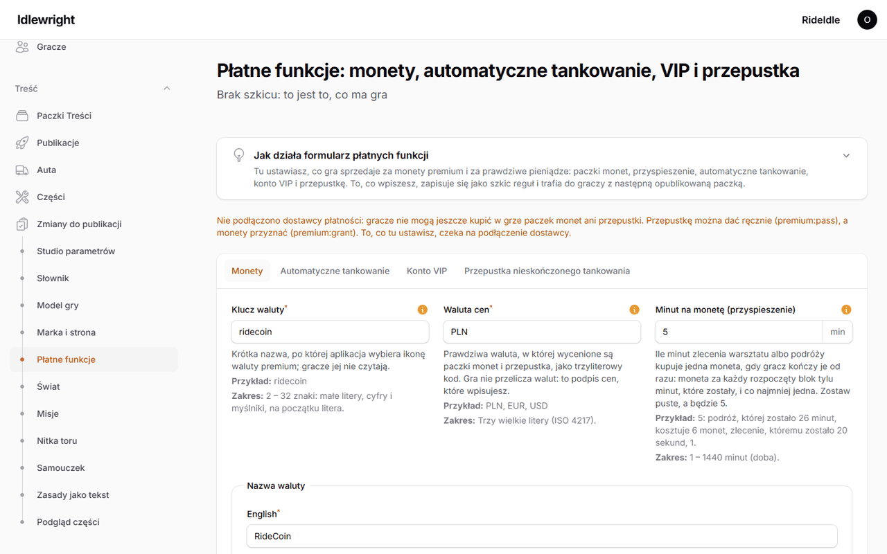

**Płatne funkcje:** zakładki Monety (nazwa waluty premium, waluta cen, ile minut timera skraca jedna moneta), Automatyczne tankowanie, Konto VIP i Przepustka. Ceny wpisuje się w pieniądzach, a bonusy w procentach.

### 11. Publikacja paczki

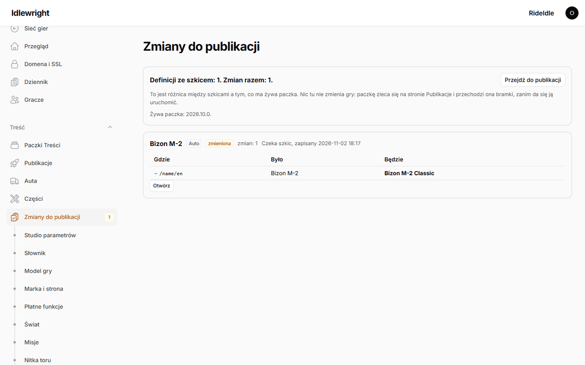

**Zmiany do publikacji** pokazują wszystkie szkice gry: która definicja, co zmieniono („Gdzie”, „Było”, „Będzie”) i kiedy zapisano szkic. „Przejdź do publikacji” prowadzi dalej.

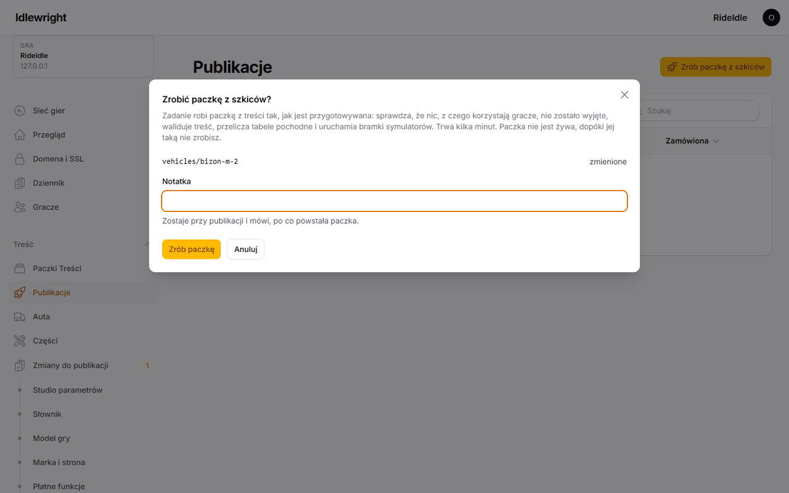

Na stronie **Publikacje** przycisk **„Zrób paczkę z szkiców”** pokazuje listę zmian i prosi o notatkę (po co powstaje paczka). Paczkę robi zadanie w tle: sprawdza, że nic, czego używają gracze, nie zniknęło, waliduje treść, przelicza tabele pochodne i uruchamia bramki symulatorów. Na serwerze zadanie wykonuje kolejka (`rideidle-queue`); bez niej paczka zostaje w stanie „Czeka”.

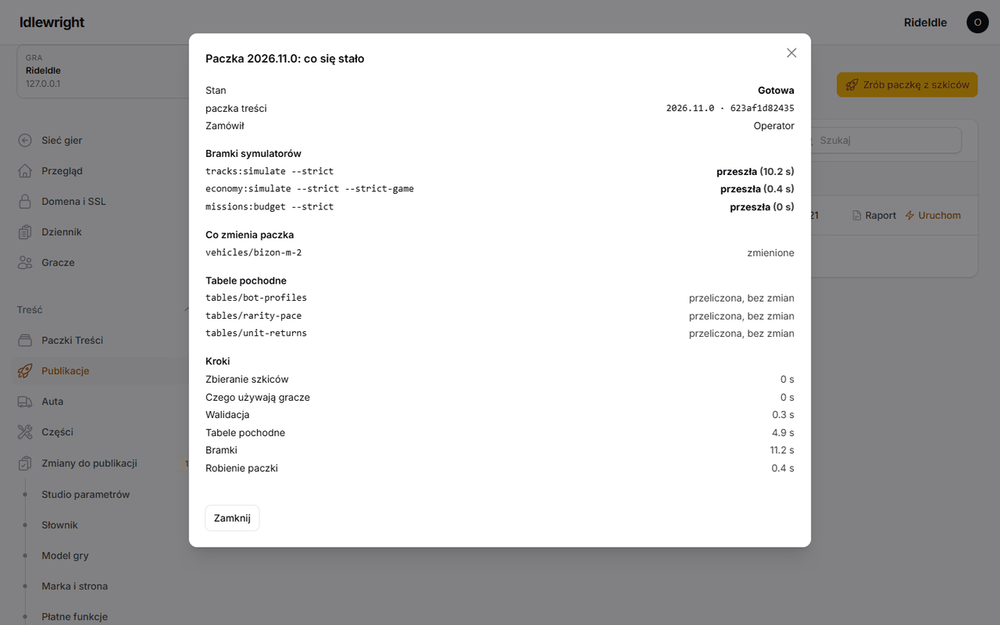

**„Raport”** przy paczce mówi, co się stało: które bramki przeszły i w jakim czasie, co paczka zmienia, które tabele przeliczono i ile trwał każdy krok.

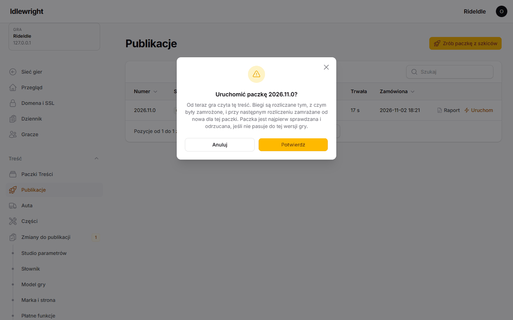

**„Uruchom”** i potwierdzenie robią z paczki żywą treść. Biegi graczy przechodzą na nową treść przy swoim następnym rozliczeniu. **Cofnięcie:** strona „Paczki Treści”, wcześniejsza paczka, „Uruchom”. Tam też jest **„Pobierz”** (paczka jako jeden plik) i **„Zaimportuj paczkę”**, którymi przenosi się treść między instalacjami albo grami.

### 12. Podgląd części

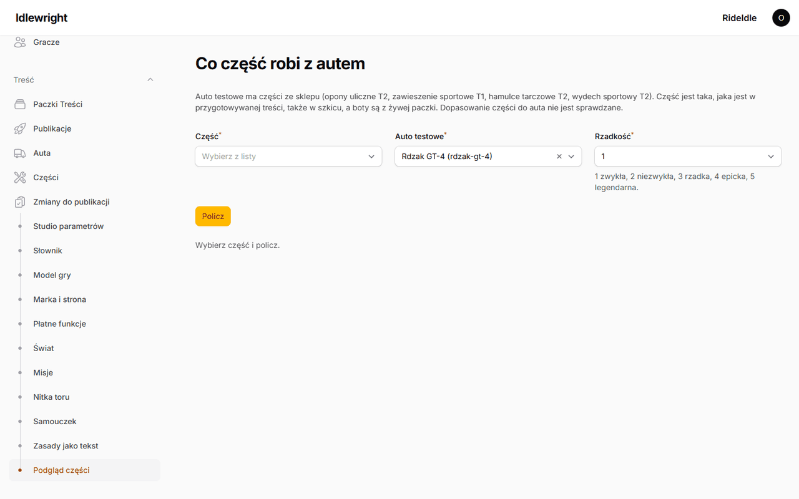

Wybierz część, auto testowe i rzadkość, a **„Policz”** pokaże, co część robi z autem na każdym torze, na sucho i w deszczu: statystyki, czas okrążenia, miejsce wśród botów i dochód na godzinę. Liczy na żywej paczce, więc pokazuje skutek, zanim część trafi do sklepu.

### 13. Gracze i dziennik

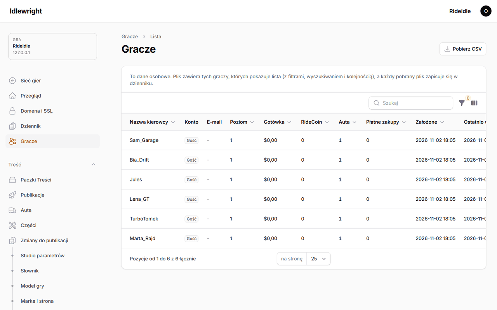

**Gracze:** konta gry, w której pracuje panel, z wyszukiwaniem, filtrami, stroną konta i plikiem CSV („Pobierz CSV”). Strona niczego na kontach nie zmienia.

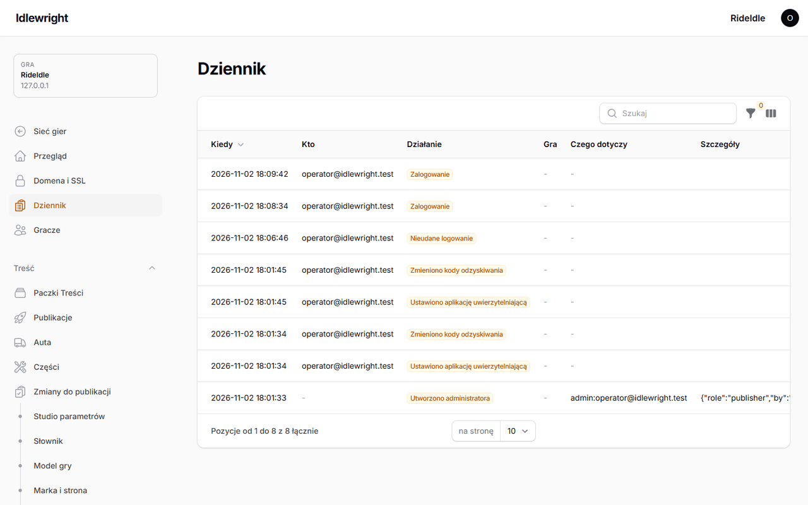

**Dziennik:** każde logowanie, zapis, publikacja i uruchomienie paczki, z osobą, grą i szczegółami.

## Typowe zadania

| Zadanie | Kroki |
|---|---|
| Zmienić cenę paliwa | Studio, sekcja „Paliwo”, nowa cena, „Zapisz”. Potem Publikacje: „Zrób paczkę z szkiców”, „Uruchom”. |
| Dodać auto | Auta, „Utwórz”, formularz z nazwą w językach, liczbami i obrazkiem, „Zapisz”. Sprawdź w „Zmianach do publikacji”, zrób paczkę i ją uruchom. |
| Zdjąć część ze sklepu | Części, „Edytuj”, „Wycofaj z oferty”, potem paczka. Gracze, którzy ją mają, nic nie tracą. |
| Sprawdzić nową część przed sklepem | Podgląd części: część, auto, rzadkość, „Policz”. |
| Postawić nową grę na własnej domenie | Rekord A domeny na serwer. Sieć gier, „Utwórz nową grę”, kreator z „Domeną i SSL”. Potem Marka i strona, i paczka. |
| Zrobić grę w innym świecie (np. statki) | Nowa gra z szablonu. Model gry (nazwy slotów), Słownik („Wczytaj motyw”), auta i części jako statki i moduły, Marka i strona, paczka. |
| Cofnąć złą zmianę | Paczki Treści, poprzednia paczka, „Uruchom”. |

## Dla programistów

### Stack

| Warstwa | Technologia |
|---|---|
| Backend | PHP 8.4, Laravel 13 (API-first), Sanctum, Socialite |
| Panel | Filament 5 (osobny host na produkcji) |
| Frontend | Vue 3, TypeScript, Vite, Pinia, Vue Router, Tailwind CSS 4, vue-i18n |
| Baza | lokalnie MariaDB, MySQL albo SQLite; testy domyślnie na SQLite w pamięci; produkcja PostgreSQL |
| Cache, kolejki, blokady | lokalnie baza; na produkcji liczniki limitów w Redisie, a kolejka w bazie (żeby `accounts:delete` mogło usunąć czekające maile) |
| Serwer | Ubuntu, nginx, PHP-FPM, jedna domena na grę ([`deploy/`](deploy)) |
| Testy | Pest 4 (także testy architektury), Vitest |
| CI | GitHub Actions: API na SQLite, MariaDB i PostgreSQL, web z typami, testami i buildem |

### Struktura repozytorium

```
api/                Laravel: logika gry, rozliczanie, API, panel
  app/Domain/       czyste funkcje bez frameworka, bazy i zegara: rozliczanie, bieg, ekonomia, rynek, warsztat
  app/Services/     operacje na bazie (transakcje, księga, misje, warsztat, rynek, konta)
  app/Filament/     panel: strony i zasoby
  app/Games/        wiele gier: gra z hosta żądania, zakres zapytań
  app/Payments/     płatności: dostawca testowy, Stripe, webhook
  lang/<język>/     teksty API i katalog pomocy panelu (help/)
web/                Vue 3: aplikacja gracza (PWA), wspólna dla wszystkich gier
  src/views/        ekrany (garaż, warsztat, sklep, mapa, wyścig, misje, premium...)
  src/features/     logika ekranów pogrupowana według obszarów gry
  src/i18n/locales/ teksty aplikacji w pięciu językach
content/            treść pierwszej gry w JSON
  packs/core/       paczka: auta i części
  rules/            reguły: bieg i świat (starter), ekonomia, misje, model, samouczek, słownik, zlecenia
  schema/           schematy JSON paczek i reguł
  tables/           tabele liczone przez komendy (profile botów, tabela Elo, tempo rzadkości, zwroty jednostek)
  themes/           motywy innych światów
deploy/             wdrożenie na Ubuntu: skrypty, nginx, systemd, kopie bazy, test obciążeniowy
docker/             usługi pomocnicze do pracy lokalnej
docs/               specyfikacje i decyzje; docs/img/ to zrzuty do tego pliku
```

Skrypty wdrożenia, usługi systemd, ścieżki na serwerze i klucz konfiguracji `ride` noszą jeszcze nazwę pierwszej gry (`rideidle`, `ride`), bo nazwa silnika jest nowsza od nich.

### Zasady, które obowiązują od pierwszego dnia

- Serwer jest jedynym źródłem czasu i wyników. Klient wysyła intencje, nigdy wyniki.
- Rozliczanie jest funkcją czystą na liczbach całkowitych (czas w ms, gotówka w centach), z testami wektorowymi i testem własności (`settle(t1)` potem `settle(t2)` daje to samo co `settle(t2)`).
- Każda zmiana salda lub stanu idzie w transakcji z `lockForUpdate()` i kluczem idempotencji.
- Definicje (treść z paczek) i instancje (rzeczy graczy) są rozdzielone. Slug definicji jest niezmienny.
- Kod pyta o rolę slotu z modelu gry (`rules/model`), nie o jego nazwę.
- Treść i konta należą do gry (`game_id`), a grę wybiera host żądania.
- Kod działa na MariaDB i PostgreSQL. Różnice wychodzą w CI, nie na produkcji.

### Języki

Pięć języków: `pl`, `en`, `fr`, `de`, `pt-BR` (skrót `br` to alias brazylijskiego portugalskiego). Angielski jest językiem zapasowym.

- **API:** język odpowiedzi wybiera middleware `SetLocale`: nagłówek `X-Locale`, język konta, `Accept-Language`, język domyślny. Komunikaty są w `api/lang/<język>/`, pomoc pól panelu w `api/lang/<język>/help/`, a teksty treści (nazwy, opisy) w polach JSON z tłumaczeniami.
- **Web:** `vue-i18n`, pliki w `web/src/i18n/locales/<język>.json`, ładowane leniwie. Liczby i waluta idą przez `Intl`. Słowa świata gry mogą pochodzić ze słownika paczki.
- **Testy pilnują zgodności:** te same klucze i symbole zastępcze we wszystkich językach (API, web i katalog pomocy).

Nowy tekst dodajemy od razu we wszystkich pięciu językach. Teksty francuskie, niemieckie i brazylijskie nie przeszły jeszcze przeglądu osoby, dla której to język ojczysty.

### Uruchomienie lokalne

Wymagania: PHP 8.4 z Composerem, Node 24, baza MariaDB, MySQL albo SQLite. Docker jest opcjonalny.

```sh
# API
cd api
composer install
cp .env.example .env && php artisan key:generate
php artisan migrate
php artisan serve              # http://127.0.0.1:8000, panel pod /admin
php artisan queue:work         # maile i publikacja paczek z panelu

# Web
cd web
npm install
npm run dev                    # http://localhost:5173, /api idzie do DEV_API_TARGET (domyślnie port 8000)

# Usługi pomocnicze w Dockerze: MariaDB (3307), PostgreSQL (5432), Redis (6379), Mailpit (SMTP 1025, podgląd 8025)
docker compose -f docker/compose.yaml up -d
```

- Treść gra czyta domyślnie z plików repozytorium (`CONTENT_SOURCE=files`). Żeby pracować w panelu na treści z bazy (szkice, paczki, publikacje), ustaw `CONTENT_SOURCE=database` i wczytaj paczkę: `php artisan content:import --activate`.
- Pierwszy administrator: `php artisan admin:create ty@example.com --role=publisher`.
- Maile z `.env.example` idą na `127.0.0.1:1025`, czyli do Mailpita z Dockera.
- Jeśli port 8000 zajmuje inny projekt, uruchom API na innym (`php artisan serve --port=8011`) i wskaż go w `web/.env.local`: `DEV_API_TARGET=http://127.0.0.1:8011`.

### Testy

```sh
cd api && vendor/bin/pest                                  # domyślnie SQLite w pamięci
cd web && npm test && npm run typecheck && npm run build
```

- Testy API na konkretnej bazie: `DB_CONNECTION=mariadb DB_HOST=127.0.0.1 DB_PORT=3307 DB_DATABASE=ride_idle DB_USERNAME=root DB_PASSWORD=secret vendor/bin/pest`. CI uruchamia je na SQLite, MariaDB i PostgreSQL.
- Nie uruchamiaj dwóch pełnych zestawów Pest naraz na jednej maszynie: dzielą katalog tymczasowy Livewire i jeden potrafi zepsuć drugiemu testy obrazków.
- `php artisan content:validate` sprawdza paczkę ze schematem, a `content:check` (uruchamia go też wydanie), czy treść, którą czyta gra, jest cała i pasuje do kodu.

### Przydatne komendy

Wszystkie uruchamia się w `api/` przez `php artisan <komenda>`, a `--help` pokazuje opcje. Komendy treści, kont, premium i część symulatorów przyjmują `--game`, gdy chodzi o grę inną niż domyślna.

| Obszar | Komendy |
|---|---|
| Treść | `content:validate`, `content:check`, `content:status`, `content:import`, `content:export`, `content:activate`, `content:convert-tracks`, `content:elo-table` |
| Balans i symulatory | `economy:simulate`, `economy:fleet`, `economy:preview`, `economy:rarity-pace`, `economy:unit-returns`, `economy:bot-profiles`, `economy:transmute`, `tracks:simulate`, `missions:budget`, `streaks:budget`, `gigs:report`, `parts:roll-affixes` |
| Konta i dane | `accounts:export`, `accounts:delete`, `accounts:prune-guests`, `accounts:prune-tokens` |
| Panel i domeny | `admin:create`, `admin:update`, `domains:claim`, `domains:report` |
| Premium i płatności | `premium:grant`, `premium:pass`, `payments:status`, `payments:switch`, `payments:reprocess`, `payments:prune`, `purchases:prune` |
| Pomiary i sprzątanie | `metrics:report`, `missions:prune`, `loadtest:accounts`, `loadtest:cleanup` |

### Wdrożenie

[`deploy/`](deploy) stawia instalację na jednym serwerze Ubuntu, docelowo pod `raceidle.cerasusdigital.pl` (aplikacja web pod `/`, API pod `/api`):

- `deploy/upload.sh bootstrap root@SERWER` i `provision.sh` raz przygotowują serwer: PHP, PostgreSQL, Redis, nginx, certyfikat Let's Encrypt, kolejka, harmonogram, kopie bazy ze sprawdzaniem, zapora.
- `deploy/upload.sh release deploy@DOMENA` wydaje zatwierdzony stan repozytorium, a gdy sprawdzenie po wydaniu się nie uda, wraca do poprzedniego.
- `deploy/admin-site.sh` wystawia panel na osobnym hoście.
- Kolejna gra na własnej domenie: z panelu (kreator, strona „Domena i SSL”) albo ręcznie `deploy/game-site.sh`.

Kolejność kroków, DNS, poczta, adresy dla Google, Facebooka i Apple, kopie i wycofanie: [`deploy/README.md`](deploy/README.md). Zestaw nie był jeszcze uruchomiony na prawdziwym serwerze Ubuntu.

### Dokumentacja

| Plik | Co opisuje |
|---|---|
| [`docs/settlement.md`](docs/settlement.md) | rozliczanie: klasy, wektory testowe, testy własności, zamrażanie konfiguracji biegu, zapis w bazie |
| [`docs/api-runs.md`](docs/api-runs.md) | API gry i panel: punkty końcowe, garaż, warsztat, świat, rynek, płatne funkcje, misje, zlecenia, samouczek, strony panelu |
| [`docs/web-run.md`](docs/web-run.md) | ekrany aplikacji gracza, wygląd, PWA |
| [`docs/konto.md`](docs/konto.md) | konto i logowanie, e-mail, dostawcy, kopia i usunięcie danych |
| [`docs/prawo.md`](docs/prawo.md) | regulamin, polityka prywatności, pytania do przeglądu prawnego |
| [`docs/nitka-toru.md`](docs/nitka-toru.md) | nitka toru i model okrążenia |
| [`docs/panel-pomoc-uwagi.md`](docs/panel-pomoc-uwagi.md) | uwagi z pisania katalogu pomocy panelu i co z nimi zrobiono |
| [`docs/panel-podrecznik-plan.md`](docs/panel-podrecznik-plan.md) | plan pełnego podręcznika operatora panelu |
| [`docs/pomoc-notatki/`](docs/pomoc-notatki) | notatki do plików katalogu pomocy (źródła, generatory) |
| [`docs/dziennik-zmian.md`](docs/dziennik-zmian.md) | archiwum dawnej sekcji „Stan” z README (do 2026-10-29) |
| [`content/README.md`](content/README.md) | paczki treści, reguły, tory, ekonomia, symulatory, wersje balansu |
| [`deploy/README.md`](deploy/README.md) | wdrożenie krok po kroku |

Projekt gry (założenia, systemy, katalogi, roadmapa, plansze ekranów) jest na płótnie projektowym: https://claude.ai/artifact/Ag5ArvxSnEiuVvr4vUzecy. Ekrany aplikacji gracza mają wyglądać jak plansze z płótna.

## Stan i co dalej

Stan na 2026-11-02. Roadmapa na płótnie ma fazy F0–F9.

- **Zrobione:** F0 (szkielet), F1 (pionowy wycinek gry), F2 (tory, zegar, mapa, flota, rynek, skrzynki, boty), F3 (warsztat i części), F4 (treść w bazie i panel) i F5 (pomiary, podsumowanie nieobecności, PWA, kopie, test obciążeniowy). Poza roadmapą: silnik jako narzędzie (Studio, słownik, model gry, wiele gier, marka), panel sieci gier, misje, model toru i nitki torów.
- **W toku (F6):** w `main` są seria dni, limit aut aktywnych, transmutacja rzadkości, bonusy części i pierwsze etapy zleceń pobocznych. Na gałęziach poza `main` są między innymi silnik rywalizacji, dostrajanie części, most AI w panelu i powiadomienia web push (`git branch --no-merged main` pokazuje aktualną listę).

Czeka na właściciela projektu albo na prawdziwe usługi:

- klucze testowe Stripe, przegląd prawny (regulamin, RideCoin, próg wieku) i odpowiedź Stripe w sprawie RideCoin, zanim ruszy sprzedaż monet,
- sprawdzenie logowania przez prawdziwe Google, Facebooka i Apple,
- pierwsze uruchomienie wdrożenia na prawdziwym serwerze Ubuntu,
- przegląd tekstów francuskich, niemieckich i brazylijskich,
- wycinanki pozostałych aut na jasną scenę (mają je trzy auta z paczki).

## Zasady pracy

- Każda zmiana to osobny commit. Komunikaty commitów piszemy po angielsku, w stylu `feat(api): ...`, `fix(web): ...`, `docs: ...`.
- Dokumentacja (ten plik, `docs/`) jest po polsku. Teksty w grze powstają od razu w pięciu językach.
