# Podręcznik operatora panelu Idlewright

Ten podręcznik jest dla osoby, która ma zmieniać grę w panelu administracyjnym: dodać auto, poprawić cenę, ustawić tory, przepisać słowa aplikacji, postawić nową grę na własnej domenie, a potem bezpiecznie opublikować zmianę. Nie musisz znać kodu. Po przeczytaniu rozdziałów 1–9 umiesz: zalogować się z kodem z telefonu, wybrać grę, edytować auta i części, świat, reguły (Studio, tryb prosty), słownik i markę, obejrzeć graczy, opublikować zmianę przez bramki i wdrożyć domenę z certyfikatem. Rozdział 17 uczy zmieniać wiele rzeczy naraz rozmową z asystentem AI, a rozdziały 13–16 opisują strony kursów i zleceń (z nocnym kursem i policją), bonusów części, klas aut oraz powiadomień push i powrotów graczy.

Krótka wersja, z tym samym planem, jest w [README](../README.md) (sekcja „Instrukcja obsługi panelu”). Tu jest wersja pełna: krok po kroku, z przykładami z liczbami prawdziwej gry RideIdle.

## Spis treści

- [Co to jest i co można zrobić w 15 minut](#co-to-jest-i-co-można-zrobić-w-15-minut)
- [Jak czytać ten podręcznik](#jak-czytać-ten-podręcznik)
- [Najważniejsza zasada: jak zmiana trafia do graczy](#najważniejsza-zasada-jak-zmiana-trafia-do-graczy)
1. [Zaczynam: logowanie, kod z aplikacji, role, sieć gier](#1-zaczynam-logowanie-kod-z-aplikacji-role-sieć-gier)
2. [Nowa gra, domena i SSL](#2-nowa-gra-domena-i-ssl)
3. [Auto](#3-auto)
4. [Część](#4-część)
5. [Świat i tory](#5-świat-i-tory)
6. [Samouczek](#6-samouczek)
7. [Reguły w Studiu parametrów](#7-reguły-w-studiu-parametrów)
8. [Model gry, słownik, marka i strona](#8-model-gry-słownik-marka-i-strona)
9. [Szkice i publikowanie](#9-szkice-i-publikowanie)
10. [Wycofanie zmian](#10-wycofanie-zmian)
11. [Gracze i dziennik](#11-gracze-i-dziennik)
12. [Płatne funkcje i misje](#12-płatne-funkcje-i-misje)
13. [Kursy i zlecenia](#13-kursy-i-zlecenia)
14. [Bonusy części](#14-bonusy-części)
15. [Klasy aut (F–SS) i PI](#15-klasy-aut-fss-i-pi)
16. [Powiadomienia push i powroty graczy](#16-powiadomienia-push-i-powroty-graczy)
17. [Most AI: zmiany rozmową z asystentem](#17-most-ai-zmiany-rozmową-z-asystentem)
18. [Co robić, gdy coś nie działa](#18-co-robić-gdy-coś-nie-działa)
- [Dodatek A. Jak odtworzyć zrzuty tego podręcznika](#dodatek-a-jak-odtworzyć-zrzuty-tego-podręcznika)

## Co to jest i co można zrobić w 15 minut

**Panel Idlewright to narzędzie operatora gier.** W jednym miejscu zmieniasz auta i części, świat i tory, liczby, słowa, wygląd, samouczek, misje, płatne funkcje, kursy i powiadomienia gry, a potem bezpiecznie publikujesz zmianę, bez udziału programisty. Jedna instalacja prowadzi wiele gier, każdą na własnej domenie, z własną marką, treścią i graczami; przykłady w tym podręczniku pokazują panel prowadzący pierwszą grę zbudowaną na Idlewright, wyścigową grę RideIdle, i drugą, „Statki”.

**Jak wygląda praca w panelu:** po zalogowaniu (z kodem z aplikacji) wybierasz grę w sieci gier, a menu „Treść” dotyczy tej jednej gry. Każda zmiana jest najpierw szkicem, potem przechodzi **pięć bramek symulatorów** (tory, ekonomia, misje, bonusy części i kursy) i dopiero wtedy trafia do graczy; złą paczkę cofa się jednym kliknięciem. Każde pole ma opis, przykład i zakres, a zmiany można też zlecić rozmową z asystentem AI.

### Pokaz w 15 minut: ekrany w kolejności

Poniższa kolejność to wycieczka po ekranach panelu: od wejścia, przez zmianę jednej liczby i publikację, po strony, które dają grze nowe możliwości bez kodu. Budowanie paczki trwa kilka minut (bramki liczą ekonomię), więc do pokazu **zrób paczkę wcześniej** i pokaż jej raport oraz „Uruchom”.

| Czas | Ekran (menu) | Co pokazać | Rozdział |
|---|---|---|---|
| 0:00 | Logowanie z kodem z aplikacji, **Sieć gier**, **Przegląd** | dwie gry w jednej instalacji, przełącznik gry, liczby graczy i powrotów | 1 |
| 1:30 | **Utwórz nową grę** (kreator) i **Domena i SSL** | trzy kroki: nazwa i domena, punkt startowy (szablon), domena z certyfikatem; nie klikaj „Skonfiguruj”, jeśli serwer nie jest gotowy | 2 |
| 3:00 | **Studio parametrów** → **Zmiany do publikacji** → **Publikacje** | cena paliwa 2,00 → 2,20 $, „Podgląd balansu”, szkic, tabela było/będzie, okno paczki, **raport z pięcioma bramkami**, „Uruchom” | 7, 9, 10 |
| 5:30 | **Auta**, **Części**, **Podgląd części** | formularz, w którym każde pole mówi, co zmienia; skutek części na torze | 3, 4 |
| 7:30 | **Świat**, **Nitka toru**, Studio „Rywalizacja” | tor: długość wyznacza czas, paliwo i płacę; rajd z mieszanką żwiru i asfaltu; rysunek toru i „Zamknij pętlę”; klasy aut F–SS i PI | 5, 15 |
| 10:00 | **Most AI** | „wszystkie silniki T3 +12% mocy” rozmową: instrukcja, odpowiedź, tabela zmian, „Zapisz jako szkic” | 17 |
| 12:00 | **Słownik**, **Marka i strona**, **Model gry** | „Wczytaj motyw” (statki zamiast aut), nazwy slotów i statystyk, własne kolory i strona startowa | 8 |
| 14:00 | **Misje**, **Kursy i zlecenia** (nocny kurs), **Bonusy części**, **Powiadomienia**, **Gracze**, **Dziennik** | co jeszcze jest w panelu i że każda z tych stron też idzie przez szkic i paczkę | 11–16 |

**Czego pokaz nie obiecuje** (to, czego nikt nie próbował na prawdziwym serwerze lub u prawdziwego dostawcy, jest w podręczniku oznaczone „Nie sprawdzono”): ustawienia domeny i certyfikatu na prawdziwym Ubuntu, prawdziwej wysyłki powiadomień push do przeglądarek, płatności prawdziwą kartą (jest dostawca testowy) i pracy z prawdziwym modelem AI (są gotowe odpowiedzi do testów).

## Jak czytać ten podręcznik

- **Zrzuty mają numerowane czerwone ramki.** Numer przy ramce odsyła do listy pod zrzutem.
- **Lista pod zrzutem (legenda) to te same zdania, które panel pokazuje pod polem formularza.** Nie są napisane osobno: wpisuje je skrypt z katalogu pomocy panelu (`api/lang/pl/help/*.php`), więc podręcznik nie rozjedzie się z panelem. Gdyby jednak zdanie w podręczniku różniło się od tego w panelu, racja jest po stronie panelu (a skrypt z dodatku A naprawia podręcznik jednym poleceniem).
- Przykłady używają danych demonstracyjnych: gra RideIdle, druga gra „Statki”, administrator `boss@example.com`, czternastu graczy testowych. Twoja instalacja ma inne liczby graczy, ale auta, części i tory są te same.
- Przy każdym zadaniu jest: **cel**, **kroki**, **przykład**, **co się stanie w grze i kiedy** i **co sprawdzić po zapisaniu**.
- Miejsca oznaczone **„Nie sprawdzono”** to rzeczy, których nikt jeszcze nie próbował na prawdziwym serwerze albo z prawdziwym zewnętrznym usługodawcą. Podręcznik nie obiecuje, że działają.

## Najważniejsza zasada: jak zmiana trafia do graczy

Żadna zmiana w panelu nie trafia do graczy od razu. Droga jest zawsze ta sama, bez względu na to, czy zmieniasz cenę, auto, tor czy słowo w menu:

```
formularz  →  SZKIC  →  Zmiany do publikacji  →  PACZKA (bramki)  →  URUCHOMIENIE  →  gracze
```

1. **Szkic.** Zapis formularza robi szkic, nie zmianę w grze. Szkic jest sprawdzany schematem, więc nie da się zapisać czegoś, czego gra nie umie przeczytać. Nagłówek strony mówi, czy szkic jest („Czeka szkic, zapisany 2026-11-03 12:37”) czy go nie ma („Brak szkicu: to jest to, co ma gra”).
2. **Zmiany do publikacji.** Jedna strona zbiera wszystkie szkice gry i pokazuje, co zmienią: gdzie, było, będzie.
3. **Paczka.** „Zrób paczkę z szkiców” składa szkice w paczkę i puszcza ją przez **bramki symulatorów**. Paczka, która nie przejdzie bramek, nie powstaje.
4. **Uruchomienie.** „Uruchom” robi z gotowej paczki żywą treść gry. Wcześniejsze paczki zostają, więc cofnięcie zmiany to uruchomienie poprzedniej paczki.

Pod każdym formularzem, w którym coś zmieniono, a czego jeszcze nie zapisano, pojawia się **pasek zmian** z listą „pole: było → będzie” i przyciskami „Cofnij” (jedno pole) i „Cofnij wszystko”.

---

## 1. Zaczynam: logowanie, kod z aplikacji, role, sieć gier

### Logowanie

**Cel:** wejść do panelu. Panel jest pod adresem `/admin`: lokalnie `http://127.0.0.1:8000/admin`, na serwerze na osobnym hoście (na przykład `admin.raceidle.cerasusdigital.pl`).

**Kroki:**

1. Wpisz adres e-mail i hasło konta administratora i kliknij „Zaloguj się”.
2. Panel poprosi o sześciocyfrowy kod z aplikacji uwierzytelniającej (Google Authenticator i podobne). Wpisz go: kod zmienia się co 30 sekund.
3. Gdy telefon jest niedostępny, kliknij „Użyj kodu odzyskiwania” i wpisz jeden z kodów odzyskiwania. Każdy kod działa raz.

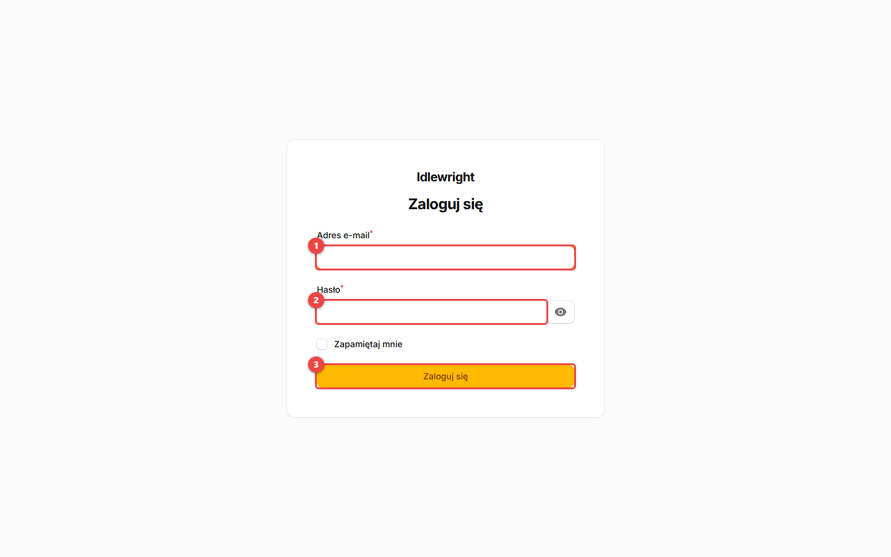

<!-- legenda:logowanie -->
1. **Adres e-mail.** Adres, na który administrator ma konto w panelu.
2. **Hasło.** Hasło do konta w panelu.
3. **Zaloguj się.** Po poprawnym haśle panel prosi jeszcze o kod z aplikacji.
<!-- /legenda -->

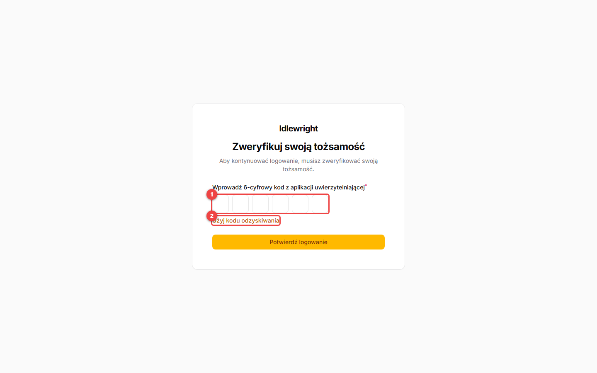

<!-- legenda:kod-2fa -->
1. **Sześciocyfrowy kod.** Kod z aplikacji uwierzytelniającej, zmienia się co 30 sekund; panel wymaga go od każdego administratora.
2. **Użyj kodu odzyskiwania.** Gdy nie masz telefonu: jednorazowy kod odzyskiwania, który zapisałeś przy zakładaniu konta.
<!-- /legenda -->

**Konto zakłada administrator serwera**, nie panel: `php artisan admin:create ty@example.com --role=publisher`. Hasło jest pokazane raz. Przy **pierwszym** logowaniu panel każe ustawić aplikację uwierzytelniającą (pokazuje kod QR) i wypisuje kody odzyskiwania: zapisz je w bezpiecznym miejscu. Od tej pory każde logowanie wymaga hasła i kodu.

Zgubiony telefon, zmiana roli, wyłączenie konta albo nowe hasło to polecenia administratora serwera: `php artisan admin:update ADRES --role=… | --deactivate | --reset-password | --reset-mfa`.

Po kilku nieudanych logowaniach z rzędu panel każe chwilę poczekać; to zabezpieczenie, nie awaria.

### Role

| Rola | Co może |
|---|---|
| `editor` (edytor) | ogląda wszystko i robi szkice |
| `publisher` (wydawca) | to samo, a do tego robi i uruchamia paczki, importuje paczki z pliku, widzi dziennik i pobiera listę graczy w pliku CSV |

Domyślnie administrator pracuje we wszystkich grach. Można go ograniczyć do wybranych gier, z osobną rolą w każdej (`--game=statki:publisher`). **Gry i domeny zakłada tylko administrator wszystkich gier.**

### Sieć gier i przełącznik gry

**Sieć gier** to strona główna panelu. Pokazuje liczby całej instalacji i kafel każdej gry: status, domenę, stan certyfikatu SSL, konta, aktywnych, przychód z 30 dni i numer żywej paczki.

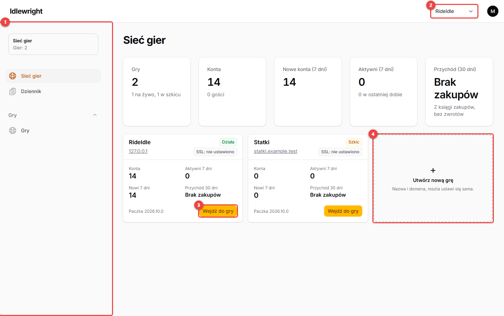

<!-- legenda:siec-gier -->
1. **Menu sieci.** W sieci gier menu jest o całej sieci: przegląd, dziennik i lista gier.
2. **Przełącznik gry.** Wybiera grę, w której panel pracuje; jest na górze każdej strony.
3. **Wejdź do gry.** Przełącza panel na tę grę i otwiera jej przegląd; od tej chwili menu jest menu gry.
4. **Utwórz nową grę.** Otwiera kreator w trzech krokach.
<!-- /legenda -->

**Wszystko w menu „Treść” dotyczy gry, w której panel właśnie pracuje.** Dlatego zawsze sprawdź nazwę gry w prawym górnym rogu, zanim zaczniesz edytować. „Wejdź do gry” na kaflu przełącza panel na tę grę, tak samo jak przełącznik z jej nazwą. Wybór gry jest zapamiętany w sesji.

Po wejściu do gry menu ma dwa poziomy: **menu gry** (Przegląd, Domena i SSL, Dziennik, Gracze) i **Treść** (Paczki Treści, Publikacje, Auta, Części, Zmiany do publikacji i pod nimi strony: Studio parametrów, Słownik, Model gry, Marka i strona, Płatne funkcje, Świat, Misje, Nitka toru; dalej Most AI, Bonusy części, Samouczek, Zasady jako tekst i Podgląd części). Przejdź przez nie raz, żeby wiedzieć, gdzie co leży.

**Przegląd** to strona główna gry: konta, nowe konta, aktywni z doby i tygodnia, powroty po dniu i po tygodniu (D1, D7), przychód, numer żywej paczki, skąd gra czyta treść (pliki albo baza) i ile szkiców czeka.

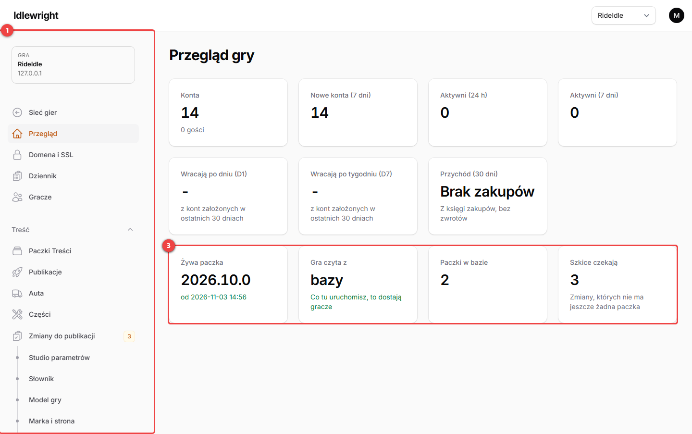

<!-- legenda:przeglad-gry -->
1. **Menu gry.** Po wejściu do gry w menu są strony tej gry: treść (auta, części, świat, reguły) i publikowanie.
2. **Żywa paczka.** Numer paczki treści, z której gra korzysta teraz, i od kiedy.
3. **Szkice czekają.** Ile zmian czeka na paczkę; graczy dotkną dopiero po jej uruchomieniu.
<!-- /legenda -->

**Co sprawdzić po wejściu:** nazwa gry w prawym górnym rogu zgadza się z tą, którą chcesz zmieniać.

---

## 2. Nowa gra, domena i SSL

**Cel:** postawić drugą grę (na przykład „Statki”) na własnej domenie z certyfikatem HTTPS.

**Zanim zaczniesz:** rekord **A** domeny musi wskazywać na serwer. Dopóki tego nie ma, certyfikat się nie wystawi. Zmiana DNS potrafi trwać od minut do kilku godzin.

**Kroki:** na stronie sieci kliknij „Utwórz nową grę”. Kreator ma trzy kroki.

1. **Nazwa i domena:** nazwa, slug (robi się sam z nazwy i **potem się nie zmienia**), domena, język i kolor. Podgląd obok pokazuje kartę przeglądarki i pasek aplikacji nowej gry.
2. **Punkt startowy:** „Gra samochodowa (szablon)” (gra dostaje treść RideIdle do przerobienia), „Kopia innej gry” (jej żywa paczka) albo „Bez treści” (pusta gra, której nie da się uruchomić, dopóki nie dostanie paczki).
3. **Domena i SSL:** „Sprawdź DNS” porównuje rekord A domeny z adresem serwera; przełącznik zleca serwerowi ustawienie domeny i certyfikatu zaraz po utworzeniu gry.

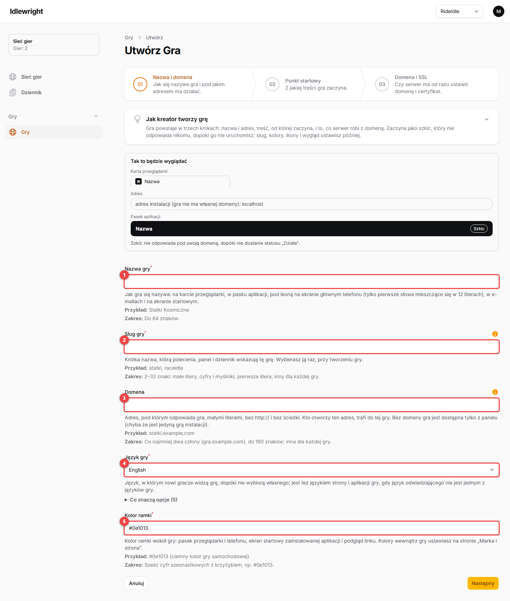

<!-- legenda:kreator-gry -->
1. **Nazwa gry.** Jak gra się nazywa: na karcie przeglądarki, w pasku aplikacji, pod ikoną na ekranie głównym telefonu (tylko pierwsze słowa mieszczące się w 12 literach), w e-mailach i na ekranie startowym. Zakres: Do 64 znaków. Przykład: Statki Kosmiczne.
2. **Slug gry.** Krótka nazwa, którą polecenia, panel i dziennik wskazują tę grę. Wybierasz ją raz, przy tworzeniu gry. Zakres: 2–32 znaki: małe litery, cyfry i myślniki, pierwsza litera; inny dla każdej gry. Przykład: statki, raceidle. Wskazówka: Nie da się go potem zmienić, bo polecenia (--game=slug), skrypty wdrożenia, dziennik zmian i przełącznik gier w panelu nazywają grę właśnie tak. W kreatorze podpowiada się z nazwy; możesz go poprawić, zanim przejdziesz dalej.
3. **Domena.** Adres, pod którym odpowiada gra, małymi literami, bez http:// i bez ścieżki. Kto otworzy ten adres, trafi do tej gry. Bez domeny gra jest dostępna tylko z panelu (chyba że jest jedyną grą instalacji). Zakres: Co najmniej dwa człony (gra.example.com), do 190 znaków; inna dla każdej gry. Przykład: statki.example.com. Wskazówka: Zanim wystawi się certyfikat, domena musi wskazywać na ten serwer (rekord A, AAAA dla IPv6). Po ustawieniu albo zmianie otwórz stronę „Domena i SSL” tej gry: sprawdza DNS i zleca serwerowi ustawienie adresu i certyfikatu SSL. Gra w szkicu nie odpowiada na swojej domenie także wtedy.
4. **Język gry.** Język, w którym nowi gracze widzą grę, dopóki nie wybiorą własnego; jest też językiem strony i aplikacji gry, gdy język odwiedzającego nie jest jednym z języków gry.
5. **Kolor ramki.** Kolor ramki wokół gry: pasek przeglądarki i telefonu, ekran startowy zainstalowanej aplikacji i podgląd linku. Kolory wewnątrz gry ustawiasz na stronie „Marka i strona”. Zakres: Sześć cyfr szesnastkowych z krzyżykiem, np. #0e1013. Przykład: #0e1013 (ciemny kolor gry samochodowej).
<!-- /legenda -->

Ikony gry ustawia się potem w edycji gry (menu „Gry”).

### Strona „Domena i SSL”

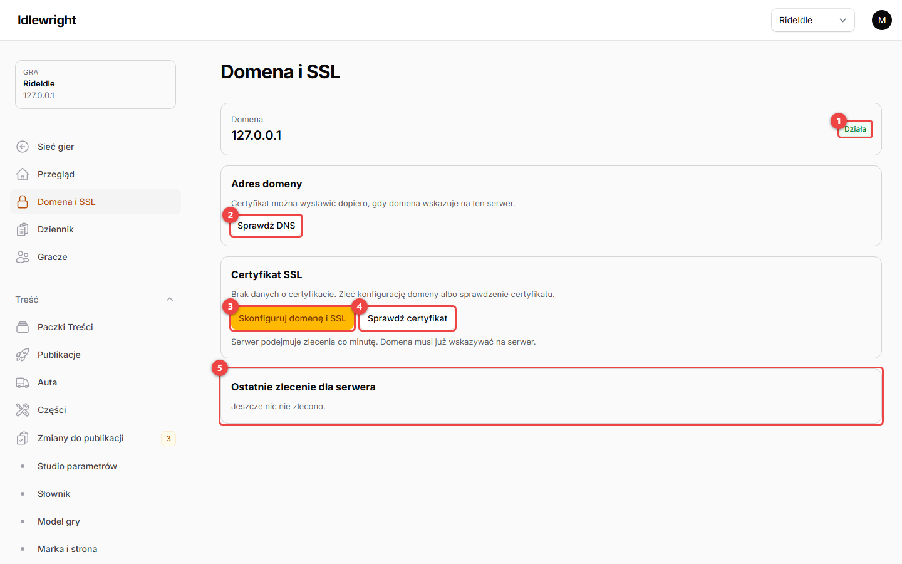

<!-- legenda:domena -->
1. **Stan domeny.** Czy domena gry działa; przy kafelku gry w sieci ten sam stan pokazuje plakietka SSL.
2. **Sprawdź DNS.** Porównuje rekord A domeny z adresem serwera; certyfikat można wystawić dopiero, gdy domena wskazuje na ten serwer.
3. **Skonfiguruj domenę i SSL.** Zleca serwerowi ustawienie domeny i certyfikatu; serwer podejmuje zlecenia co minutę.
4. **Sprawdź certyfikat.** Zleca serwerowi odczyt daty końca certyfikatu.
5. **Ostatnie zlecenie dla serwera.** Wynik ostatniego zlecenia: log, kod wyjścia i data końca certyfikatu (przed pierwszym zleceniem: „Jeszcze nic nie zlecono”).
<!-- /legenda -->

Strona pokazuje domenę gry i jej stan („Działa”), a niżej trzy przyciski: „Sprawdź DNS” (w bloku „Adres domeny”: certyfikat można wystawić dopiero, gdy domena wskazuje na ten serwer), „Skonfiguruj domenę i SSL” i „Sprawdź certyfikat” (w bloku „Certyfikat SSL”). Na dole jest blok „Ostatnie zlecenie dla serwera” (przed pierwszym zleceniem: „Jeszcze nic nie zlecono”). **Panel niczego nie uruchamia na serwerze sam** (proces www nie ma do tego uprawnień). Zapisuje **zlecenie**, a na serwerze co minutę budzi się worker (timer `rideidle-domains.timer`, działa jako root), wykonuje je i odkłada wynik: log, kod wyjścia i datę końca certyfikatu. Wynik wraca na tę stronę, więc po kliknięciu poczekaj minutę i odśwież.

**Jak czytać status:** strona pokazuje, czy zlecenie czeka na serwer, jest wykonywane, udało się albo nie; przy nieudanym zajrzyj do loga (ostatnie 20 KB wyjścia skryptu). Kafel gry w sieci ma plakietkę SSL z datą końca certyfikatu. Certyfikaty odnawia timer certbota, a worker tylko czyta datę końca (zlecenie „Sprawdź certyfikat”).

**Gdy certyfikat się nie udał**, najczęstsze przyczyny to: rekord A jeszcze się nie rozszedł albo wskazuje inny adres (sprawdź „Sprawdź DNS”), port 80 zamknięty u dostawcy serwera, błędny rekord AAAA, limit Let's Encrypt. Napraw przyczynę i zleć domenę jeszcze raz: zlecenie można powtarzać.

### Po stronie administratora serwera

To sekcja dla osoby, która ma dostęp do serwera Ubuntu. Szczegóły i polecenia są w [`deploy/README.md`](../deploy/README.md); tu tylko to, co operator panelu musi wiedzieć, żeby poprosić o właściwą rzecz:

- Na serwerze musi działać timer `rideidle-domains.timer` (co minutę). Sprawdza się go `systemctl list-timers rideidle-domains.timer`, a historię zleceń `journalctl -u rideidle-domains`.
- W `.env` aplikacji muszą być `ACME_EMAIL` (adres, na który Let's Encrypt pisze o certyfikacie) i `SERVER_IPS` (publiczne adresy serwera, z którymi panel porównuje rekord A).
- Pierwszą próbę najlepiej zrobić na **certyfikacie próbnym** (`CERTBOT_STAGING=1`), który nie zużywa limitów Let's Encrypt; drugie zlecenie domeny bez tego ustawienia zamienia go na prawdziwy.
- Sam panel stawia się na osobnym hoście skryptem `deploy/admin-site.sh`.

**Nie sprawdzono:** całego tego przepływu na prawdziwym Ubuntu z systemd, certbotem, nginx i prawdziwą domeną. Skrypty przeszły testy na atrapach (opisane w `deploy/README.md`), ale pierwsze prawdziwe uruchomienie może wymagać drobnych poprawek.

**Co sprawdzić po wszystkim:** adres gry otwiera się przez `https://`, kafel w sieci ma plakietkę SSL, a „Sprawdź certyfikat” pokazuje datę końca.

---

## 3. Auto

**Cel:** dodać do gry nowe auto albo zmienić istniejące.

**Lista aut:** slug, nazwa, klasa, tier, status (w ofercie, wycofane, zarchiwizowane), znak szkicu i liczba wersji. „Utwórz” zaczyna nową definicję; wyszukiwanie i filtr statusu zawężają listę.

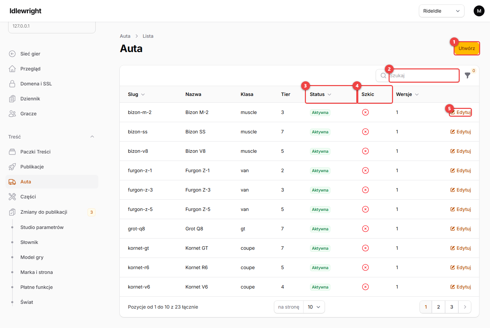

<!-- legenda:auta-lista -->
1. **Utwórz.** Formularz nowego auta; auto powstaje jako szkic.
2. **Szukaj.** Szuka po slugu i nazwie.
3. **Status.** Aktywna: auto jest w grze; wycofane i zarchiwizowane są opisane w rozdziale o cyklu życia.
4. **Szkic.** Krzyżyk to brak szkicu, znacznik to zmiana, która czeka na paczkę.
5. **Edytuj.** Otwiera formularz tego auta.
<!-- /legenda -->

### Formularz auta pole po polu

Formularz ma przy każdym polu opis tego, co pole zmienia w grze, przykład i dozwolony zakres. Nazwy i opisy wpisuje się w pięciu językach (angielski i polski są wymagane, reszta bez tekstu pokazuje angielski). Sekcje: Identyfikacja (slug i nazwy), Obrazek, Auto (klasa, napęd, układ, silnik, moc, masa, prześwit, ładunek, zbiornik albo bateria) i Oferta (poziom gracza, cena, źródła).

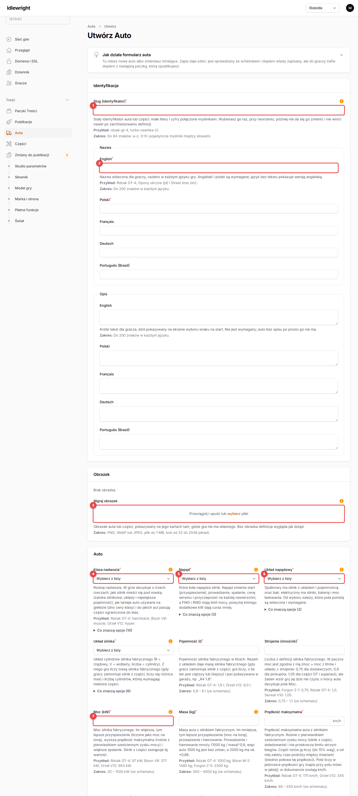

<!-- legenda:formularz-auta -->
1. **Slug (identyfikator).** Stały identyfikator auta lub części: małe litery i cyfry połączone myślnikami. Wybierasz go raz, przy tworzeniu; później nie da się go zmienić i nie wróci nawet po zarchiwizowaniu definicji. Zakres: Do 64 znaków: a–z, 0–9 i pojedyncze myślniki między słowami. Przykład: rdzak-gt-4, turbo-osemka-t2. Wskazówka: Po slugu odwołują się do auta lub części paczka, zasady (lista sklepu, opony fabryczne), samouczek i auta graczy. Dlatego nazwę wyświetlaną można zmieniać, a slug nie.
2. **Nazwa.** Nazwa widoczna dla graczy, osobno w każdym języku gry. Angielski i polski są wymagane; język bez tekstu pokazuje wersję angielską. Zakres: Do 200 znaków w każdym języku. Przykład: Rdzak GT-4; Opony uliczne (pl) i Street tires (en).
3. **Wgraj obrazek.** Obrazek auta lub części, pokazywany na jego kartach tam, gdzie gra nie ma własnego. Bez obrazka definicja wygląda jak dotąd. Zakres: PNG, WebP lub JPEG, plik do 1 MB, bok od :min do :max pikseli. Wskazówka: Plik jest zapisywany w bazie pod sumą kontrolną swoich bajtów, a definicja tylko wskazuje jego nazwę. Trafia do gry z następną paczką, a paczka zapisana jako plik zabiera go ze sobą.
4. **Klasa nadwozia.** Rodzaj nadwozia. W grze decyduje o trzech rzeczach: jaki silnik mieści się pod maską (zatoka silnikowa: układy i największa pojemność), jak tanieje auto używane na giełdzie (dno ceny klasy) i do jakich aut pasują części ograniczone do klas. Przykład: Rdzak GT-4: hatchback; Bizon V8: muscle; Orzeł V12: hyper. Wskazówka: Silnik fabryczny auta powinien mieścić się w zatoce swojej klasy (pilnuje tego test paczki startowej), a silnik z części, który się nie mieści, warsztat odrzuci. Przypisanie klas do dna ceny to decyzja projektu gry.
5. **Napęd.** Które koła napędza silnik. Napęd zmienia start (przyspieszenie), prowadzenie, spalanie, cenę serwisu i przyczepność na każdej nawierzchni, a FWD i RWD mają limit mocy, powyżej którego dodatkowe kW dają coraz mniej. Wskazówka: Napęd jest stały: wynika z definicji auta i gracz go nie zmieni, więc mocny silnik w aucie FWD zderzy się z limitem. FWD jest punktem odniesienia: auto FWD poniżej 130 kW jedzie tak, jakby napędów w grze nie było.
6. **Układ napędowy.** Spalinowy ma silnik z układem i pojemnością oraz bak; elektryczny ma silniki, baterię i moc ładowania. Od wyboru zależy, które pola poniżej są widoczne i wymagane. Wskazówka: Dziś jeżdżą tylko auta spalinowe: elektryczne nie mają jeszcze mechaniki ładowania, dealer, giełda i magazyny ich nie sprzedają, a bieg takiego auta się nie policzy. Auto elektryczne można zapisać w paczce, ale gracz go nie dostanie, więc nie nadawaj mu źródła „Wrak na start”.
7. **Moc (kW).** Moc silnika fabrycznego. Im większa, tym lepsze przyspieszenie (liczone jako moc na tonę), wyższa prędkość maksymalna (rośnie z pierwiastkiem sześciennym zysku mocy) i większe spalanie. Silnik z części zastępuje tę wartość. Zakres: 20 – 1500 kW (ze schematu). Przykład: Rdzak GT-4: 97 kW; Bizon V8: 371 kW; Orzeł V12: 663 kW. Wskazówka: Spalanie ma punkt odniesienia 97 kW, a zużycie części rośnie z mocą (od 0,8 do 2 razy). Napęd FWD przestaje wykorzystywać moc powyżej 130 kW, a RWD powyżej 260 kW, więc kolejne kW w takim aucie dają coraz mniej.
8. **Tier.** Szczebel auta, 1–10. Mnoży nagrodę za okrążenie (od tieru 5 coraz mocniej), wyznacza pole botów, z którymi auto się ściga (czas najszybszego seryjnego auta tego tieru), i musi odpowiadać poziomowi gracza: poziom = 3 × tier − 3 (co najmniej 1). Wskazówka: Tabela botów jest liczona dla tierów, które mają auta w paczce, i przeliczana przy publikacji. Wyższy tier płaci więcej za okrążenie, więc jest drabiną dochodu gry, którą pilnują bramki symulatora.
9. **Poziom gracza (dealer).** Od jakiego poziomu gracza auto jest w ofercie dealera i na giełdzie (oraz w magazynach o odpowiedniej puli). Schemat wymaga, żeby wynosił 3 × tier − 3 (co najmniej 1); inna liczba to błąd, którego szkic nie przyjmie. Zakres: 1 – 100 (ze schematu), a do tego równo max(1, 3 × tier − 3). Przykład: Rdzak GT-2 (tier 1): 1; Rdzak GT-4 (tier 2): 3; Orzeł V12 (tier 10): 27.
10. **Cena nowego auta ($).** Cena u dealera w dolarach (w dokumencie zapisana w centach). Z niej liczy się też cena używanego auta na giełdzie, wartość auta z magazynu i sprzedaż: gracz dostaje 70% wartości z chwili zdobycia (nie mniej niż złom). Zakres: Od 0; setne części dolara są dozwolone (np. 21500,50). Przykład: Rdzak GT-4: 21 500 $; Orzeł V12: 780 000 $. Wskazówka: Wrak ze złomowiska ma osobną cenę w zasadach (garage.wreck_price_cents), więc ta liczba jej nie zmienia. Używane auto kosztuje: cena nowego × max(dno klasy, 0,89^wiek) × czynnik przebiegu × (0,35 + 0,65 × stan).
11. **Skąd można je mieć.** Gdzie gracz może zdobyć auto; trzeba zaznaczyć co najmniej jedno miejsce. Złomowisko sprzedaje tylko wraki wymienione w zasadach (garage.wreck_price_cents), niezależnie od tego pola.
<!-- /legenda -->

**Slug wybiera się raz, przy tworzeniu.** Potem nie da się go zmienić, bo gracze mają auto zapisane pod tym identyfikatorem.

### Przykład: dodajemy nowe auto od początku do gry

Dodamy „Rdzak GT-9”, mocniejszego brata istniejącego Rdzaka GT-4 (hatchback na przód, silnik R4 1,8 l, 97 kW, masa 1000 kg, tier 2, od 3. poziomu gracza, 21 500 $). Liczby są przykładowe: trzymają się opisów pól (zatoka hatchbacka to R4 i V6 do 3,0 l, a auto na przód przestaje wykorzystywać moc powyżej 130 kW), ale bramki publikacji mogą je i tak zatrzymać, jeśli nowe auto zaburzy flotę gry.

1. Auta → „Utwórz”.
2. Slug `rdzak-gt-9`; nazwa po angielsku i po polsku „Rdzak GT-9” (reszta języków może zostać pusta).
3. Klasa „Hatchback”, napęd „Napęd przedni (FWD)”, układ napędowy „Spalinowy”, silnik R4 2,0 l.
4. Moc 110 kW, masa 1040 kg, prześwit 20 cm, zbiornik 50 l.
5. Tier 3, poziom gracza 6, cena 32 000 $, źródła: „Dealer” i „Giełda” (te źródła są tylko dla aut spalinowych).
6. Wgraj obrazek (PNG, WebP albo JPEG, do 1 MB). Bez obrazka auto jest w grze, tylko bez własnej grafiki.
7. „Utwórz”. Pasek u góry pokaże „Czeka szkic”.

**Co się stanie w grze i kiedy:** nic, dopóki nie zrobisz i nie uruchomisz paczki (rozdział 9). Po uruchomieniu auto pojawia się w ofercie dla graczy, którzy mają wymagany poziom; bieg każdego gracza przechodzi na nową treść przy swoim następnym rozliczeniu.

**Co sprawdzić po zapisaniu:** „Zmiany do publikacji” pokazuje nowe auto jako zmianę; w polach „Moc”, „Masa” i „Cena” nie ma czerwonych błędów; a „Podgląd części” (rozdział 4) i symulatory przy robieniu paczki nie narzekają.

### Akcje u góry strony auta

- **Odrzuć szkic:** wraca do tego, co ma gra.
- **Wycofaj z oferty:** auta nie da się już kupić ani wylosować, ale gracze, którzy je mają, nadal je mają i używają. **Przywróć do oferty** odwraca to.
- **Zarchiwizuj:** usuwa auto z kolejnych paczek; działa tylko wtedy, gdy nikt go nie używa.
- **Usuń szkic:** tylko dla definicji, która nigdy nie była opublikowana.
- **Przygotuj dla AI (ten rekord):** instrukcja dla asystenta AI dotycząca tylko tego auta (rozdział 17).

---

## 4. Część

**Cel:** dodać część do slotu albo zmienić istniejącą. Formularz działa tak jak formularz auta (te same akcje u góry, ten sam cykl życia).

Część ma **slot** (miejsce w aucie: silnik, opony i tak dalej) i **tier**. Slot ma w grze **rolę** i to ona mówi, co część robi: statystyki części są czytane według roli slotu (opony dają przyczepność, silnik moc, zbiornik pojemność). Dla opon formularz ma jeszcze pole **„Rodzaj opon”** (całoroczne, uliczne, slick, deszczowe i inne): wybiera kolumnę macierzy opon, czyli to, jak opony trzymają na suchym i mokrym asfalcie, żwirze, błocie i śniegu.

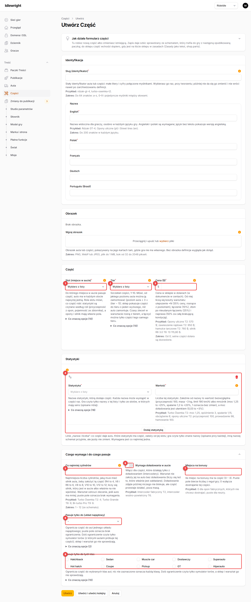

<!-- legenda:formularz-czesci -->
1. **Slot (miejsce w aucie).** Do którego miejsca w aucie pasuje część; auto ma w każdym slocie najwyżej jedną. Rola slotu mówi, co część robi: statystyki są czytane według roli (przyczepność z opon, pojemność ze zbiornika), a opony i silnik mają własne pola. Wskazówka: Sloty i ich role są w modelu gry (strona „Model gry”). Slot bez roli, jak wydech, trzyma części, których statystyki wzory już czytają (np. mnożnik mocy). Ukryty slot (ecu) może trzymać części, ale garaż go nie pokazuje.
2. **Tier.** Szczebel części, 1–10. Mówi, od jakiego poziomu auta można ją zamontować (poziom auta ≥ 3 × (tier − 1)); sklep pokazuje części do tieru o jeden wyższego, niż auto zamontuje. Czasy zleceń w warsztacie rosną z tierem, a łączyć można tylko części tego samego tieru. Wskazówka: Dla silnika tier podnosi też moc z litra o 7,5% za każdy tier ponad pierwszym. Cena części jest sprawdzana z krzywą ekonomii dla jej tieru.
3. **Cena ($).** Cena w sklepie w dolarach (w dokumencie w centach). Od niej liczą się koszty warsztatu: ulepszenie +N (35% ceny, rosnące z poziomem), łączenie (10%), złom po nieudanym łączeniu (25%) i naprawa (50% za całą brakującą kondycję). Zakres: Od 0; setne części dolara są dozwolone. Przykład: Opony uliczne T2: 570 $; zawieszenie rajdowe T2: 950 $; hamulce tarczowe T2: 760 $; silnik R6 3.0 T6: 13 115,80 $. Wskazówka: Ceny części poza grupą silnika (opony, zawieszenie, hamulce, wydech, zbiornik, ECU) są sprawdzane z krzywą: cena nowego auta tieru (15 000, 19 000, 25 000, 34 000, 48 000, 75 000, 100 000, 200 000, 450 000, 800 000 $) × 50% × udział slotu (opony 6%, zawieszenie 10%, hamulce 8%, wydech 5%, zbiornik 3%, ECU 3%), z tolerancją 20%; poza nią bramka publikacji zatrzyma paczkę. Silniki, doładowania, chłodzenie i skrzynie są z tego porównania wyłączone (silnik w paczce: litry × cena litra układu × 1,35^(tier − 1)).
4. **Statystyki części.** Linie „nazwa i liczba”: co część daje autu. Które statystyki ma część, zależy od jej slotu; gra czyta tylko znane nazwy (opisane przy każdej), inną nazwę schemat przyjmie, ale jazdy nie zmieni. Wymagana jest co najmniej jedna. Wskazówka: Rzadkość części i ulepszenie +N mnożą przyczepność, prowadzenie, hamowanie, terenowość i moc silnika, a z mnożnika mocy tylko zysk ponad 1; limity, masy, opóźnienie i spalanie zostają. Zużycie obniża te statystyki do 60% przy części zużytej do końca.
5. **Co najmniej cylindrów.** Najmniejsza liczba cylindrów, jaką musi mieć silnik auta, żeby założyć tę część (R4 to 4, V6 i R6 to 6, V8 to 8, V10 to 10, V12 to 12; liczy się silnik, który jest w aucie albo właśnie na nie wjeżdża). Warsztat odrzuci zlecenie, jeśli auto ma mniej; puste pole oznacza brak wymagania. Zakres: 1 – 12 (ze schematu). Przykład: Turbo Ósemka T2: 4; Turbo Grande T6: 6; Bi-turbo Pro T9: 8. Wskazówka: Silnik, który zostawiłby doładowanie na aucie z za małą liczbą cylindrów, też jest odrzucany.
6. **Wymaga doładowania w aucie.** Włącz dla części, które działają tylko z doładowaniem (intercoolery). Warsztat nie założy jej na auto bez doładowania (liczy się też to, które właśnie jest zakładane). Doładowanie zdjęte później niczego nie blokuje, ale część przestaje działać, poza masą. Przykład: Intercooler fabryczny T2, intercooler wodno-powietrzny T6.
7. **Miejsca na bonusy.** Ile miejsc na bonusy ma ta część (0 – 3). Puste pole bierze liczbę z reguł gry; 0 wyłącza dostrajanie tej części. Przykład: 0 dla opon fabrycznych, których nie chcesz dostrajać; puste dla reszty.
8. **Pasuje tylko do (układ napędowy).** Ogranicza część do aut jednego układu napędowego; puste pole oznacza brak ograniczenia. Dziś ograniczenie czyta tylko symulator torów (z którymi autami próbuje tej części); sklep i warsztat go nie sprawdzają.
9. **Pasuje tylko do tych klas.** Ogranicza część do wybranych klas aut; nic nie zaznaczone oznacza każdą klasę. Dziś ograniczenie czyta tylko symulator torów, a sklep i warsztat go nie sprawdzają.
<!-- /legenda -->

**Statystyki części** to linie „nazwa i liczba”. Gra czyta tylko znane nazwy, a które mają sens, zależy od slotu; ta sama nazwa może wystąpić raz. Wymagana jest co najmniej jedna.

**Wymagania** (zwinięta sekcja „Czego wymaga i do czego pasuje”): najmniejsza liczba cylindrów silnika auta, czy część wymaga doładowania w aucie, miejsca na bonusy, układ napędowy oraz klasy aut, do których część pasuje. Dziś ograniczenia napędu i klas czyta tylko symulator torów (z którymi autami próbuje część); sklep i warsztat ich nie sprawdzają.

**Rzadkość i afiksy nie są polami tego formularza.** Rzadkość części i jej afiksy (losowe bonusy) nadaje gra: losuje je, gdy część powstaje, a przy łączeniu części dolosowuje brakujące. Panel ustawia tylko reguły losowania (w Studio parametrów, sekcja o afiksach, rozdział 7) i skutki wyjątkowych części legendarnych. Skutek konkretnej rzadkości sprawdzasz w „Podglądzie części” poniżej.

### Przykład: dodajemy część do slotu

Dodajemy silnik tieru 3 „V6 2.5 Sport” obok istniejącego „Silnika V6 2.5” (moc 158,12 kW, masa 150 kg, cena 3 758,91 $).

1. Części → „Utwórz”; slug `engine-v6-2-5-sport-t3`; nazwy.
2. Slot „Silnik”, tier 3, cena 4 400 $.
3. Statystyki: moc 170 kW, masa silnika 155 kg.
4. W „Czego wymaga”: co najmniej 6 cylindrów (V6 pasuje).
5. „Utwórz”, a potem sprawdź część w „Podglądzie części”.

### Podgląd części: sprawdzam część, zanim trafi do sklepu

Menu Treść → Podgląd części. Wybierz część, auto testowe i rzadkość i kliknij **„Policz”**: strona pokaże, co część robi z autem na każdym torze, na sucho i w deszczu: statystyki, czas okrążenia, miejsce wśród botów i dochód na godzinę. Liczy na żywej paczce, więc działa, zanim część trafi do sklepu.

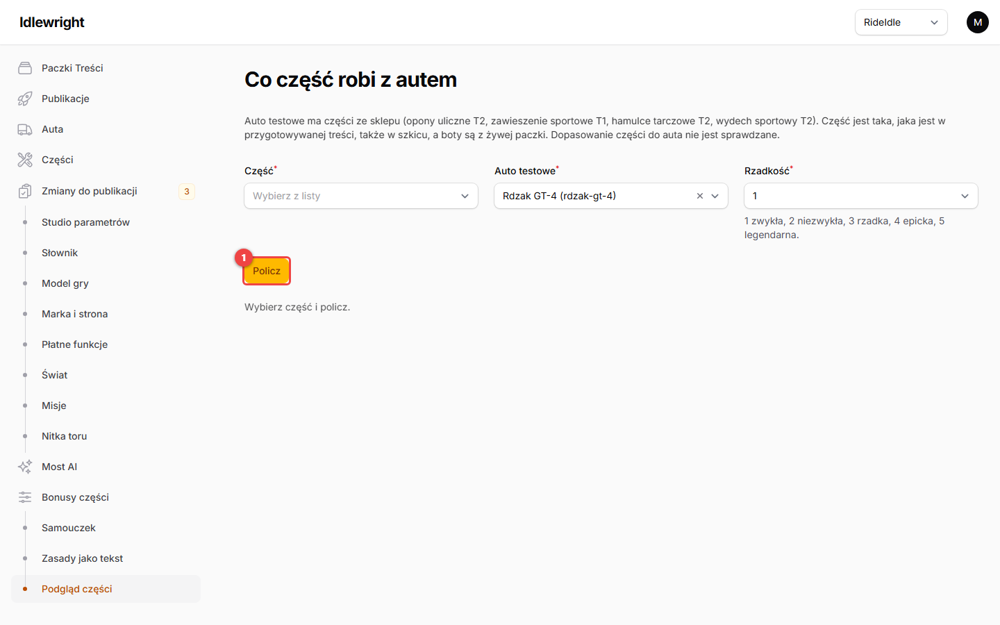

<!-- legenda:podglad-czesci -->
1. **Policz.** Liczy skutek wybranej części na żywej paczce, na każdym torze, na sucho i w deszczu.
<!-- /legenda -->

**Co się stanie w grze i kiedy:** jak przy aucie, część pojawia się w sklepie, gdy jest na liście sklepu w zasadach (Zasady jako tekst, `shop.parts`) i paczka jest uruchomiona.

**Co sprawdzić po zapisaniu:** czas okrążenia w podglądzie nie jest absurdalnie lepszy od najlepszej istniejącej części tego tieru (bramka ekonomii i tak go zatrzyma, ale lepiej wiedzieć wcześniej).

---

## 5. Świat i tory

**Cel:** ustawić miasta, drogi między nimi i tory, na których gracze zarabiają.

Menu Treść → Świat. Strona ma zakładki **Mapa**, **Miasta**, **Drogi** i **Tory**. Kolejność pozycji zmienia się strzałkami przy każdej z nich.

### Mapa

Zakładka **Mapa** pokazuje świat tak, jak gracz zobaczy go na ekranie mapy w telefonie: kółka miast z ikoną (dom w mieście startowym, kłódka tam, gdzie potrzebny jest poziom wyższy niż 1), pod nimi nazwę i linię „LV n+ · nawierzchnia” oraz drogi. Przerywana ramka to pas, w którym całe kółko miasta mieści się na ekranie. Długość nowej drogi panel podpowiada ze skali mapy (mediana „km na jednostkę” istniejących dróg). Drogi mogą tworzyć łańcuch, pętlę albo dowolną sieć, a auto jedzie najkrótszą trasą. Miejsca, których dotyczą uwagi, są obwiedzione na pomarańczowo, a miasto bez dojazdu na czerwono: takiego szkicu nie da się zapisać.

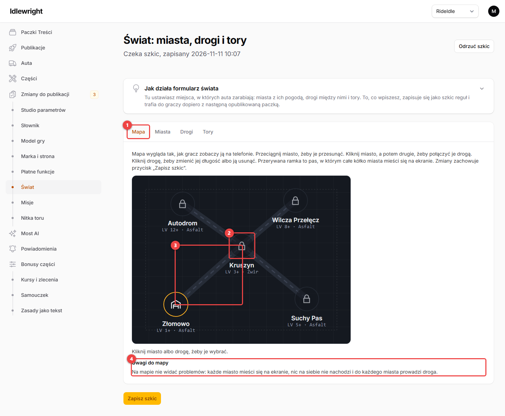

<!-- legenda:swiat-mapa -->
1. **Mapa.** Świat tak, jak gracz widzi go na telefonie: miasta przeciąga się, a drogę rysuje kliknięciem dwóch miast.
2. **Miasto.** Chwyć kółko i upuść w nowym miejscu; kliknięcie wybiera miasto (pod mapą pojawiają się jego x i y), a kliknięcie drugiego miasta rysuje drogę z długością podpowiedzianą ze skali mapy.
3. **Droga.** Kliknij drogę, żeby zmienić jej długość albo ją usunąć; żadne miasto nie musi być środkiem.
4. **Uwagi do mapy.** Co gracz odczyta źle: miasto ucięte przez krawędź, miasta albo nazwy na sobie, droga przez miasto, którego nie łączy, drogi przecinające się poza miastem; na czerwono miasto bez dojazdu z miasta startowego.
<!-- /legenda -->

Zmiany z mapy zachowuje przycisk „Zapisz szkic”, jak wszystkie inne na tej stronie. Gra rysuje mapę tak samo: nazwę przy krawędzi przesuwa do środka, przy dolnej krawędzi stawia ją nad kółkiem, a auto w podróży jedzie po drogach przez miasta pośrednie.

### Miasta i drogi

Miasto ma własną pogodę (szanse wpisuje się w **procentach**), garaże, warsztat i rynek, co najmniej jeden tor i miejsce na mapie (x i y, najwygodniej ustawiane w zakładce Mapa, do której prowadzi link „Pokaż na mapie”). Miasto otwiera się graczowi na poziomie swojego najłatwiejszego toru. Droga łączy dwa miasta i ma długość w kilometrach.

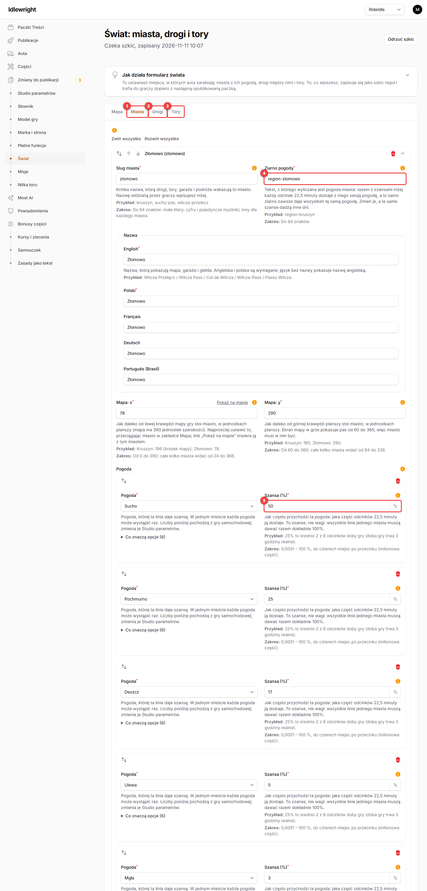

<!-- legenda:swiat-miasta -->
1. **Miasta.** Miasta gry: mapa, klimat i szanse pogody.
2. **Drogi.** Drogi między miastami.
3. **Tory.** Tory w miastach: rodzaj, długość, czas, nagroda i wagi statystyk.
4. **Ziarno pogody.** Tekst, z którego wyliczana jest pogoda miasta: razem z szansami niżej każdy odcinek 22,5 minuty dostaje z niego swoją pogodę, a to samo ziarno zawsze daje wszystkim tę samą pogodę. Zmień je, a te same szanse dadzą inne dni. Zakres: Do 64 znaków. Przykład: region-kruszyn. Wskazówka: Daj każdemu miastu własne ziarno: dwa miasta z tym samym ziarnem i tymi samymi szansami miałyby w tym samym czasie identyczną pogodę.
5. **Szansa (%).** Jak często przychodzi ta pogoda: jaka część odcinków 22,5 minuty ją dostaje. To szanse, nie wagi: wszystkie linie jednego miasta muszą dawać razem dokładnie 100%. Zakres: 0,0001 – 100 %, do czterech miejsc po przecinku (milionowa część). Przykład: 25% to średnio 2 z 8 odcinków doby gry (doba gry trwa 3 godziny realne). Wskazówka: Gra trzyma szansę w milionowych częściach i odrzuca miasto, w którym szanse nie dają dokładnie 1 000 000, więc unikaj trzykrotnego 33,33 (razem 99,99): wpisz 33,3334, 33,3333 i 33,3333 albo okrągłe liczby.
<!-- /legenda -->

### Tory

Tor ma **rodzaj**, miasto, nawierzchnię, poziom kierowcy, od którego tor jest otwarty, i to, czy jest oświetlony nocą. Rodzaj mówi, czego tor wymaga od kierowcy, i ustala obciążenie silnika, a więc paliwo okrążenia: sprint spala 12 ml na sekundę okrążenia, standard 20, dystans 32 (te liczby są w Studiu, pole „Paliwo na sekundę okrążenia”). Rodzaj jest też etykietą na liście torów gracza i grupą, którą liczy bramka balansu.

- **Sprint:** okrążenie 10–15 s, mało wypłaty i mało paliwa za okrążenie; zbiornik starcza na ok. godzinę.
- **Standardowy** (puste pole): okrążenie ok. minuty lub dłuższe, zwykła wypłata i zużycie paliwa.
- **Dystans:** okrążenie rzędu minut, dużo wypłaty i zbiornik opróżniony w ok. dwadzieścia minut, więc łapczywe auta zarabiają na nim mniej.
- **Rajd:** okrążenie po mieszance asfaltu i żwiru, które dobrze płaci i pali więcej niż zwykły tor; żadne auto nie powinno być najlepsze w więcej niż dwóch rajdach.

**Długość okrążenia jest źródłem liczb toru.** Okrążenie wzorcowe to długość podzielona przez prędkość toru, więc dłuższy tor trwa dłużej, a szybsze auto pokonuje ten sam dystans szybciej, chyba że tor ma utrudnienia (dlatego prędkość toru jest średnia z zakrętami, nawierzchnią i ruchem). Paliwo wynika z rodzaju toru i czasu, a wypłata i XP są liczone **na godzinę jazdy**, więc krótszy tor nie płaci więcej za samo bycie krótkim. Pod formularzem toru jest linia „Auto wzorcowe”, która mówi, co z tych liczb wyjdzie.

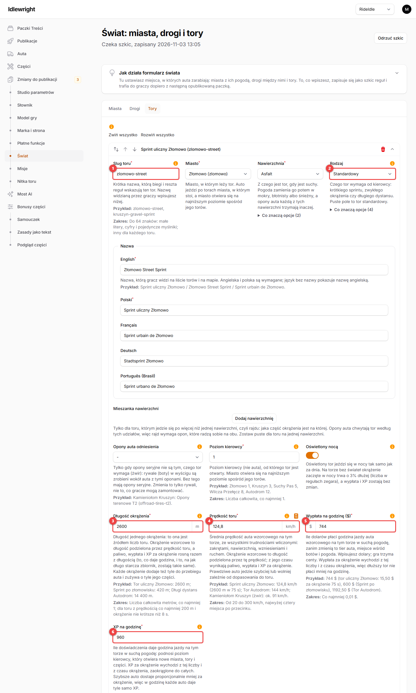

<!-- legenda:swiat-tory -->
1. **Slug toru.** Krótka nazwa, którą biegi i reszta reguł wskazują ten tor. Nazwę widzianą przez graczy wpisujesz niżej. Zakres: Do 64 znaków: małe litery, cyfry i pojedyncze myślniki; inny dla każdego toru. Przykład: zlomowo-street, kruszyn-gravel-sprint. Wskazówka: Stały, gdy gracze jeżdżą na torze: zmiana sluga to usunięcie toru i dodanie nowego, czego zapis szkicu nie przyjmie, dopóki jakieś auto tam jeździ.
2. **Rodzaj.** Czego tor wymaga od kierowcy: krótkiego sprintu, zwykłego okrążenia czy długiego dystansu. Puste pole to tor standardowy. Wskazówka: Rodzaj ustala obciążenie silnika, a więc paliwo okrążenia: sprint spala 12 ml na sekundę okrążenia, standard 20, dystans 32 (liczby są w Studiu, „Paliwo na sekundę okrążenia”). Jest też etykietą na liście torów gracza i grupą, którą liczy bramka balansu (żadne auto nie wygrywa więcej niż dwóch torów jednego rodzaju).
3. **Poziom kierowcy.** Poziom kierowcy (nie auta), od którego tor jest otwarty. Miasto otwiera się na najniższym poziomie spośród jego torów. Zakres: Liczba całkowita, co najmniej 1. Przykład: Złomowo 1, Kruszyn 3, Suchy Pas 5, Wilcza Przełęcz 8, Autodrom 12. Wskazówka: Pierwszy tor z listy musi mieć 1. Poziom rośnie z XP, więc to główny hamulec tempa, w jakim kierowca poznaje nowe miejsca.
4. **Oświetlony nocą.** Oświetlony tor jeździ się w nocy tak samo jak za dnia. Na torze bez świateł okrążenie zaczęte w nocy trwa o 3% dłużej (liczba w regułach zegara), a wypłata i XP zostają bez zmian. Wskazówka: Doba gry trwa 3 godziny realne, a noc to 22:00–5:00 czasu gry, czyli ok. 52 minuty z każdych 3 godzin.
5. **Mieszanka nawierzchni.** Tylko dla toru, którym jedzie się po więcej niż jednej nawierzchni, czyli rajdu: jaka część okrążenia jest na której. Opony auta chwytają tor według tych udziałów, więc rajd wymaga opon, które radzą sobie na obu. Zostaw puste dla toru na jednej nawierzchni.
6. **Opony auta odniesienia.** Tylko gdy opony seryjne nie są tym, czego tor wymaga (żwir): rywale (boty) w wyścigu są zrobieni wokół auta z tymi oponami. Bez tego mają opony seryjne. Zmienia to tylko rywali, nie to, co gracze mogą zamontować. Przykład: Kamieniołom Kruszyn: Opony terenowe T2 (offroad-tires-t2). Wskazówka: Na żwirze każde auto z oponami seryjnymi jest o sekundę wolniejsze niż z właściwymi, więc stawka botów zrobiona wokół opon seryjnych płaciłaby premię każdemu, kto kupi właściwe. Na asfalcie zostaw puste.
7. **Długość okrążenia.** Długość jednego okrążenia: to ona jest źródłem liczb toru. Okrążenie wzorcowe to długość podzielona przez prędkość toru, a paliwo, wypłata i XP za okrążenie rosną razem z długością (to, co daje godzina, i to, na jak długo starcza zbiornik, zostają takie same). Każde okrążenie dodaje też tyle do przebiegu auta i zużywa o tyle jego części. Zakres: Liczba całkowita metrów, co najmniej 1; dla toru z prędkością co najmniej 200 m i okrążenie nie krótsze niż 8 s. Przykład: Tor uliczny Złomowo: 2600 m; Sprint po złomowisku: 420 m; Długi dystans Autodrom: 14 400 m. Wskazówka: Przy tej samej prędkości dłuższy tor to dłuższe okrążenie, więcej paliwa i większa wypłata za okrążenie, a nie większy zarobek na godzinę: ten ustawia „Wypłata na godzinę”. Na bardzo krótkim torze zaokrąglenie XP za okrążenie do całych potrafi zmienić wynik o kilkanaście procent.
8. **Prędkość toru.** Średnia prędkość auta wzorcowego na tym torze, ze wszystkimi trudnościami wliczonymi: zakrętami, nawierzchnią, wzniesieniami i ruchem. Okrążenie wzorcowe to długość podzielona przez tę prędkość; z jego czasu wynikają paliwo, wypłata i XP za okrążenie. Prawdziwe auto jedzie szybciej lub wolniej zależnie od dopasowania do toru. Zakres: Od 20 do 300 km/h, najwyżej cztery miejsca po przecinku. Przykład: Sprint uliczny Złomowo: 124,8 km/h (2600 m w 75 s); Tor Autodrom: 144 km/h; Kamieniołom Kruszyn (żwir): ok. 91 km/h. Wskazówka: Nie wiesz, ile wpisać? Przycisk „Podpowiedz prędkość” liczy ją z zakrętów, wzniesień i ruchu. Wolniejszy tor to dłuższe okrążenie i więcej paliwa na kilometr; wypłata na godzinę zostaje taka, jaką ustawisz.
9. **Wypłata na godzinę ($).** Ile dolarów płaci godzina jazdy auta wzorcowego na tym torze w suchą pogodę, zanim zmienią to tier auta, miejsce wśród botów i pogoda. Wpisujesz dolary; gra trzyma centy. Wypłata za okrążenie wychodzi z tej liczby i z czasu okrążenia, więc dłuższy tor nie płaci mniej na godzinę. Zakres: Co najmniej 0,01 $. Przykład: 744 $ (tor uliczny Złomowo: 15,50 $ za okrążenie 75 s), 600 $ (Sprint po złomowisku), 1192,50 $ (Tor Autodrom). Wskazówka: Zarobek na godzinę to wypłata na godzinę minus paliwo na godzinę: to porównują kontrole balansu między torami, więc nowa wypłata zmienia, który tor jest najlepszy na danym poziomie. Deszcz, ulewa i śnieg płacą o 7% mniej (dziś).
10. **XP na godzinę.** Ile doświadczenia daje godzina jazdy na tym torze w suchą pogodę: podnosi poziom kierowcy, który otwiera nowe miasta, tory i części. XP za okrążenie wychodzi z tej liczby i z czasu okrążenia, zaokrąglone do całych. Szybsze auto dostaje proporcjonalnie mniej za okrążenie, więc w godzinę każde auto daje tyle samo XP. Zakres: Od 0 do 3600, najwyżej dwa miejsca po przecinku. Przykład: 960 XP (tor uliczny Złomowo, 20 XP za okrążenie), 900 XP (Tor Autodrom i sprinty). Wskazówka: Na bardzo krótkim torze zaokrąglenie XP za okrążenie do całych zmienia wynik nawet o jedną piątą; w mokrej pogodzie jest o 7% mniej.
<!-- /legenda -->

### Przykład: jak liczby toru przekładają się na zarobek

Tor „Sprint uliczny Złomowo” ma długość 2600 m i prędkość 124,8 km/h. Linia pod formularzem liczy z tego: okrążenie wzorcowe 1 min 15 s, 48 okrążeń na godzinę, paliwo około 1,50 l na okrążenie, wypłata 15,50 $ i 20 XP za okrążenie (744 $ i 960 XP na godzinę). Gdy podniesiesz wypłatę na godzinę do 800 $, okrążenie zacznie płacić około 16,70 $, a cała zmiana zadziała dopiero po paczce.

### Rajd: mieszanka nawierzchni i opony odniesienia

Tor rajdowy jedzie się po więcej niż jednej nawierzchni. W polu **Mieszanka nawierzchni** wpisujesz, jaka część okrążenia jest na której (udziały dają razem 100%): opony auta chwytają tor według tych udziałów, więc rajd wymaga opon, które radzą sobie na obu nawierzchniach. Zestaw zostaje pusty dla toru na jednej nawierzchni. Na zrzucie „Rajd leśny pod Kruszynem” ma rodzaj Rajd, nawierzchnię żwir i mieszankę, w której żwir to 63% okrążenia (reszta, 37%, to asfalt). Pole **Opony auta odniesienia** ustawia się tylko wtedy, gdy opony seryjne nie są tym, czego tor wymaga (żwir): rywale w wyścigu są wtedy zrobieni wokół auta z tymi oponami.

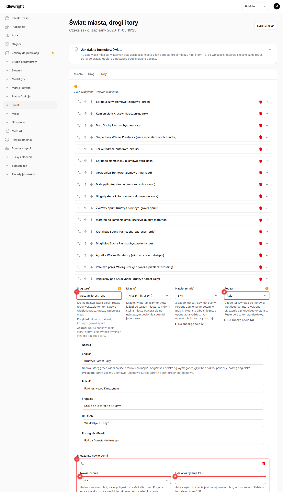

<!-- legenda:swiat-tory-rajd -->
1. **Slug toru.** Krótka nazwa, którą biegi i reszta reguł wskazują ten tor. Nazwę widzianą przez graczy wpisujesz niżej. Zakres: Do 64 znaków: małe litery, cyfry i pojedyncze myślniki; inny dla każdego toru. Przykład: zlomowo-street, kruszyn-gravel-sprint. Wskazówka: Stały, gdy gracze jeżdżą na torze: zmiana sluga to usunięcie toru i dodanie nowego, czego zapis szkicu nie przyjmie, dopóki jakieś auto tam jeździ.
2. **Rodzaj.** Czego tor wymaga od kierowcy: krótkiego sprintu, zwykłego okrążenia czy długiego dystansu. Puste pole to tor standardowy. Wskazówka: Rodzaj ustala obciążenie silnika, a więc paliwo okrążenia: sprint spala 12 ml na sekundę okrążenia, standard 20, dystans 32 (liczby są w Studiu, „Paliwo na sekundę okrążenia”). Jest też etykietą na liście torów gracza i grupą, którą liczy bramka balansu (żadne auto nie wygrywa więcej niż dwóch torów jednego rodzaju).
3. **Mieszanka nawierzchni.** Tylko dla toru, którym jedzie się po więcej niż jednej nawierzchni, czyli rajdu: jaka część okrążenia jest na której. Opony auta chwytają tor według tych udziałów, więc rajd wymaga opon, które radzą sobie na obu. Zostaw puste dla toru na jednej nawierzchni.
4. **Nawierzchnia.** Jedna z nawierzchni, z których jest tor: asfalt albo żwir. Pogoda moczy ją albo robi z niej błoto tak samo jak resztę okrążenia.
5. **Udział okrążenia (%).** Jaka część okrążenia jest na tej nawierzchni, w procentach. Udziały toru dają razem 100.
6. **Opony auta odniesienia.** Tylko gdy opony seryjne nie są tym, czego tor wymaga (żwir): rywale (boty) w wyścigu są zrobieni wokół auta z tymi oponami. Bez tego mają opony seryjne. Zmienia to tylko rywali, nie to, co gracze mogą zamontować. Przykład: Kamieniołom Kruszyn: Opony terenowe T2 (offroad-tires-t2). Wskazówka: Na żwirze każde auto z oponami seryjnymi jest o sekundę wolniejsze niż z właściwymi, więc stawka botów zrobiona wokół opon seryjnych płaciłaby premię każdemu, kto kupi właściwe. Na asfalcie zostaw puste.
<!-- /legenda -->

### Pięć torów rajdowych

W grze jest pięć torów rajdowych, po jednym w każdym mieście. Każdy ma rodzaj Rajd, mieszankę żwiru i asfaltu (w polu „Mieszanka nawierzchni” i w odcinkach nitki), własny popyt na statystyki auta i płacę na godzinę leżącą blisko najlepszego toru swojego poziomu, więc rajdy dają różnorodność, a nie skok dochodu. Pali się na nich 26 ml na sekundę okrążenia (nowa liczba w Studiu, sekcja „Model toru”). Właściciel gry zatwierdził nazwę „Rajd”, pięć profili i płace (2026-11-03).

| Tor | Od poziomu | Długość | Żwir | Czego wymaga | Płaca na godzinę |
|---|---|---|---|---|---|
| Rajd leśny pod Kruszynem | 8 | 6,4 km | 63% | prześwit i przyczepność | 1000 $ |
| Rajd wydmowy Suchego Pasa | 12 | 8,8 km | 56% | rajd mocy: przyspieszenie i prędkość | 1120 $ |
| Rajd przełęczy Wilczej | 16 | 10,2 km | 48% | prowadzenie i hamowanie | 1180 $ |
| Rajd po złomowiskach | 20 | 7,6 km | 40% | | 1200 $ |
| Rallycross na Autodromie | 25 | 5,2 km | 48% | | 1240 $ |

Pierwszy bieg bramki torów (`tracks:simulate --strict`) przeszedł bez strojenia: zwycięzcami pięciu rajdów są pięć różnych aut, więc warunek „żadne auto nie wygrywa więcej niż dwóch rajdów” jest spełniony z zapasem.

### Auto odniesienia toru i przycisk „Weź z auta”

Niżej w formularzu toru są dwie listy. **Czego wymaga tor** to udziały statystyk (razem dokładnie 100%). **Auto odniesienia** to dla każdej statystyki wartość, przy której auto jest dla tego toru dokładnie „normalne”: auto powyżej niej jedzie okrążenie szybciej, poniżej wolniej. Każda statystyka z „Czego wymaga tor” potrzebuje tu wartości. Przycisk z ikoną ciężarówki (**„Weź z auta”**, przy nagłówku „Auto odniesienia”) wypełnia te wartości statystykami auta z gry, z jakim startuje i z częściami, z którymi startuje; bierze je z **opublikowanej paczki**, nie ze szkiców, w liczbach całkowitych, a każdą możesz potem zmienić.

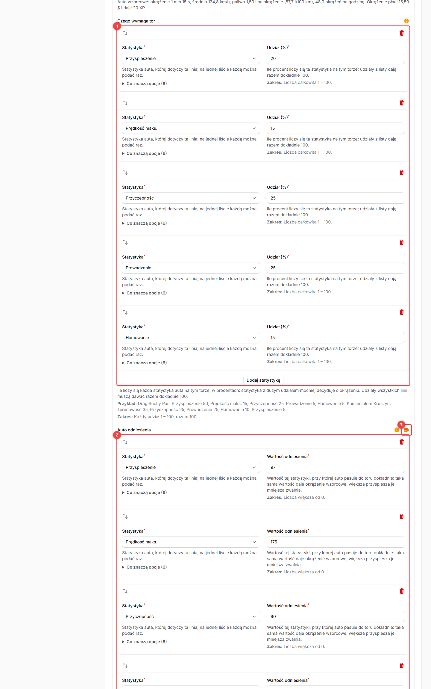

<!-- legenda:swiat-tory-wymagania -->
1. **Czego wymaga tor.** Ile liczy się każda statystyka auta na tym torze, w procentach: statystyka z dużym udziałem mocniej decyduje o okrążeniu. Udziały wszystkich linii muszą dawać razem dokładnie 100. Zakres: Każdy udział 1 – 100, razem 100. Przykład: Drag Suchy Pas: Przyspieszenie 50, Prędkość maks. 15, Przyczepność 25, Prowadzenie 5, Hamowanie 5. Kamieniołom Kruszyn: Terenowość 35, Przyczepność 25, Prowadzenie 25, Hamowanie 10, Przyspieszenie 5. Wskazówka: Każda statystyka wymagana tutaj musi mieć też linię w „Aucie odniesienia”. Statystyka, której tu nie ma, nie liczy się na tym torze wcale.
2. **Auto odniesienia.** Dla każdej statystyki: wartość, przy której auto jest dla tego toru dokładnie „normalne”. Auto powyżej niej jeździ okrążenie szybciej, poniżej wolniej (wartość auta liczy się od 0,2 do 1,6 razy tyle co odniesienie). Przykład: Tor uliczny Złomowo: Przyspieszenie 97, Prędkość maks. 175, Przyczepność 90, Prowadzenie 88, Hamowanie 90; fabryczny Rdzak GT-4 pasuje do niego dokładnie (dopasowanie 100). Wskazówka: Każda statystyka z „Czego wymaga tor” potrzebuje tu wartości odniesienia.
3. **Weź z auta.** Wypełnia auto wzorcowe statystykami auta z gry takiego, z jakim startuje, z częściami, z którymi startuje (z opublikowanej paczki, nie ze szkiców). To, co jest teraz w liniach, zostaje zastąpione. Tor jeżdżony po nitce potrzebuje wszystkich pięciu statystyk modelu.
<!-- /legenda -->

Tor, którego auto odniesienia nie ma wartości któregoś z pięciu statystyk modelu (przyspieszenie, prędkość maks., przyczepność, prowadzenie, hamowanie), dostaje w grze tylko linię toru, bez zdania o tym, co auto robi dobrze (według dokumentacji nitki toru dziś są to trzy tory Kruszyna: żwirowe referencje nie mają prędkości maksymalnej). Przycisk „Weź z auta” pozwala je uzupełnić, ale to, jaką prędkość maksymalną dać żwirowi, jest decyzją właściciela gry.

### Nitka toru

Menu Treść → Nitka toru rysuje jeden tor naraz (lista **Tor**) z odcinków: proste i zakręty, każdy z długością albo promieniem i kątem, kierunkiem, nawierzchnią, limitem prędkości i nierównością. Kolejność odcinków zmienia się strzałkami, a przycisk „Duplikuj” robi kopię odcinka. Obok formularza (po każdej zmianie) strona rysuje linię toru z góry, **tak jak ją tworzą odcinki**: pokolorowaną prędkością auta wzorcowego (ciepło to wolno, zielono to szybko), z numerami odcinków i, gdy linia się nie zamyka, czerwoną przerywaną linią do startu. Lista **Czas okrążenia z** mówi, czy czas okrążenia liczy wzór (statystyki auta przez wymagania toru), czy jazda po nitce; przy wzorze nitka tylko rysuje tor. Według dokumentacji nitki wszystkie piętnaście torów ma narysowaną nitkę, ale czas okrążenia liczy nadal wzór; które tory przestawić na nitkę, decyduje właściciel gry, po jednym.

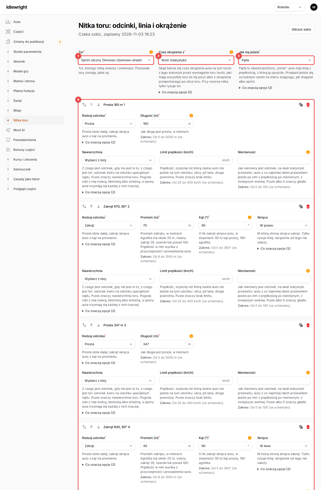

<!-- legenda:nitka-toru -->
1. **Tor.** Tor, którego nitkę widzisz i zmieniasz. Pozostałe tory zostają, jakie są. Wskazówka: Zapisz przed przejściem do innego toru: zmiany toru, który opuszczasz, nie są zachowywane.
2. **Czas okrążenia z.** Skąd bierze się czas okrążenia auta na tym torze: z jego statystyk przez wymagania toru (wzór, jaki mają wszystkie tory do tej pory) albo z okrążenia przejechanego po nitce toru. Przy wzorze nitka tylko rysuje tor. Wskazówka: Zanim przestawisz tor na nitkę, spójrz na tabelę aut pod linią: pokazuje, o ile zmieniłoby się każde okrążenie. Okrążenie auta wzorcowego zostaje czasem bazowym toru tak czy inaczej.
3. **Jak się jedzie.** Pętla to obwód jeżdżony „lotnie”: auto mija linię z prędkością, z którą ją opuściło. Przejazd jedzie się za każdym razem ze startu stojącego, jak dragster albo sprint.
4. **Odcinki.** Nitka jako łańcuch odcinków w kolejności jazdy: proste i zakręty. Kolejność zmieniasz strzałkami; linia obok jest z nich rysowana.
<!-- /legenda -->

### Narzędzia strony „Nitka toru”

Pod listą odcinków są narzędzia, które oszczędzają ręczne liczenie. Wszystkie działają na szkicu: nic się nie zapisze, dopóki nie zapiszesz szkicu.

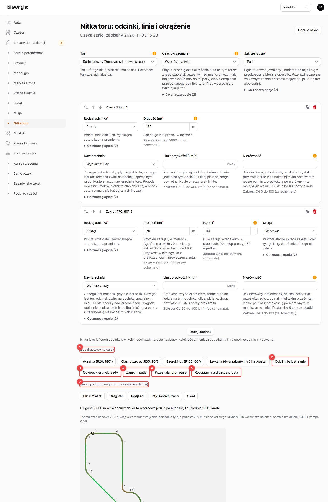

<!-- legenda:nitka-toru-narzedzia -->
1. **Dodaj gotowy kawałek.** Gotowe kawałki toru: agrafka, ciasny zakręt, szeroki łuk i szykana.
2. **Odbij linię lustrzanie.** Odbija linię toru lustrzanie.
3. **Odwróć kierunek jazdy.** Odwraca kierunek jazdy po torze.
4. **Przeskaluj promienie.** Mnoży promień każdego zakrętu przez liczbę: 1,2 robi zakręty o 20% szersze, 0,8 ciaśniejsze. Promień zostaje między 8 a 1000 m. Pętla zapewne przestanie się zamykać: użyj „Zamknij pętlę”.
5. **Rozciągnij najdłuższą prostą.** Robi z najdłuższej prostej nitki prostą o podanej długości, w metrach. Pętla zapewne przestanie się zamykać.
6. **Zamknij pętlę.** Zmienia dwie proste i kąt jednego zakrętu tak, żeby linia wróciła do startu; działa tylko dla przejazdu „Pętla”.
7. **Zacznij od gotowego toru.** To zastępuje sposób jazdy i wszystkie odcinki toru szablonem. Nic się nie zapisze, dopóki nie zapiszesz szkicu.
8. **Na co idzie czas okrążenia.** Przyspieszanie, jazda na limicie, hamowanie, zakręty i powrót na start auta wzorcowego.
9. **Auta: ze wzoru i po nitce.** Ze wzoru to okrążenie, które tor daje dziś; po nitce to okrążenie, które dałby, gdyby jego czas brał się z nitki („Czas okrążenia z” ustawiony na nitkę). Różnica to to, co zmieniłoby przestawienie toru.
<!-- /legenda -->

- **Gotowe kawałki** (agrafka, ciasny zakręt, szeroki łuk, szykana) dopisują kilka odcinków naraz. **Odbij linię lustrzanie** i **Odwróć kierunek jazdy** zmieniają całą linię.
- **Zamknij pętlę** rusza tylko trzy liczby: kąt ostatniego zakrętu (tak, żeby zakręty dawały pełny obrót) i długości dwóch prostych (tak, żeby linia wróciła na start). Działa dla przejazdu „Pętla”. Gdy nie może, mówi po ludzku dlaczego: przejazd się nie zamyka, brakuje liczb w odcinku, brakuje zakrętu albo drugiej prostej, zakręty nie dają pełnego obrotu, żadna para prostych nie zamknie linii.
- **Przeskaluj promienie** i **Rozciągnij najdłuższą prostą** zmieniają kształt; po nich pętla zwykle przestaje się zamykać, więc obok jest „Zamknij pętlę”.
- **Zacznij od gotowego toru** (ulice miasta, dragster, podjazd, rajd, owal) **zastępuje** sposób jazdy i wszystkie odcinki szablonem i pyta o potwierdzenie.
- Kliknięcie linii na rysunku przewija listę do odpowiedniego odcinka i na chwilę go obwodzi.
- Pod rysunkiem są dwa bloki: **na co idzie czas okrążenia** auta wzorcowego (przyspieszanie, jazda na limicie, hamowanie, zakręty, powrót na start) i **auta katalogu: okrążenie ze wzoru i po nitce** z różnicą w procentach, czyli to, jak zmieniłoby się okrążenie każdego auta po przestawieniu toru na nitkę, zanim to zapiszesz.

**Jak sprawdzić, że nowy tor nie psuje tempa gry:** zrób paczkę. Bramka `tracks:simulate --strict` pilnuje, że każde opony pytają o swoją nawierzchnię i że żadne auto nie wygrywa więcej niż dwóch torów, a bramka ekonomii mierzy tempo trzech rodzajów graczy na drabince aut. Ten sam pomiar bez paczki daje „Podgląd balansu” w Studiu (rozdział 7). Dla torów jeżdżonych po nitce `tracks:simulate` liczy też **rozrzut** (najwolniejsze auto podzielone przez najszybsze) i **ostrzega, nie zatrzymując paczki**, gdy jest poniżej 1,15 (tor prawie nic nie wymaga od auta), powyżej 2,2 (większość aut przepada) albo gdy zwycięzca toru wygrywa też co najmniej dwa inne tory. Dlatego przestawiaj tory na nitkę po jednym, patrząc na ostrzeżenia. Jeśli bramka zatrzyma paczkę, raport mówi, który tor i co mu przeszkadza (rozdział 9).

### Jak tor widać w grze: wybór toru

Na mapie, w mieście, w którym stoi auto gracza, karta każdego toru pokazuje miniaturę jego linii (z nitki), zdanie o tym, czego tor wymaga (tor zakrętów, limitu, mocy albo zrównoważony, z udziału czasu okrążenia auta wzorcowego w zakrętach, na limicie i w przyspieszaniu) oraz pasek: w których grupach (przyspieszanie, limit, hamowanie, zakręty) auto gracza zyskuje albo traci względem auta wzorcowego, i jedno zdanie, gdzie zyskuje najwięcej, a gdzie traci najwięcej. Pokazywane są grupy, w których różnica wynosi co najmniej 2% okrążenia. Na torze, którego czas okrążenia liczy wzór, pasek mówi, że czas okrążenia jest ustalony ręcznie, a pasek opisuje kształt toru, nie ten czas; tor bez pełnego auta odniesienia ma tylko linię. Obok tytułu „Tory w tym mieście” widać klasę i PI auta, którym gracz gra (rozdział 15); lista nie mówi nic o rywalach, bo boty są dobierane do tieru auta, chyba że właściciel ustawi krok rywali na klasę. Na ekranie wyścigu auto jedzie po linii toru z prędkością auta takiego, jakie jest teraz, a czas okrążenia zostaje ten, który rozliczenie zamroziło na początku biegu.

---

## 6. Samouczek

**Cel:** ustawić pierwszą jazdę nowego gracza: kroki, wiadomości mentora, nagrody i ułożone pierwsze zlecenia.

Menu Treść → Samouczek. Góra strony to ustawienia pierwszego przejazdu (paliwo na starcie, okrążenie, na którym psuje się pierwsze auto, najdłuższe pierwsze zlecenie warsztatu i ułożone ogłoszenie giełdy). Niżej jest lista **kroków**. Każdy ma fazę, nadawcę (numer mentora), warunek początku i końca, podświetlony element ekranu, do dwóch wiadomości w pięciu językach, przycisk odpowiedzi i nagrodę (gotówka, XP, część albo garaż w mieście).

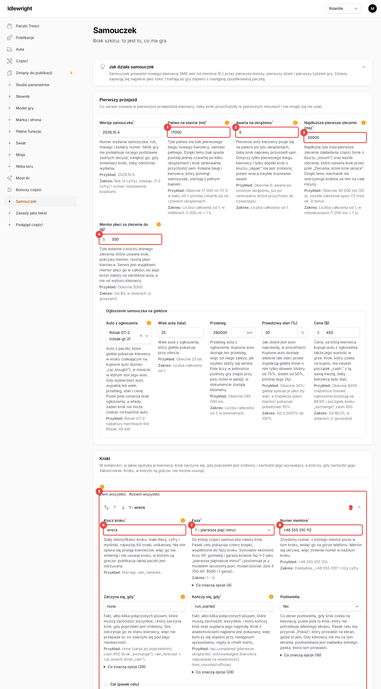

<!-- legenda:samouczek -->
1. **Paliwo na starcie (ml).** Tyle paliwa ma bak pierwszego biegu nowego kierowcy, zamiast pełnego. Dzięki temu bak spada poniżej jednej czwartej po kilku okrążeniach i krok tankowania przychodzi sam. Kolejne biegi i kierowca, który pominął samouczek, startują z pełnym bakiem. Zakres: Liczba całkowita od 1, w mililitrach (1 000 ml = 1 l). Przykład: Obecnie 17 000 ml (17 l) w baku 45 l: poniżej ćwiartki po ok. czterech okrążeniach. Wskazówka: Ustaw tak, żeby ostrzeżenie o paliwie (poniżej 25% baku) przyszło przed okrążeniem awarii, a bak nie opróżnił się, zanim kierowca zdąży zareagować. Gdy bak auta jest mniejszy, obowiązuje jego pojemność.
2. **Awaria na okrążeniu.** Pierwsze auto kierowcy psuje się na pewno po tylu okrążeniach, żeby krok naprawy przyszedł sam. Dotyczy tylko pierwszego biegu kierowcy i tylko dopóki krok o kluczu „repair” nie jest zrobiony; potem wraca zwykłe losowanie awarii. Zakres: Liczba całkowita od 1. Przykład: Obecnie 6: awaria po szóstym okrążeniu, już po tankowaniu (które przychodzi ok. czwartego). Wskazówka: Daj liczbę większą niż okrążenie, na którym przychodzi tankowanie, żeby kroki szły po kolei. Auto, które zrobiło już tyle okrążeń lub więcej, nie psuje się z tego powodu.
3. **Najdłuższe pierwsze zlecenie (ms).** Najdłużej tyle trwa pierwsze zlecenie zakładania części (krok o kluczu „mount”) oraz każde zlecenie, które ustawia krok przez pole „Zlecenia, które krok skraca”. Dzięki temu mechanik nie wstrzymuje kroków za nim na całe minuty. Zakres: Liczba całkowita od 1, w milisekundach (1 000 ms = 1 s). Przykład: Obecnie 30 000 ms (30 s); zwykłe założenie opon T2 trwa ok. 4 minut. Wskazówka: Skraca tylko zlecenie, które i tak byłoby dłuższe; krótszego nie wydłuża. Pierwszy montaż dotyczy kierowcy, który po zrobionej naprawie jest przy kroku „mount” i nie ma jeszcze żadnego zlecenia.
4. **Mentor płaci za zlecenie do ($).** Tyle dolarów z kosztu jednego zlecenia, które ustawia krok, pokrywa mentor; resztę płaci kierowca. Serwis jest wyjątkiem: mentor płaci go w całości, bo jego koszt zależy od zarobków auta, a nie od wyboru kierowcy. Zakres: Od $0, w dolarach (z groszami). Przykład: Obecnie $300. Wskazówka: Dotyczy tylko zleceń z pola „Zlecenia, które krok skraca”. To nie nagroda: pokrywa tylko koszt zlecenia i nic nie trafia do portfela kierowcy.
5. **Kroki samouczka.** Kroki w kolejności, w jakiej kierowca je spotyka. Krok zaczyna się, gdy poprzedni jest zrobiony i zachodzi jego początek, a kończy, gdy zachodzi jego koniec. Przykład: Obecnie 20 kroków: 5 w fazie 1, 5 w fazie 2, 6 w fazie 3 i 4 w fazie 4. Wskazówka: Kolejność jest ważna: krok, którego początek nie zachodzi, wstrzymuje wszystkie za nim. Krok dodany później zaczyna się u każdego kierowcy, który nie zrezygnował z samouczka i nie ma dla niego wiersza, także u tego, który jest już dalej albo go skończył (gdy tylko zachodzi jego początek); u kierowcy, który jest już za nim, nie wstrzymuje kroków za sobą i nie liczy się do jego postępu, dopóki się nie zacznie. Kierowca, który z samouczka zrezygnował, takiego kroku nie dostaje. Kroku, w którym są gracze, nie można usunąć z paczki.
6. **Klucz kroku.** Stały identyfikator kroku: małe litery, cyfry i myślniki, najwyżej 64 znaki, unikatowy. Na nim opiera się postęp kierowców, więc go nie zmieniaj i nie usuwaj kroku, w którym są gracze: publikacja takiej paczki jest odrzucana. Przykład: first-lap, rain, network. Wskazówka: Trzy klucze zna sam serwer: „repair” (awaria pierwszego auta trwa, dopóki ten krok nie jest zrobiony; symulator ekonomii nie liczy jego gotówki jako daru), „mount” (od zrobionej naprawy do zrobionego montażu pierwsze zlecenie jest krótkie) i „crate” (od zrobionego montażu do zrobionej skrzynki pierwsza skrzynka jest za darmo). Nie zmieniaj ich ani kolejności tych kroków. Sprawdzenie paczki ostrzega, gdy któregoś z trzech brakuje.
7. **Faza.** Do której części samouczka należy krok. Pasek celu pokazuje cztery kropki, wypełnione do fazy kroku. Symulator ekonomii liczy XP, gotówkę i garaże kroków faz 1–2 jako „pierwsze piętnaście minut” i porównuje je z modelem (economy.json, model.tutorial: dziś 4 700 XP, $590 i 1 garaż). Zakres: 1 – 4.
8. **Nadawca.** Od kogo są wiadomości tego kroku; widać to na górze urządzenia (telefonu, listu, tabletu). Dowolny tekst, ten sam w każdym języku: numer, nazwa, znak wywoławczy. Puste pole to nadawca urządzenia (sekcja „Urządzenie”). W RideIdle mentor się ukrywa, więc w każdym kroku pisze z innego zmyślonego numeru. Zakres: Najwyżej 40 znaków. Przykład: +48 555 010 120; Kapitanat portu; Kanał 7.
<!-- /legenda -->

**Wersja samouczka** (rok, miesiąc i kolejny numer, na przykład `2026.10.4`) to tylko etykieta wydania: silnik nie podejmuje na jej podstawie decyzji, ale zwiększ ją, gdy zmieniasz kroki, żeby odróżniać wydania. **Kroku, w którym są gracze, nie można usunąć:** publikacja takiej paczki jest odrzucana.

### Urządzenie, słowa i historia na start

Każda gra ma własny samouczek: RideIdle pisze z pękniętego telefonu, gra o statkach może pisać listy, a gra kosmiczna z tabletu albo z urządzenia narysowanego przez grę. Między ustawieniami pierwszego przejazdu a krokami są trzy sekcje:

- **Urządzenie.** Na czym mentor pisze: telefon, list, tablet, zwykłe okno w kolorach gry albo **własny obraz** (wgrywasz obraz ramki z przezroczystym miejscem na ekran i podajesz, ile procent obrazu zostaje od ekranu do każdej krawędzi). Przełączniki wyłączają części urządzenia (pęknięcia ekranu, pasek sieci i baterii, pole odpowiedzi, przycisk „Kto to?”). **Nadawca urządzenia** to nadawca kroków, które nie mają własnego, i pierwszej wiadomości historii, gdy historia nie ma własnego. Krok z własnym nadawcą pisze od niego (tak RideIdle zmienia numer w każdym kroku), więc gdy mentor ma pisać zawsze od tego samego nadawcy, wpisz go i kliknij **„Wszystkie kroki od tego nadawcy”**: przycisk czyści pole „Nadawca” we wszystkich krokach i w historii, a „Zapisz szkic” to zachowuje. **Ikona** to mała ikona na pasku celu (bez niej gra rysuje ikonę urządzenia).
- **Słowa samouczka.** Każdy komunikat samouczka aplikacji (sieć, „Kto to?”, odpowiedź mentora, „Wyślij”, okno pomijania, komunikaty nagród, pasek celu) w pięciu językach. Puste pole to tekst aplikacji, który widać jako podpowiedź; nazwy w klamrach (`{cash}`) muszą zostać. Te słowa nie są już na stronie Słownik.
- **Historia na start.** Co gracz widzi między nadaniem imienia a wyborem wraku: **historia aplikacji** (cztery sceny RideIdle), **własna historia** (obraz, od jednej do sześciu scen z czasem, ruchem kamery i punktem skupienia, pierwsza wiadomość i słowa ekranu) albo **bez historii** (gracz od razu wybiera wrak; sceny zostają w dokumencie na później). `{name}` w tekście sceny to imię gracza.

Nadawca kroku to teraz dowolny tekst (numer, nazwa, znak wywoławczy), najwyżej 40 znaków; gdy ma się różnić między językami, rozwiń „Nadawca w językach”. Wiadomość ma najwyżej 200 znaków, a w liście 400.

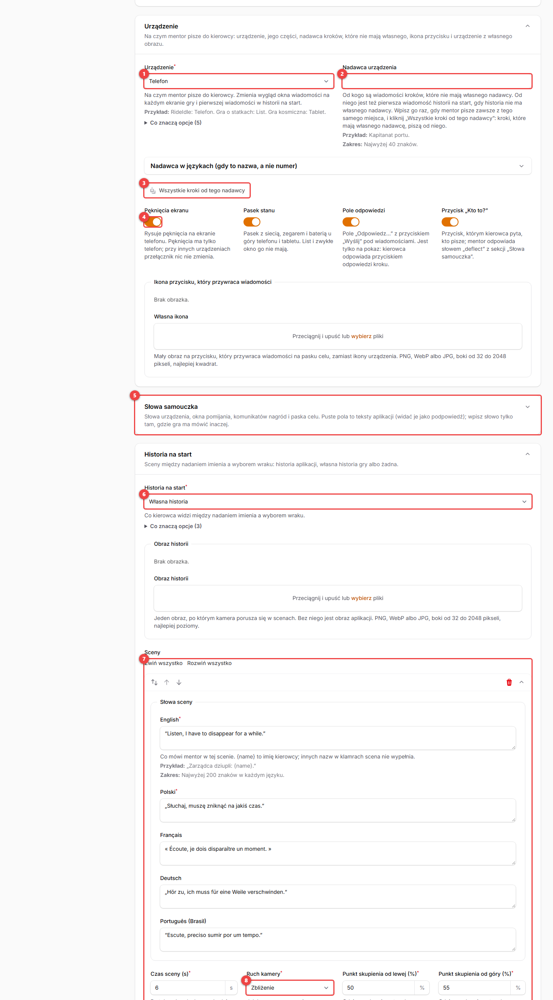

<!-- legenda:samouczek-urzadzenie -->
1. **Urządzenie.** Na czym mentor pisze do kierowcy. Zmienia wygląd okna wiadomości na każdym ekranie gry i pierwszej wiadomości w historii na start. Przykład: RideIdle: Telefon. Gra o statkach: List. Gra kosmiczna: Tablet.
2. **Nadawca urządzenia.** Od kogo są wiadomości kroków, które nie mają własnego nadawcy. Od niego jest też pierwsza wiadomość historii na start, gdy historia nie ma własnego nadawcy. Wpisz go raz, gdy mentor pisze zawsze z tego samego miejsca, i kliknij „Wszystkie kroki od tego nadawcy”: kroki, które mają własnego nadawcę, piszą od niego. Zakres: Najwyżej 40 znaków. Przykład: Kapitanat portu.
3. **Wszystkie kroki od tego nadawcy.** Czyści pole „Nadawca” we wszystkich krokach i w historii, więc wszędzie pisze nadawca urządzenia; działa, gdy nadawca urządzenia jest wpisany.
4. **Pęknięcia ekranu.** Rysuje pęknięcia na ekranie telefonu. Pęknięcia ma tylko telefon; przy innych urządzeniach przełącznik nic nie zmienia.
5. **Słowa samouczka.** Rozwiń, żeby powiedzieć słowa samouczka po swojemu; puste pole to tekst aplikacji.
6. **Historia na start.** Co kierowca widzi między nadaniem imienia a wyborem wraku.
7. **Sceny.** Od jednej do sześciu scen, w kolejności. Każda zostaje na ekranie przez swój czas albo do dotknięcia; w ostatniej przychodzi pierwsza wiadomość. Zakres: 1–6 scen. Przykład: RideIdle: 4 sceny, razem 24 s.
8. **Ruch kamery.** Jak kamera porusza się po obrazie w tej scenie.
<!-- /legenda -->

**Przez asystenta AI:** zaznacz „Samouczek” w Moście AI (rozdział 17). Asystent zmieni urządzenie, nadawców, teksty kroków, słowa i sceny oraz doda nowy krok, ale nie usunie kroku, nie zmieni kolejności i nie wgra obrazu.

**Co się stanie w grze i kiedy:** nowi gracze po następnej paczce zaczynają od nowej wersji samouczka. Urządzenie, nadawcy i słowa zmieniają się po paczce także u graczy, którzy są w trakcie (słowa najpóźniej minutę po niej, bo przeglądarka trzyma je przez 60 s).

**Nie rozstrzygnięte:** co dzieje się z krokami dodanymi później u graczy, którzy są już dalej w samouczku (czy dostaną je, czy nie), nie jest dziś ustalone i nie jest tu opisane. Zanim dodasz krok w środku działającej gry, sprawdź to na koncie testowym.

**Co sprawdzić po zapisaniu:** wypełnij wiadomości mentora we wszystkich pięciu językach (gracz z językiem bez tekstu zobaczy angielski); cel (podświetlony element) musi istnieć na ekranie, który krok pokazuje.

---

## 7. Reguły w Studiu parametrów

**Cel:** zmienić liczby, które ustawiają tempo i pieniądze gry: ceny, czasy, nagrody, zużycie, paliwo.

Menu Treść → Studio parametrów zbiera liczby reguł gry w sekcjach. Liczby są w jednostkach, w jakich się o nich myśli: procenty, sekundy, dolary, litry (Studio przelicza na zapisane wartości samo). **Tryb prosty** (domyślnie włączony) pokazuje tylko liczby, które ustawiają tempo i pieniądze; wyłącz go (przełącznik na górze), żeby zobaczyć wszystkie (to około 750 liczb). Sekcję wybiera się z listy „Sekcja” (w nawiasie liczba liczb w niej; w trybie prostym tylko tych prostych), a pokazana jest jedna sekcja naraz. Każda sekcja ma zdanie **„Co to zmieni”**. Przełącznik **Suwaki**: włączony daje suwak z podpowiedzią wartości tym liczbom, którym schemat podaje granice (reszta zawsze jest polami); wyłączony zostawia same pola, w które wpisuje się dokładną wartość. Przy polu widać też to, co jest teraz w grze (na zrzucie „2 $” przy cenie paliwa).

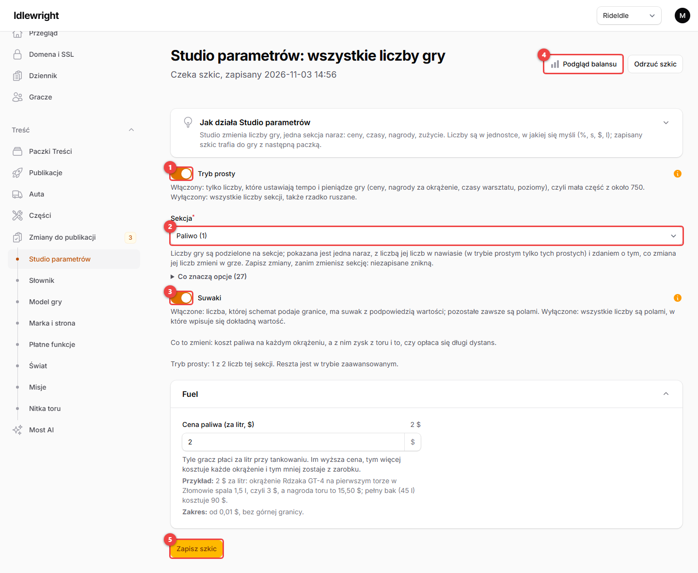

<!-- legenda:studio -->
1. **Tryb prosty.** Włączony: tylko liczby, które ustawiają tempo i pieniądze gry (ceny, nagrody za okrążenie, czasy warsztatu, poziomy), czyli mała część z około 750. Wyłączony: wszystkie liczby sekcji, także rzadko ruszane. Wskazówka: Tryb prosty jest włączony na starcie. Przełączenie odświeża formularz z zapisanego szkicu, więc zapisz zmiany przed przełączeniem.
2. **Sekcja.** Liczby gry są podzielone na sekcje; pokazana jest jedna naraz, z liczbą jej liczb w nawiasie (w trybie prostym tylko tych prostych) i zdaniem o tym, co zmiana jej liczb zmieni w grze. Zapisz zmiany, zanim zmienisz sekcję: niezapisane znikną.
3. **Suwaki.** Włączone: liczba, której schemat podaje granice, ma suwak z podpowiedzią wartości; pozostałe zawsze są polami. Wyłączone: wszystkie liczby są polami, w które wpisuje się dokładną wartość. Wskazówka: Suwak ma krok liczby i nie nadaje się do bardzo szerokich zakresów (ponad 2000 kroków), tam jest pole. Przełączenie odświeża formularz z zapisanego szkicu, więc zapisz zmiany przed przełączeniem.
4. **Podgląd balansu.** Liczy grę na zapisanym szkicu i na żywej paczce i pokazuje je obok siebie, razem z bramkami.
5. **Zapisz szkic.** Zapisuje zmiany jako szkic; nic nie jest opublikowane.
<!-- /legenda -->

### Wartość z żywej paczki i powrót do niej

Przy liczbie zmienionej względem żywej paczki Studio pokazuje, co jest teraz w grze. Pasek zmian pod formularzem wypisuje „pole: było → będzie” i pozwala cofnąć jedno pole („Cofnij”) albo wszystkie („Cofnij wszystko”). „Odrzuć szkic” u góry wraca całej strony do żywej paczki.

### Podgląd balansu i jak czytać bramki

**„Podgląd balansu”** liczy skutek zmian na ekonomii, zanim zrobisz paczkę: tempo trzech rodzajów graczy na drabince aut (docelowy dzień kontra dzień, w którym gracz dojdzie według szkicu, z odchyleniem) i bramki publikacji. Zielone „przeszło” znaczy, że bramka dopuszcza paczkę; czerwone „nie przeszło” pokazuje fragment wyjścia symulatora (które auto, który dzień, jakie odchylenie).

### Przykład: zmieniamy cenę paliwa

Dziś litr kosztuje 2 $. Zgodnie z opisem pola, okrążenie Rdzaka GT-4 na pierwszym torze w Złomowie spala 1,5 l (3 $), a pełny bak (45 l) kosztuje 90 $.

1. Studio, sekcja „Paliwo”, pole „Cena paliwa (za litr, $)”.
2. Wpisz 2,20.
3. Kliknij „Podgląd balansu”: sprawdź, że bramki przechodzą.
4. „Zapisz szkic”. Pasek zmian pokaże „Cena paliwa: 2 $ → 2,20 $”.
5. Zrób paczkę (rozdział 9).

**Co się stanie w grze i kiedy:** po uruchomieniu paczki okrążenie na tym torze kosztuje gracza 3,30 $ zamiast 3 $, a pełny bak 99 $ zamiast 90 $. Zarobek na okrążeniu (15,50 $) się nie zmienia, więc zostaje z niego mniej.

**Zasada pracy:** zmień jedną sekcję i zapisz, zanim przejdziesz do następnej. Zmiana kilku sekcji naraz utrudnia wskazanie, co zatrzymało bramkę.

### Zasady jako tekst (tryb zaawansowany)

Menu Treść → Zasady jako tekst to cały dokument reguł jako JSON, dla zmian, których formularze jeszcze nie obsługują. **Błąd w tym tekście nie wyłączy gry**: zapis jest sprawdzany schematem i odrzucany z komunikatem, a efekt trafia do graczy dopiero z paczką. Mimo to używaj tej strony tylko wtedy, gdy Studio nie ma pola, które potrzebujesz.

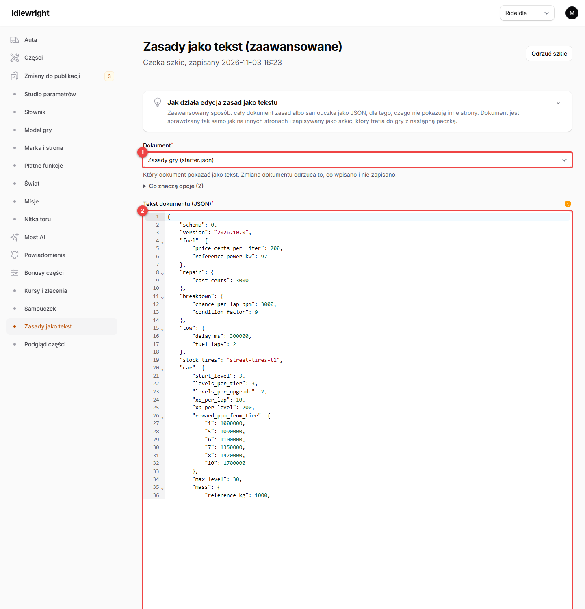

<!-- legenda:zasady-tekst -->
1. **Dokument.** Który dokument pokazać jako tekst. Zmiana dokumentu odrzuca to, co wpisano i nie zapisano.
2. **Tekst dokumentu (JSON).** Cały dokument jako JSON, dla tego, czego nie pokazują inne strony. Sprawdza go ten sam schemat i te same reguły świata co na innych stronach; zapis tworzy szkic, który trafia do gry z następną paczką. Wskazówka: Błąd składni (np. brakujący przecinek) pokazuje samo pole i nic się nie zapisuje; błąd treści (zła wartość, brakujące pole) pokazuje czerwone powiadomienie z miejscem i powodem (do ośmiu pierwszych), również bez zapisu. Dokument równy opublikowanemu nie zostawia szkicu.
3. **Zapisz szkic.** Sprawdza tekst schematem i zapisuje go jako szkic.
<!-- /legenda -->

---

## 8. Model gry, słownik, marka i strona

### Model gry

**Cel:** zmienić, z jakich slotów i statystyk składa się auto w tej grze (na przykład „kadłub” zamiast „nadwozia” w grze o statkach).

Model opisuje **sloty** (klucz, rolę i to, czy slot jest ukryty w garażu) oraz **statystyki**. Kod gry pyta o **rolę** slotu, nie o jego nazwę, więc slot „kadłub” z rolą opon jeździ tak, jak opony. Slotu, w którym gracze mają części, nie da się usunąć przy publikacji: bramka to zatrzyma.

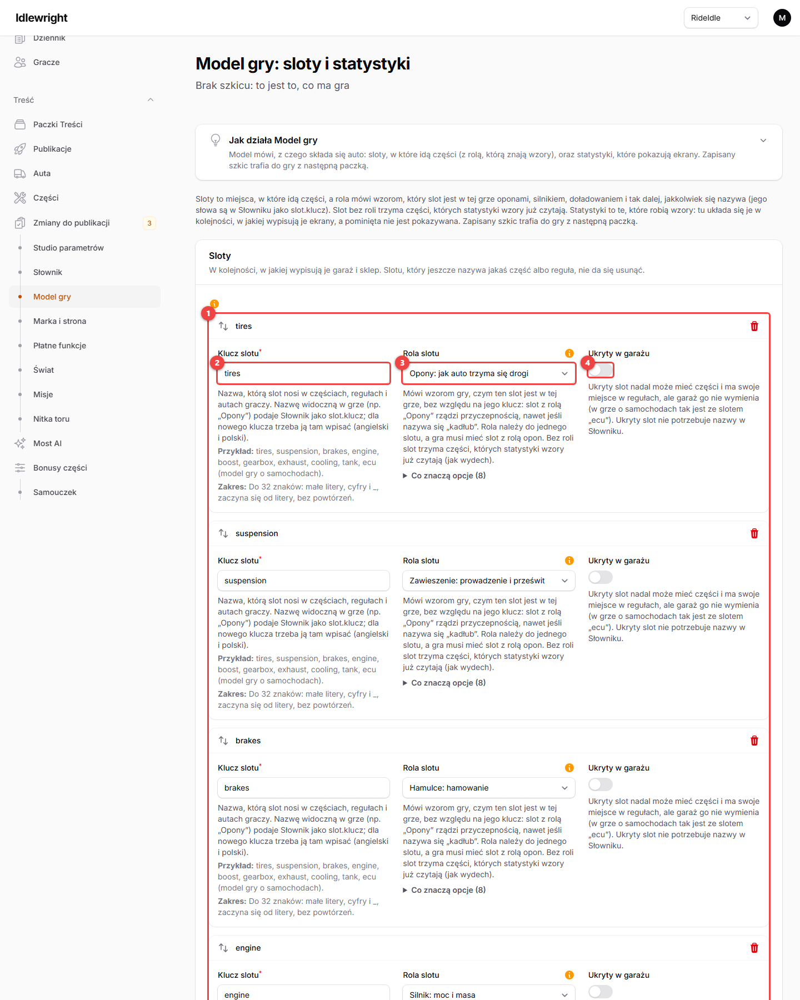

<!-- legenda:model-gry -->
1. **Sloty.** Miejsca w aucie, w które idą części, w kolejności, w jakiej wypisują je garaż i sklep. Od 1 do 24 slotów; przeciągnij wiersz, żeby zmienić kolejność. Zakres: Od 1 do 24 slotów. Wskazówka: Slotu, który jeszcze nazywa jakaś część albo reguła, nie da się usunąć: zapis zostanie odrzucony z listą miejsc, które go używają. Publikacja nie wyjmie też slotu, w którym gracze mają części, więc zmiana klucza używanego slotu jest zablokowana.
2. **Klucz slotu.** Nazwa, którą slot nosi w częściach, regułach i autach graczy. Nazwę widoczną w grze (np. „Opony”) podaje Słownik jako slot.klucz; dla nowego klucza trzeba ją tam wpisać (angielski i polski). Zakres: Do 32 znaków: małe litery, cyfry i _, zaczyna się od litery, bez powtórzeń. Przykład: tires, suspension, brakes, engine, boost, gearbox, exhaust, cooling, tank, ecu (model gry o samochodach).
3. **Rola slotu.** Mówi wzorom gry, czym ten slot jest w tej grze, bez względu na jego klucz: slot z rolą „Opony” rządzi przyczepnością, nawet jeśli nazywa się „kadłub”. Rola należy do jednego slotu, a gra musi mieć slot z rolą opon. Bez roli slot trzyma części, których statystyki wzory już czytają (jak wydech). Wskazówka: Części w slocie z rolą opon muszą mieć rodzaj opon, a w slocie z rolą silnika silnik (układ i pojemność); w innych slotach części nie mają tych pól.
4. **Ukryty w garażu.** Ukryty slot nadal może mieć części i ma swoje miejsce w regułach, ale garaż go nie wymienia (w grze o samochodach tak jest ze slotem „ecu”). Ukryty slot nie potrzebuje nazwy w Słowniku.
5. **Statystyki.** Statystyki auta, które pokazują ekrany garażu i warsztatu, w kolejności listy. Pominięta statystyka nie jest pokazywana, a nowej dodać się nie da, bo statystyki liczą wzory. Wskazówka: Lista wpływa tylko na to, co widać, i na ogólny wynik auta (średnia pasków). Żaden wzór wyścigu jej nie czyta, więc pominięcie statystyki nie zmienia jazdy.
<!-- /legenda -->

### Słownik

**Cel:** zmienić słowa aplikacji dla tej gry (nazwy slotów, menu, teksty ekranów) osobno w każdym z pięciu języków.

Wybierz **obszar** (pierwsze słowo klucza: `menu`, `workshop`, `shop` i tak dalej) albo wyszukaj fragment klucza lub tekstu. Puste pole to tekst aplikacji; wpisz słowo tylko tam, gdzie gra ma mówić inaczej. Angielski i polski uzupełniają się tekstem aplikacji, a język bez własnego tekstu dostaje angielski tekst paczki. „Tylko zmienione przez paczkę” pokazuje to, co gra mówi inaczej niż aplikacja domyślna.

Dwa przyciski u góry: **„Pobierz słownik”** zapisuje słownik do pliku, a **„Wczytaj motyw”** wczytuje gotowy zestaw słów (przykład: [`content/themes/ships.json`](../content/themes/ships.json), statki zamiast aut).

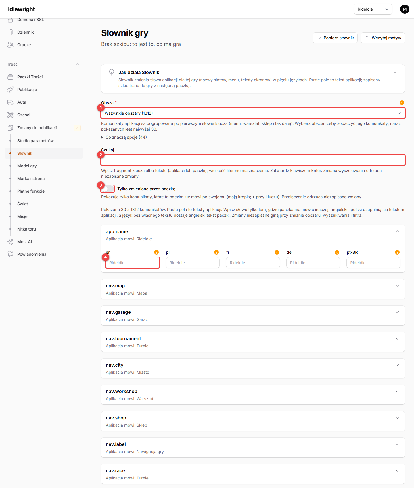

<!-- legenda:slownik -->
1. **Obszar.** Komunikaty aplikacji są pogrupowane po pierwszym słowie klucza (menu, warsztat, sklep i tak dalej). Wybierz obszar, żeby zobaczyć jego komunikaty; naraz pokazanych jest najwyżej 30. Wskazówka: Obszar „server.game” to teksty serwera (odmowy zasad gry, rzadkości, pogoda), a nie aplikacji. Zmiana obszaru, wyszukiwania albo filtra odrzuca niezapisane zmiany.
2. **Szukaj.** Wpisz fragment klucza albo tekstu (aplikacji lub paczki); wielkość liter nie ma znaczenia. Zatwierdź klawiszem Enter. Zmiana wyszukiwania odrzuca niezapisane zmiany.
3. **Tylko zmienione przez paczkę.** Pokazuje tylko komunikaty, które ta paczka już mówi po swojemu (mają kropkę ● przy kluczu). Przełączenie odrzuca niezapisane zmiany.
4. **Tekst w danym języku.** Puste pole to tekst aplikacji, widoczny w polu jako podpowiedź. Wpisz tekst tylko tam, gdzie paczka ma mówić inaczej. Zakres: Do 400 znaków w każdym języku. Wskazówka: Zostaw nazwy w klamrach, np. {name}, dokładnie jak w oryginale (w tekstach serwera nazwa ma dwukropek na początku), tyle samo form liczby mnogiej oddzielonych znakiem |, bez innych klamer i bez linków @:. Język z pustym polem dostaje angielski tekst paczki, a nie tekst aplikacji w tym języku.
<!-- /legenda -->

**Uwaga:** zmiany niezapisane giną przy zmianie obszaru, wyszukiwania i filtra, więc zapisz szkic, zanim przejdziesz dalej. W Słowniku można też przemianować klasy aut (klucze `car.className.F` do `car.className.SS`, rozdział 15).

### Marka i strona

**Cel:** zmienić wygląd gry dla graczy: kolory, czcionki, własny CSS, stronę startową i podgląd linku.

Kolory aplikacji (tło, powierzchnie kart, linie i inne), czcionki, własny arkusz CSS (**oczyszczany z niebezpiecznych rzeczy**: to, co odrzucone, jest wymienione przy zapisie), bloki strony startowej i podgląd linku, który widać po wklejeniu adresu gry w komunikatorze. Każde pole mówi, gdzie w aplikacji widać zmianę.

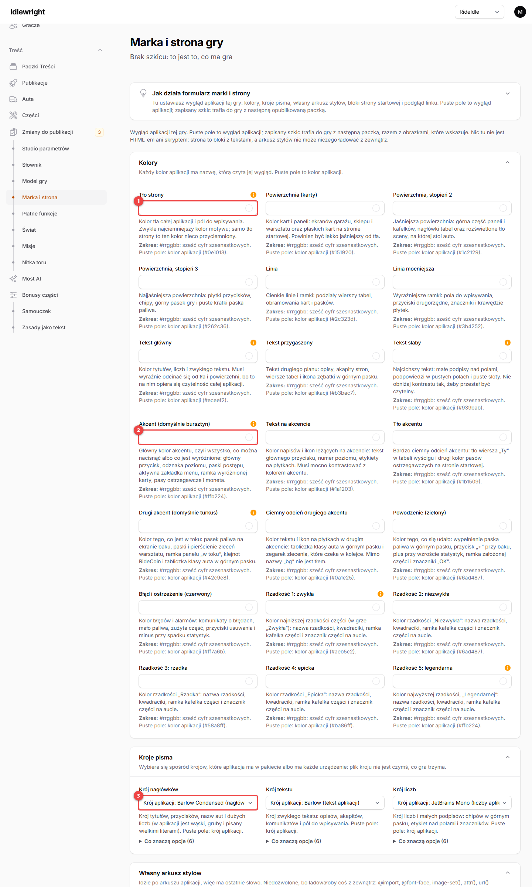

<!-- legenda:marka -->
1. **Tło strony.** Kolor tła całej aplikacji i pól do wpisywania. Zwykle najciemniejszy kolor motywu; samo tło strony to ten kolor nieco przyciemniony. Zakres: #rrggbb: sześć cyfr szesnastkowych. Puste pole: kolor aplikacji (:default). Wskazówka: Od tego koloru liczone są też ciemne wnęki i cienie pod panelami, więc jego zmiana przesuwa cały „dół” motywu.
2. **Akcent (domyślnie bursztyn).** Główny kolor akcentu, czyli wszystko, co można nacisnąć albo co jest wyróżnione: główny przycisk, odznaka poziomu, paski postępu, aktywna zakładka menu, ramka wyróżnionej karty, pasy ostrzegawcze i moneta. Zakres: #rrggbb: sześć cyfr szesnastkowych. Puste pole: kolor aplikacji (:default). Wskazówka: Jasne i ciemne odcienie przycisku, jego krawędź i poświata są liczone z tego jednego koloru. „Amber” to tylko nazwa roli: kolor może być dowolny.
3. **Krój nagłówków.** Krój tytułów, przycisków, nazw aut i dużych liczb (w aplikacji jest wąski, gruby i pisany wielkimi literami). Puste pole: krój aplikacji.
4. **Własny arkusz stylów (CSS).** Reguły CSS, które idą po arkuszu aplikacji i mają ostatnie słowo, więc mogą zmienić wygląd dowolnego elementu. Arkusz nie może niczego ładować z zewnątrz: odrzucane są @import, @font-face, @namespace, image-set(), src(), image(), element(), cross-fade(), paint(), attr(), expression(), javascript:, behavior:, -moz-binding, każde url() poza obrazkiem gry (/api/v1/media/nazwa) oraz odwrotny ukośnik poza tekstem w cudzysłowie. Zakres: Najwyżej 20 000 bajtów (litera spoza ASCII to 2 do 4 bajtów). Przykład: .ttl { text-shadow: none; } zdejmuje cień spod tytułów ekranów. Wskazówka: Arkusz jest czytany tak jak w przeglądarce: komentarze i teksty w cudzysłowie są pomijane, więc content: "\201C" jest dozwolone. Arkusz, który nie przechodzi, nie jest zapisywany, a komunikat podaje powód każdej odrzuconej rzeczy; nigdy nie jest przyjmowany częściowo. Obrazek w url() musi już być w magazynie obrazków gry (wgrywa się go w panelu), a jego nazwa to 64 znaki szesnastkowe z rozszerzeniem png, webp albo jpg.
5. **Tytuł podglądu linku.** Tytuł, który pokazuje czat albo serwis społecznościowy, gdy ktoś wklei adres gry. To jeden tekst, bez języków. Puste pole: nazwa gry. Zakres: Do 70 znaków.
<!-- /legenda -->

**Co się stanie w grze i kiedy:** jak wszystko inne, marka trafia do graczy z paczką. Podgląd linku w komunikatorach odświeża się dopiero, gdy komunikator ponownie pobierze stronę (część z nich zapamiętuje podgląd na dni).

**Co sprawdzić po zapisaniu:** kontrast tekstu do tła na obu stronach (panel pokazuje podgląd), a także czy własny CSS nie został w całości odrzucony.

---

## 9. Szkice i publikowanie

**Cel:** zamienić zapisane szkice w zmianę, którą widzą gracze, tak żeby nic nie zepsuć.

### Zmiany do publikacji

Strona zbiera wszystkie szkice gry. Na górze jest podsumowanie („Definicji ze szkicem: 3. Zmian razem: 1.”) i numer żywej paczki. Pod nim każda definicja ze szkicem: nazwa, rodzaj (Auto, Część, Reguły), znacznik „zmieniona” albo „bez różnic”, liczba zmian i kiedy zapisano szkic. Przy zmienionej definicji jest tabela: **Gdzie** w dokumencie, co **Było** i co **Będzie** (na zrzucie cena Rdzaka GT-4 w centach: 2 150 000 → 2 257 500, czyli 21 500 $ → 22 575 $), a przycisk „Otwórz” prowadzi do formularza. „Przejdź do publikacji” prowadzi dalej. Nic na tej stronie nie zmienia gry.

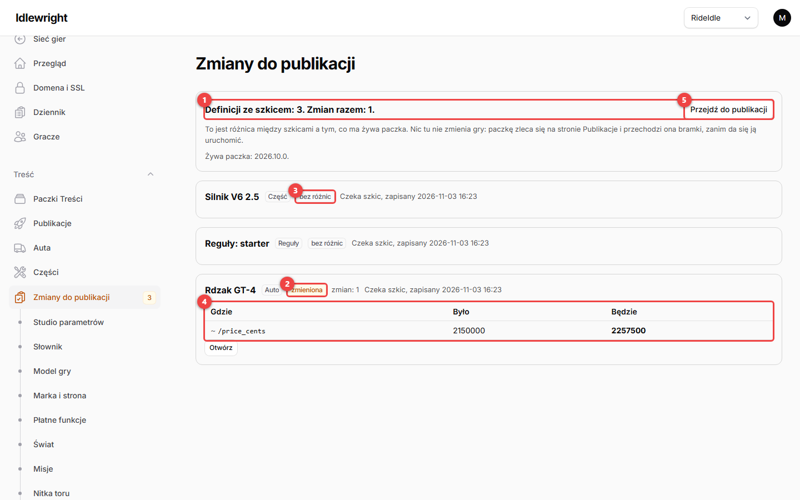

<!-- legenda:zmiany -->
1. **Podsumowanie.** Ile definicji ma szkic, ile zmian razem i numer żywej paczki.
2. **Zmieniona.** Szkic różni się od ostatnio opublikowanej wersji; obok liczba zmian i kiedy zapisano szkic.
3. **Bez różnic.** Szkic, który mówi to samo co ostatnio opublikowana wersja dokumentu (tu: ten, który jest już w zrobionej paczce).
4. **Gdzie, było, będzie.** Każda zmiana: gdzie w dokumencie (tu: cena auta w centach), co było i co będzie.
5. **Przejdź do publikacji.** Prowadzi do strony Publikacje, gdzie robi się paczkę z szkiców.
<!-- /legenda -->

**Uwaga o „bez różnic”.** Strona porównuje szkic z **ostatnio opublikowaną wersją** dokumentu, a ta obejmuje także paczkę, która jest już zrobiona, ale jeszcze nie uruchomiona. Dlatego szkic, który taka paczka zawiera (na zrzucie Silnik V6 2.5 i Reguły: starter), pokazuje „bez różnic”, choć gra jeszcze go nie ma: okno „Zrób paczkę z szkiców” i raport paczki liczą różnice względem paczki żywej. Gdy te dwa miejsca mówią co innego, wierz raportowi paczki i pamiętaj, że decyduje to, co jest żywe.

### Zrób paczkę

Na stronie **Publikacje** przycisk **„Zrób paczkę z szkiców”** zleca zbudowanie paczki. Paczkę robi zadanie w tle: sprawdza, że nic, czego używają gracze, nie zniknęło, waliduje treść, przelicza tabele pochodne i uruchamia pięć **bramek symulatorów**. Lista pokazuje stan każdej paczki: **Czeka**, **Robi się**, **Gotowa** albo **Zatrzymana** (kolumna „Zatrzymana na” mówi wtedy, na którym kroku).

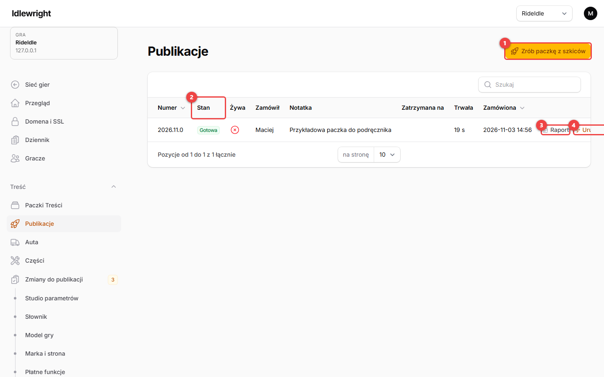

<!-- legenda:publikacje -->
1. **Zrób paczkę z szkiców.** Zleca zbudowanie paczki z wszystkich szkiców gry (okno z listą zmian i notatką).
2. **Stan.** Czy paczka czeka, robi się, jest gotowa albo została zatrzymana.
3. **Raport.** Okno z tym, co się stało: bramki, zmiany, tabele pochodne i czas kroków.
4. **Uruchom.** Po potwierdzeniu robi z gotowej paczki żywą treść gry.
<!-- /legenda -->

Przycisk otwiera okno: lista szkiców, które wejdą do paczki (dokument i to, co z nim zrobiono), pole **Notatka** (zostaje przy publikacji i mówi, po co powstała paczka) i „Zrób paczkę”. Samo budowanie trwa kilka minut, bo to bramki i symulatory.

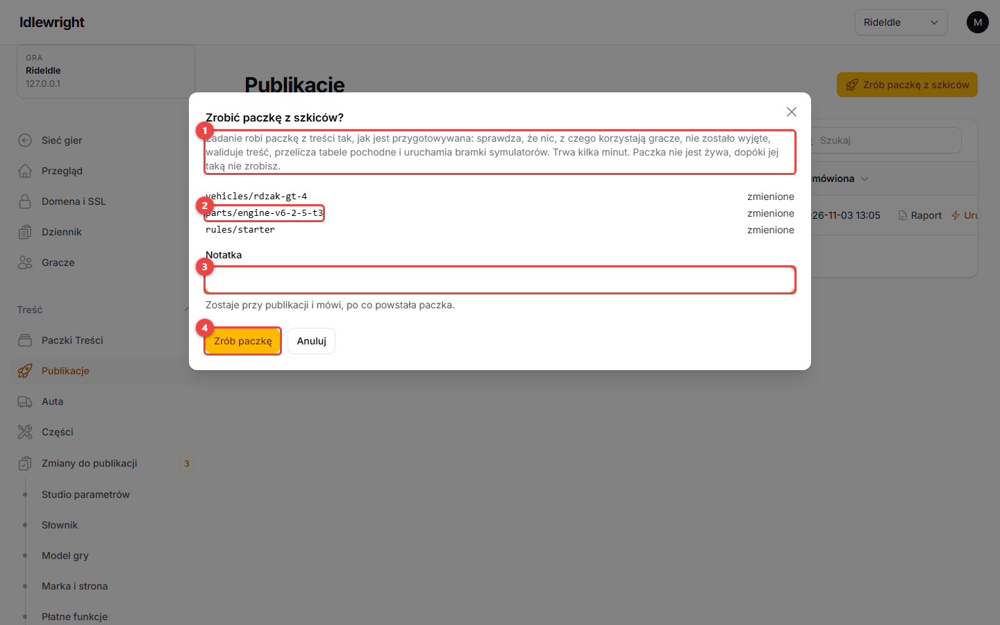

<!-- legenda:zrob-paczke -->
1. **Co robi zadanie.** Zadanie robi paczkę z treści tak, jak jest przygotowywana: sprawdza, że nic, z czego korzystają gracze, nie zostało wyjęte, waliduje treść, przelicza tabele pochodne i uruchamia bramki symulatorów. Trwa kilka minut. Paczka nie jest żywa, dopóki jej taką nie zrobisz.
2. **Lista zmian.** Szkice, które wejdą do paczki: dokument i to, co z nim zrobiono (tu: zmienione).
3. **Notatka.** Zostaje przy publikacji i mówi, po co powstała paczka.
4. **Zrób paczkę.** Zleca zbudowanie paczki; stan widać potem na liście publikacji.
<!-- /legenda -->

**Na serwerze zadanie wykonuje kolejka** (`rideidle-queue`). Gdy kolejka nie działa, paczka zostaje w stanie „Czeka”: poproś administratora serwera o jej uruchomienie.

### Bramki: co sprawdzają

| Bramka | Co sprawdza |
|---|---|
| `tracks:simulate --strict` | każde opony pytają o swoją nawierzchnię, teren się liczy, a żadne auto nie wygrywa więcej niż dwóch torów |
| `economy:simulate --strict --strict-game` | tempo trzech rodzajów graczy po drabince aut jest takie, jak w projekcie; liczby reguł są kotwicami; drabinka poziomów i flota gry są w normie |
| `missions:budget --strict` | miesiąc nagród misji to zatwierdzony udział gotówki i XP (15–100% gotówki i 5–50% XP z 30 baków dla kierowcy na 12. poziomie) |
| `tuning:budget --strict` | najlepszy zestaw bonusów części nie zdejmuje z okrążenia więcej, niż zatwierdzono (pułap 12% okrążenia przy celu 10%, a dla dochodu cel 15% i pułap 35%) |
| `gigs:report --strict` | godzina kursów nie płaci poza granicami wobec drabiny aut (R1) i nie bije okrążeń tego samego auta na jego najlepszej trasie (R2) |

Bramka, która nie przeszła, **zatrzymuje paczkę** (stan „Zatrzymana”): „Raport” przy paczce wskazuje, która bramka, i pokazuje fragment jej wyjścia. Wróć do formularza, popraw liczbę i zrób paczkę jeszcze raz. Paczka, która się zatrzymała, nie zmienia niczego w grze.

### Raport

**„Raport”** przy paczce mówi, co się stało: stan paczki, kto ją zamówił i z jaką notatką, które bramki przeszły i w jakim czasie, co paczka zmienia, które tabele pochodne przeliczono (i czy się zmieniły) oraz ile trwał każdy krok.

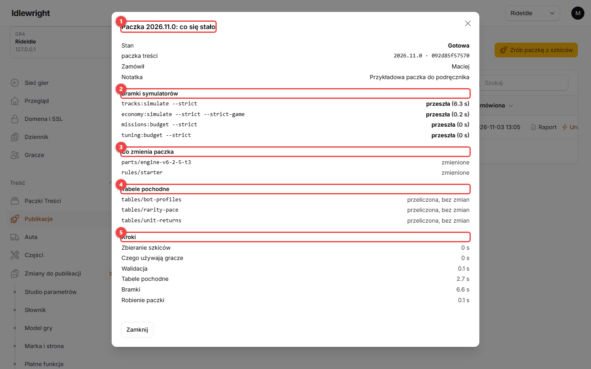

<!-- legenda:raport-paczki -->
1. **Nagłówek raportu.** Numer paczki; niżej stan (tu: Gotowa), numer i suma kontrolna paczki treści, kto ją zamówił i notatka.
2. **Bramki symulatorów.** Bramki z czasem działania i werdyktem: przeszła albo nie (przy niepowodzeniu także fragment wyjścia).
3. **Co zmienia paczka.** Dokumenty, które paczka zmienia, i co z nimi zrobiono.
4. **Tabele pochodne.** Tabele liczone z treści i to, czy się zmieniły (tu: przeliczona, bez zmian).
5. **Kroki.** Czas każdego kroku zadania, od zbierania szkiców do robienia paczki.
<!-- /legenda -->

### Uruchomienie

Gdy raport jest czysty, **„Uruchom”** przy paczce (na liście publikacji albo na stronie „Paczki Treści”) pyta o potwierdzenie i robi z paczki żywą treść. Panel mówi to wprost: od teraz gra czyta tę treść; biegi są rozliczane tym, z czym były zamrożone, i przy następnym rozliczeniu zamrażane od nowa dla tej paczki; a paczka jest najpierw sprawdzana i odrzucana, jeśli nie pasuje do tej wersji gry.

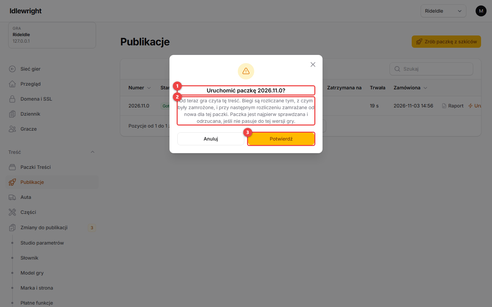

<!-- legenda:uruchom-paczke -->
1. **Pytanie.** Numer paczki, którą panel ma uruchomić.
2. **Co się stanie.** Od teraz gra czyta tę treść. Biegi są rozliczane tym, z czym były zamrożone, i przy następnym rozliczeniu zamrażane od nowa dla tej paczki. Paczka jest najpierw sprawdzana i odrzucana, jeśli nie pasuje do tej wersji gry.
3. **Potwierdź.** Uruchamia paczkę: od tej chwili jest żywą treścią gry.
<!-- /legenda -->

Strona **Paczki Treści** to lista wszystkich paczek gry. Zielony znak w kolumnie „Żywa” oznacza paczkę, którą gra czyta teraz (na zrzucie: starsza paczka 2026.10.0; nowa, 2026.11.0, jest gotowa i czeka na „Uruchom”). Stąd też pobiera się paczkę jako jeden plik i wczytuje paczkę z pliku, żeby przenieść treść między instalacjami albo grami.

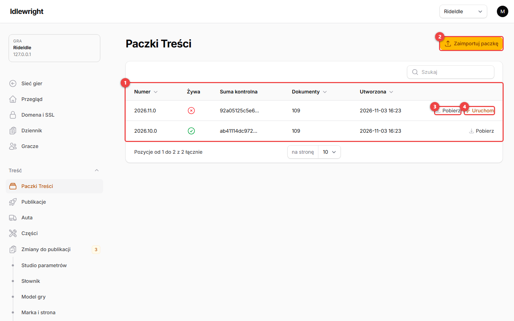

<!-- legenda:paczki -->
1. **Lista paczek.** Wszystkie paczki gry: numer, czy jest żywa (zielony znak), suma kontrolna, liczba dokumentów i data.
2. **Zaimportuj paczkę.** Wczytuje paczkę z pliku, na przykład z innej instalacji albo gry.
3. **Pobierz.** Zapisuje paczkę jako jeden plik.
4. **Uruchom.** Robi z tej paczki żywą treść gry; cofnięcie zmiany to uruchomienie wcześniejszej paczki.
<!-- /legenda -->

**Co się stanie w grze i kiedy:** po „Uruchom” wszystkie nowe wejścia graczy czytają nową treść od razu. Trwające biegi graczy (jazdy, zlecenia warsztatu) przechodzą na nową treść **przy swoim następnym rozliczeniu**, nie w połowie. Gracze zachowują wszystko, co mają: części, auta i pieniądze.

**Co sprawdzić po uruchomieniu:** numer żywej paczki na Przeglądzie gry zgadza się z uruchomioną; Dziennik zawiera wpis „uruchomienie paczki”; a przy większej zmianie zajrzyj do gry jako gracz testowy.

---

## 10. Wycofanie zmian

**Cel:** cofnąć złą zmianę.

Są dwa sposoby, zależnie od tego, jak daleko zaszła zmiana:

1. **Szkic jeszcze nie opublikowany:** na stronie, której zmiana dotyczy, „Odrzuć szkic” (całą stronę) albo „Cofnij” przy jednym polu (pasek zmian). Gra niczego nie zauważy, bo szkic nigdy do niej nie trafił.
2. **Paczka już uruchomiona:** menu Treść → Paczki Treści, poprzednia paczka, **„Uruchom”**. Wcześniejsze paczki zostają, więc cofnięcie to ponowne uruchomienie starej, bez żadnego importu. Przed uruchomieniem panel sprawdza treść paczki jeszcze raz kodem, który działa teraz, więc paczka, która przestała pasować do schematu, zostanie odrzucona z komunikatem.

**Co się dzieje ze szkicami:** po uruchomieniu paczki znikają szkice, które mówiły to samo co paczka. **Szkic zapisany po zrobieniu paczki zostaje**, także po cofnięciu do wcześniejszej paczki, więc nic nie piszesz od nowa. Cofnięcie nie zmienia też stanu (aktywna, wycofana) tych definicji, których starsza paczka nie zawiera.

**Co się dzieje z kontami graczy:** konta, auta, części i pieniądze graczy są osobno od paczki i się nie cofają. Trwające biegi przechodzą na wycofaną treść przy swoim następnym rozliczeniu. **Nie cofniesz w ten sposób tego, co stało się z graczami w czasie, gdy zła paczka była uruchomiona** (na przykład nagród, które już wypłacono). **Nie sprawdzono**, jak wygląda gra po cofnięciu do paczki, w której nie ma przedmiotu dodanego w nowszej paczce, a który gracze już mają; zamiast cofać, wycofaj taki przedmiot z oferty (rozdziały 3 i 4).

Wycofanie pojedynczego przedmiotu z oferty (bez cofania całej paczki) robi „Wycofaj z oferty” na formularzu auta albo części (rozdziały 3 i 4).

**Co sprawdzić po wycofaniu:** numer żywej paczki w Przeglądzie i wpis w Dzienniku.

---

## 11. Gracze i dziennik

### Gracze

**Cel:** zobaczyć, kto gra w tej grze i jak. Panel **niczego nie robi na kontach graczy**: nie ma tu akcji zmieniających konto, tylko podgląd.

Lista pokazuje konta gry, w której pracuje panel: nazwę, rodzaj konta (gość albo zabezpieczone), e-mail, poziom, gotówkę, monety, auta, zakupy za pieniądze, język, datę założenia i ostatnią aktywność. Wyszukiwanie po nazwie i e-mailu, filtry: rodzaj konta, aktywność (doba, tydzień, nieaktywni), nowi w tygodniu, płacący i język. Strona konta pokazuje szczegóły i wizyty.

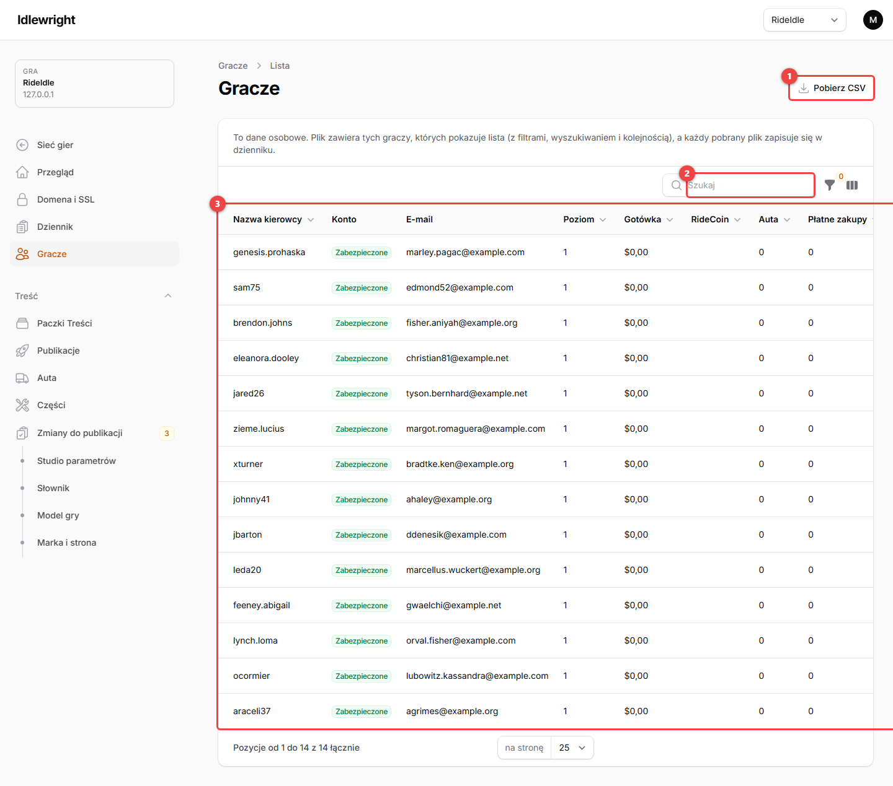

<!-- legenda:gracze -->
1. **Pobierz CSV.** Plik z tymi graczami, których pokazuje lista (z filtrami, wyszukiwaniem i kolejnością); to dane osobowe, a każdy pobrany plik zapisuje się w dzienniku; tylko dla wydawcy.
2. **Szukaj.** Wyszukuje graczy po nazwie i adresie e-mail.
3. **Lista graczy.** Konta tej gry: nazwa, rodzaj konta, e-mail, poziom, gotówka, monety, auta i płatne zakupy; kolejne kolumny (język, daty) włącza się przyciskiem kolumn.
<!-- /legenda -->

**Plik CSV** („Pobierz CSV”) widzi i pobiera tylko **wydawca**. To są **dane osobowe**: plik zawiera tych graczy, których pokazuje lista (z filtrami, wyszukiwaniem i kolejnością), a **każdy pobrany plik zapisuje się w dzienniku**. Przechowuj go tak jak inne dane osobowe i usuń, gdy przestanie być potrzebny.

**Nie sprawdzono:** samego pobrania pliku CSV w przeglądarce (generowanie sprawdzają testy).

### Dziennik

Dziennik zapisuje każde logowanie, zapis, publikację, uruchomienie paczki i pobranie pliku CSV, z osobą, grą i szczegółami. Widzi go wydawca. Zajrzyj tu, gdy trzeba ustalić, kto i kiedy zmienił coś w grze.

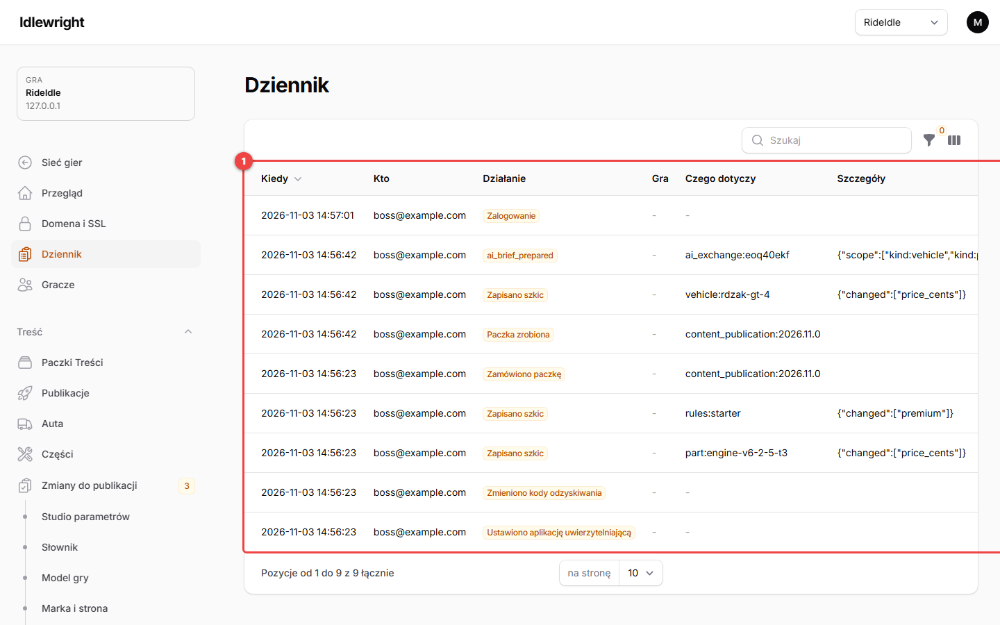

<!-- legenda:dziennik -->
1. **Dziennik.** Co zrobił który administrator, w jakiej grze i z jakiego adresu; tabela tylko się dopisuje.
<!-- /legenda -->

---

## 12. Płatne funkcje i misje

### Płatne funkcje

**Cel:** ustawić walutę premium gry (RideCoin), przyspieszenia, automatyczne tankowanie, konto VIP i przepustkę.

Strona ma zakładki **Monety** (klucz i nazwa waluty premium w pięciu językach, waluta cen, ile minut timera skraca jedna moneta, paczki monet: mała, średnia, duża i ogromna), **Automatyczne tankowanie**, **Konto VIP** i **Przepustka nieskończonego tankowania**. Ceny wpisuje się w pieniądzach, a bonusy w procentach. Pod formularzem są linie, które liczą za ciebie: cenę jednej monety, premię paczek, ile kosztuje VIP i paczka tankowań w pieniądzach.

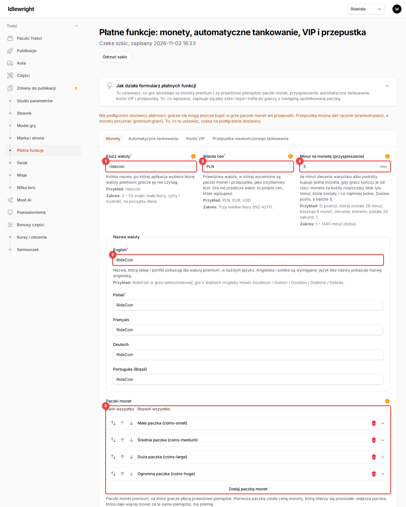

<!-- legenda:platne-funkcje -->
1. **Klucz waluty.** Krótka nazwa, po której aplikacja wybiera ikonę waluty premium; gracze jej nie czytają. Zakres: 2 – 32 znaki: małe litery, cyfry i myślniki, na początku litera. Przykład: ridecoin. Wskazówka: Zmieniaj go razem z aplikacją: klucz wybiera ikonę, a monety, które gracze mają, od niego nie zależą.
2. **Nazwa waluty.** Nazwa, którą sklep i portfel pokazują dla waluty premium, w każdym języku. Angielska i polska są wymagane; język bez nazwy pokazuje nazwę angielską. Przykład: RideCoin w grze samochodowej; gra o statkach mogłaby mówić Doubloon / Dublon / Doublon / Dublone / Dobrão.
3. **Waluta cen.** Prawdziwa waluta, w której wycenione są paczki monet i przepustka, jako trzyliterowy kod. Gra nie przelicza walut: to podpis cen, które wpisujesz. Zakres: Trzy wielkie litery (ISO 4217). Przykład: PLN, EUR, USD. Wskazówka: Zmiana niczego nie przelicza: 19,99 PLN staje się 19,99 EUR. Zapisy starych zakupów zachowują to, co pobrano.
4. **Minut na monetę (przyspieszenie).** Ile minut zlecenia warsztatu albo podróży kupuje jedna moneta, gdy gracz kończy je od razu: moneta za każdy rozpoczęty blok tylu minut, które zostały, i co najmniej jedna. Zostaw puste, a będzie 5. Zakres: 1 – 1440 minut (doba). Przykład: 5: podróż, której zostało 26 minut, kosztuje 6 monet, zlecenie, któremu zostało 20 sekund, 1. Wskazówka: To ta sama liczba, co w Studiu parametrów. Im wyższa, tym taniej pominąć czekanie.
5. **Paczki monet.** Paczki monet premium, za które gracze płacą prawdziwe pieniądze. Pierwsza paczka ustala cenę monety, którą mierzy się pozostałe: większa paczka, która daje więcej monet za te same pieniądze, ma premię. Przykład: 50 monet za 4,99 PLN, 220 za 19,99 (+10%), 600 za 49,99 (+20%), 1300 za 99,99 (+30%). Wskazówka: Trzymaj je od najmniejszej do największej. Paczka, która daje mniej monet za swoją cenę niż pierwsza, nie ma premii, a kontrola paczki ostrzega o tym. Paczki kupuje się przez dostawcę płatności, którego gra jeszcze nie ma.
<!-- /legenda -->

**Dostawca płatności.** Dopóki dostawca nie jest podłączony, strona mówi to na górze: „Nie podłączono dostawcy płatności: gracze nie mogą jeszcze kupić w grze paczek monet ani przepustki. Przepustkę można dać ręcznie (`premium:pass`), a monety przyznać (`premium:grant`). To, co tu ustawisz, czeka na podłączenie dostawcy.” **Przepustka nie ma przycisku kupna** i ma przy sobie zastrzeżenie prawne, które trzeba przeczytać, zanim ją włączysz do paczki. **Nie sprawdzono:** prawdziwych płatności (testowano tylko atrapę dostawcy; klucze Stripe i odpowiedź Stripe w sprawie waluty premium czekają na właściciela).

**Kontrole paczki:** paczka ładunków większa niż zapas to błąd, paczka monet bez premii to ostrzeżenie. **Co sprawdzić po zapisaniu:** linie pod formularzem mówią o cenie za monetę i VIP-ie to, czego się spodziewasz.

### Misje

**Cel:** ustawić misje główne, dzienne, tygodniowe i miesięczne i ich nagrody.

Strona ma zakładki **Nagrody i okresy**, **Zestawy**, **Misje główne** i **Wartość pracy**.

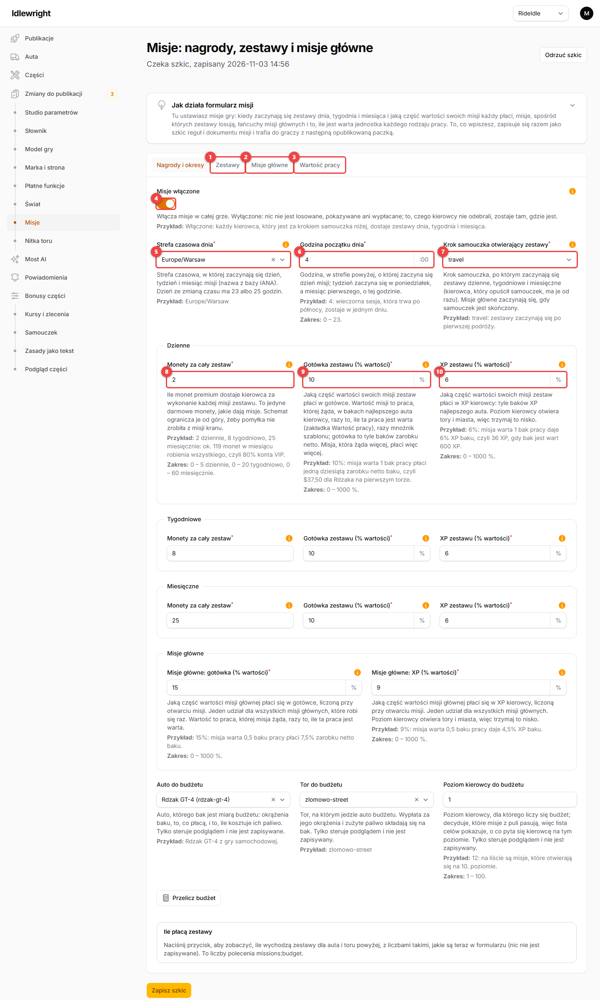

<!-- legenda:misje -->
1. **Zestawy.** Ile misji dziennych, tygodniowych i miesięcznych dostaje gracz i co płaci każdy zestaw.
2. **Misje główne.** Łańcuchy misji głównych: tytuły, cele i nagrody.
3. **Wartość pracy.** Ile jest warta jednostka pracy, od której zależą nagrody.
4. **Misje włączone.** Włącza misje w całej grze. Wyłączone: nic nie jest losowane, pokazywane ani wypłacane; to, czego kierowcy nie odebrali, zostaje tam, gdzie jest. Przykład: Włączone: każdy kierowca, który jest za krokiem samouczka niżej, dostaje zestawy dnia, tygodnia i miesiąca. Wskazówka: Kontrola paczki ostrzega, gdy zestawy płacą monety, a reguły nie mają waluty premium, albo gdy misje są włączone, a paczka nie ma dokumentu misji.
5. **Strefa czasowa dnia.** Strefa czasowa, w której zaczynają się dzień, tydzień i miesiąc misji (nazwa z bazy IANA). Dzień ze zmianą czasu ma 23 albo 25 godzin. Przykład: Europe/Warsaw. Wskazówka: Kierowcy w innych strefach widzą zmianę zestawów o tej godzinie tej strefy; wybierz strefę, w której mieszka większość graczy.
6. **Godzina początku dnia.** Godzina, w strefie powyżej, o której zaczyna się dzień misji; tydzień zaczyna się w poniedziałek, a miesiąc pierwszego, o tej godzinie. Zakres: 0 – 23. Przykład: 4: wieczorna sesja, która trwa po północy, zostaje w jednym dniu.
7. **Krok samouczka otwierający zestawy.** Krok samouczka, po którym zaczynają się zestawy dzienne, tygodniowe i miesięczne (kierowca, który opuścił samouczek, ma je od razu). Misje główne zaczynają się, gdy samouczek jest skończony. Przykład: travel: zestawy zaczynają się po pierwszej podróży. Wskazówka: Lista pokazuje kroki samouczka tak, jak się nad nim pracuje; krok usunięty z samouczka unieważnia tę liczbę.
8. **Monety za cały zestaw.** Ile monet premium dostaje kierowca za wykonanie każdej misji zestawu. To jedyne darmowe monety, jakie dają misje. Schemat ogranicza je od góry, żeby pomyłka nie zrobiła z misji kranu. Zakres: 0 – 5 dziennie, 0 – 20 tygodniowo, 0 – 60 miesięcznie. Przykład: 2 dziennie, 8 tygodniowo, 25 miesięcznie: ok. 119 monet w miesiącu robienia wszystkiego, czyli 80% konta VIP. Wskazówka: Budżet niżej pokazuje, ile wychodzi miesiąc monet obok ceny konta VIP i paczki monet.
9. **Gotówka zestawu (% wartości).** Jaką część wartości swoich misji zestaw płaci w gotówce. Wartość misji to praca, której żąda, w bakach najlepszego auta kierowcy, razy to, ile ta praca jest warta (zakładka Wartość pracy), razy mnożnik szablonu; gotówka to tyle baków zarobku netto. Misja, która żąda więcej, płaci więc więcej. Zakres: 0 – 1000 %. Przykład: 10%: misja warta 1 bak pracy płaci jedną dziesiątą zarobku netto baku, czyli $37,50 dla Rdzaka na pierwszym torze. Wskazówka: Miesiąc wszystkich zestawów musi mieścić się w granicach z konfiguracji (15 – 100% gotówki z 30 baków dla kierowcy na 12. poziomie). Pokazuje to budżet niżej, a publikacja pilnuje treści tej granicy.
10. **XP zestawu (% wartości).** Jaką część wartości swoich misji zestaw płaci w XP kierowcy: tyle baków XP najlepszego auta. Poziom kierowcy otwiera tory i miasta, więc trzymaj to nisko. Zakres: 0 – 1000 %. Przykład: 6%: misja warta 1 bak pracy daje 6% XP baku, czyli 36 XP, gdy bak jest wart 600 XP. Wskazówka: Miesiąc wszystkich zestawów musi mieścić się między 5 a 50% XP z 30 baków; publikacja pilnuje treści tej granicy.
<!-- /legenda -->

**Co płaci zestaw i misje główne.** Nagrody liczy się jako procent **wartości pracy**, a nie stałej puli: wartość misji to praca, którą misja każe wykonać, razy wartość jednostki z zakładki „Wartość pracy”, razy mnożnik szablonu. Dlatego droższe cele automatycznie dają większą nagrodę. Za komplet misji okresu gracz dostaje bonus w monetach (z sufitem). Misja ma slot i szablon (cel w procentach baku albo liczbą razy, waga), poziomy i przedmioty; łańcuchy misji głównych mają nagrody liczone przy otwarciu misji oraz tytuły i zdania w pięciu językach. **Misja, którą mają gracze, nie może zniknąć** z paczki.

**Przelicz budżet** pokazuje, ile nagród da miesiąc misji dla kierowcy na 12. poziomie względem gotówki i XP z 30 baków. Granice, których pilnuje bramka `missions:budget --strict`: miesiąc zestawów to **15–100% gotówki i 5–50% XP**. Gdy bramka zatrzyma paczkę, zmniejsz procenty nagród zestawów albo mnożnik szablonu i policz budżet jeszcze raz.

---

## 13. Kursy i zlecenia

**Cel:** ustawić zlecenia poboczne gry: tablicę ofert w mieście, to, ile płaci godzina kursu na każdym poziomie, i szablony, z których losowane są oferty.

Menu Treść → Kursy i zlecenia. Strona ma pięć zakładek: **Tablica**, **Wypłata**, **Rodzaje**, **Szablony ofert** i **Nocny kurs**. Ostatnia to nocna okazja, którą może zatrzymać policja (opisana niżej). Jak zwykle: zapis robi szkic, a gracze zobaczą zmianę z następną paczką.

### Co te liczby robią w grze

- Kierowca dostaje zakładkę Kursy po kroku samouczka, który wskazuje formularz („Otwierają się po kroku samouczka”); kierowca, który skończył samouczek, ma ją od razu.
- Każde miasto ma tablicę ofert. Tablica odświeża się **falami** (na zrzucie 22,5 minuty, tyle co kawałek pogody). W każdej fali pojawiają się nowe oferty: każdy kierowca ma własną tablicę losowaną z ziarna, a oferta zostaje tyle fal, ile mówi jej szablon. Ile ofert dochodzi w fali, zależy od pory dnia (świt, dzień, zmierzch, noc).
- Wzięty kurs można **wycofać** w ciągu kilkudziesięciu sekund (na zrzucie 60): paliwo wraca, a przepadają tylko okrążenia z tych sekund. Zero wyłącza wycofywanie.
- Kurs płaci według szczebla drabiny aut (kotwica w dolarach na godzinę po paliwie). Poziom kierowcy zmienia to, jaką część kotwicy płaci kurs, jaki najdłuższy kurs jest na tablicy i ile kursów kierowca może wziąć w ciągu doby. **Rzadkość** oferty (na zrzucie zwykła, dobra i świetna) mnoży wypłatę (100%, 115%, 135%), a jej szansa wynika z wag (700, 250 i 50, czyli 70%, 25% i 5%).

### Tablica

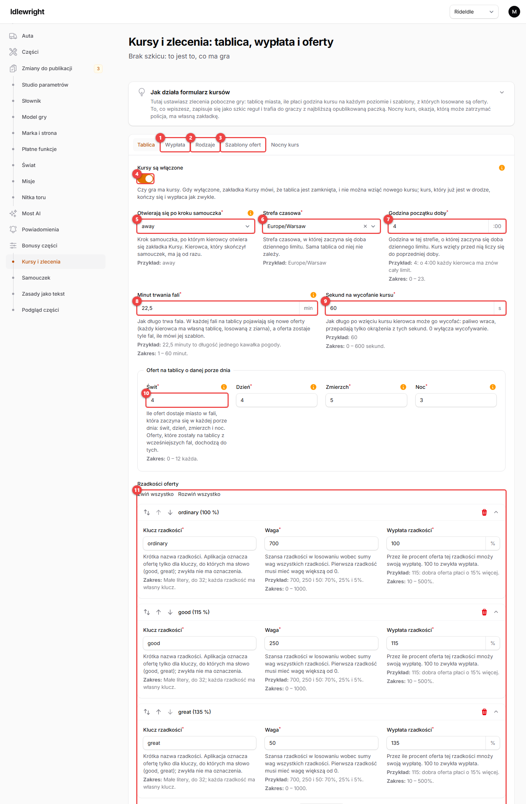

<!-- legenda:zlecenia -->
1. **Wypłata.** Ile płaci godzina kursu na każdym poziomie: prędkość odniesienia, kotwice drabiny i przedziały poziomów; na dole przycisk „Policz wypłatę”.
2. **Rodzaje.** Rodzaje kursów (na przykład taksówki, towary, dostawy) z nazwami w językach gry; to znacznik oferty na tablicy.
3. **Szablony ofert.** Z czego losowane są oferty: co musi mieć auto, jak długa jest trasa, ile płaci i jak jest prawdopodobna o każdej porze dnia.
4. **Kursy są włączone.** Czy gra ma kursy. Gdy wyłączone, zakładka Kursy mówi, że tablica jest zamknięta, i nie można wziąć nowego kursu; kurs, który już jest w drodze, kończy się i wypłaca jak zwykle. Wskazówka: Włącz dopiero po przeczytaniu wypłaty pod formularzem: bramka publikacji zatrzymuje paczkę, której wypłata jest poza granicami.
5. **Otwierają się po kroku samouczka.** Krok samouczka, po którym kierowcy otwiera się zakładka Kursy. Kierowca, który skończył samouczek, ma ją od razu. Przykład: away. Wskazówka: Krok musi być w samouczku gry: inaczej strona odmówi zapisu.
6. **Strefa czasowa.** Strefa czasowa, w której zaczyna się doba dziennego limitu. Sama tablica od niej nie zależy. Przykład: Europe/Warsaw.
7. **Godzina początku doby.** Godzina w tej strefie, o której zaczyna się doba dziennego limitu. Kurs wzięty przed nią liczy się do poprzedniej doby. Zakres: 0 – 23. Przykład: 4: o 4:00 każdy kierowca ma znów cały limit.
8. **Minut trwania fali.** Jak długo trwa fala. W każdej fali na tablicy pojawiają się nowe oferty (każdy kierowca ma własną tablicę, losowaną z ziarna), a oferta zostaje tyle fal, ile mówi jej szablon. Zakres: 1 – 60 minut. Przykład: 22,5 minuty to długość jednego kawałka pogody. Wskazówka: Krótka fala sprawia, że tablica często się zmienia i opłaca się do niej zaglądać; długa — że jest spokojna.
9. **Sekund na wycofanie kursu.** Jak długo po wzięciu kursu kierowca może go wycofać: paliwo wraca, przepadają tylko okrążenia z tych sekund. 0 wyłącza wycofywanie. Zakres: 0 – 600 sekund. Przykład: 60.
10. **Ofert o danej porze dnia.** Ile ofert dostaje miasto w fali, która zaczyna się w każdej porze dnia: świt, dzień, zmierzch i noc. Oferty, które zostały na tablicy z wcześniejszych fal, dochodzą do tych. Zakres: 0 – 12 każda. Wskazówka: W dostarczonej grze najwięcej ofert ma zmierzch (gorączka taksówek), a najmniej noc.
11. **Rzadkości oferty.** Jak dobra może być oferta. Każda oferta dostaje rzadkość przy losowaniu: waga to jej szansa wobec pozostałych, a mnożnik wypłaty sprawia, że dobra oferta płaci więcej. Pierwsza to zwykła oferta i musi mieć wagę; najwyżej pięć rzadkości. Przykład: zwykła 700, dobra 250, świetna 50: 70%, 25% i 5% ofert, płacą 100%, 115% i 135%.
<!-- /legenda -->

Przełącznik „Kursy są włączone” wyłączony zamyka tablicę: nie można wziąć nowego kursu, a kurs, który już jest w drodze, kończy się i wypłaca jak zwykle.

### Wypłata

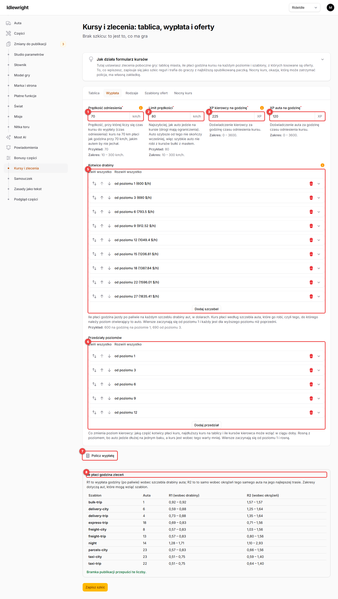

<!-- legenda:zlecenia-wyplata -->
1. **Prędkość odniesienia.** Prędkość, przy której liczy się czas kursu do wypłaty (czas odniesienia): kurs na 70 km płaci jak godzina przy 70 km/h, jakim autem by nie jechał. Zakres: 10 – 300 km/h. Przykład: 70. Wskazówka: Auto szybsze od tej wartości zarabia więcej na godzinę własnego czasu, do limitu prędkości.
2. **Limit prędkości.** Najszybciej, jak auto jedzie na kursie (drogi mają ograniczenia). Auto szybsze od tego nie skończy wcześniej, więc szybkie auto nie robi z kursów bułki z masłem. Zakres: 10 – 300 km/h. Przykład: 80.
3. **XP kierowcy na godzinę.** Doświadczenie kierowcy za godzinę czasu odniesienia kursu. Zakres: 0 – 3600. Wskazówka: Porównaj z tym, co dają okrążenia; doświadczenie z kursów nie powinno być najszybszą drogą do poziomu.
4. **XP auta na godzinę.** Doświadczenie auta za godzinę czasu odniesienia kursu. Zakres: 0 – 3600.
5. **Kotwice drabiny.** Ile płaci godzina jazdy po paliwie na każdym szczeblu drabiny aut, w dolarach. Kurs płaci według szczebla auta, które go robi, czyli tego, do którego należy poziom otwierający to auto. Wiersze zaczynają się od poziomu 1 i każdy jest dla wyższego poziomu niż poprzedni. Przykład: 600 na godzinę na poziomie 1, 690 od poziomu 3. Wskazówka: To kotwice ekonomii (600 razy 1,15 do potęgi szczebla); sprawdza je bramka ekonomii, więc zmieniaj je razem z ekonomią.
6. **Przedziały poziomów.** Co zmienia poziom kierowcy: jaką część kotwicy płaci kurs, najdłuższy kurs na tablicy i ile kursów kierowca może wziąć w ciągu doby. Rosną z poziomem, bo auto jedzie dłużej na jednym baku, a kurs jest wobec tego warty mniej. Wiersze zaczynają się od poziomu 1 i rosną.
7. **Policz wypłatę.** Naciśnij przycisk, by zobaczyć, ile płaci godzina każdego szablonu na każdym aucie paczki, z liczbami takimi, jakie są teraz w formularzu (nic się nie zapisuje). To liczby komendy gigs:report.
8. **Ile płaci godzina zleceń.** R1 to wypłata godziny (po paliwie) wobec szczebla drabiny auta; R2 to to samo wobec okrążeń tego samego auta na jego najlepszej trasie. Zakresy dotyczą aut, które mogą wziąć szablon.
<!-- /legenda -->

**„Policz wypłatę”** liczy dla szablonów i aut paczki, z liczbami takimi, jakie są teraz w formularzu (nic się nie zapisuje), ile płaci godzina każdego szablonu. Tabela pod przyciskiem ma dla każdego szablonu liczbę aut, które mogą go wziąć, i dwa zakresy: **R1** to wypłata godziny (po paliwie) wobec szczebla drabiny auta, a **R2** to to samo wobec okrążeń tego samego auta na jego najlepszej trasie. Pod tabelą strona mówi wprost, czy **bramka publikacji** (`gigs:report --strict`) przepuści te liczby, czy zatrzymałaby paczkę, i wskazuje wiersze poza granicami z powodem (wypłata godziny poza granicami wobec drabiny albo bije okrążenia tego auta). Zrób to przed zapisaniem szkicu, zamiast czekać na wynik paczki.

### Rodzaje i szablony ofert

Zakładka **Rodzaje** to rodzaje kursów (na przykład taxi, towary, dostawa) z nazwami w pięciu językach: nazwa jest znacznikiem oferty na tablicy, a każdy szablon należy do jednego rodzaju. Zakładka **Szablony ofert** to to, z czego losowane są oferty. Szablon mówi, co musi mieć auto (miejsca albo ładunek, może klasę), jak długa jest trasa, ile płaci i jak jest prawdopodobny o każdej porze dnia. Szablon, którego nie może wziąć żadne auto paczki, nawet w najmniejszej ofercie, jest odrzucany.

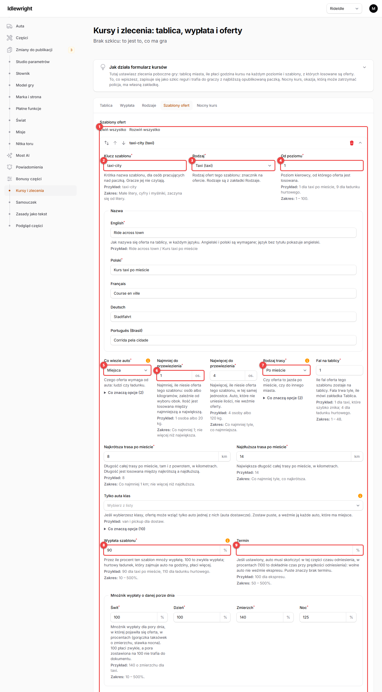

<!-- legenda:zlecenia-szablony -->
1. **Szablony ofert.** Z czego losowane są oferty. Szablon mówi, co musi mieć auto (miejsca albo ładunek, może klasę), jak długa jest trasa, ile płaci i jak jest prawdopodobny o każdej porze dnia. Szablon, którego nie może wziąć żadne auto paczki, nawet w najmniejszej ofercie, jest odrzucany. Przykład: Kurs taxi po mieście: 1 – 4 osoby, 8 – 14 km, 90% wypłaty, 140% o zmierzchu.
2. **Klucz szablonu.** Krótka nazwa szablonu, dla osób pracujących nad paczką. Gracze jej nie czytają. Zakres: Małe litery, cyfry i myślniki, zaczyna się od litery. Przykład: taxi-city.
3. **Rodzaj.** Rodzaj ofert tego szablonu: znacznik na ofercie. Rodzaje są z zakładki Rodzaje.
4. **Od poziomu.** Poziom kierowcy, od którego oferta jest losowana. Zakres: 1 – 100. Przykład: 1 dla taxi po mieście, 9 dla ładunku hurtowego.
5. **Co wiezie auto.** Czego oferta wymaga od auta: ludzi czy ładunku. Wskazówka: Auto musi mieć miejsce na wylosowaną ilość.
6. **Najmniej do przewiezienia.** Najmniej, ile niesie oferta tego szablonu: osób albo kilogramów, zależnie od wyboru obok. Ilość jest losowana między najmniejszą a największą. Zakres: Co najmniej 1; nie więcej niż największa. Przykład: 1 osoba albo 20 kg.
7. **Rodzaj trasy.** Czy oferta to jazda po mieście, czy do innego miasta. Wskazówka: Trasa do innego miasta jest tak długa, jak droga do niego, więc długość trasy po mieście jej nie dotyczy.
8. **Wypłata szablonu.** Przez ile procent ten szablon mnoży wypłatę. 100 to zwykła wypłata; hurtowy ładunek, który zajmuje auto na godziny, płaci więcej. Zakres: 10 – 500%. Przykład: 90 dla taxi po mieście, 110 dla ładunku hurtowego. Wskazówka: Bramka publikacji mierzy wynik dla każdego auta, które może wziąć szablon.
9. **Termin.** Jeśli ustawiony, auto musi skończyć w tej części czasu odniesienia, w procentach (100 to dokładnie czas przy prędkości odniesienia): wolne auto nie weźmie ekspresu. Puste znaczy brak terminu. Zakres: 50 – 500%. Przykład: 100 dla ekspresu.
<!-- /legenda -->

**Przykład: „Kurs taxi po mieście” (`taxi-city`).** Rodzaj Taxi, od 1. poziomu kierowcy; wymaga miejsc (od 1 do 4 osób), trasa po mieście od 8 do 14 km, zostaje na tablicy jedną falę; wypłata szablonu 90%, a mnożnik wypłaty o porze dnia: świt 100%, dzień 100%, zmierzch 140% (gorączka taksówek o zmierzchu), noc 125%. Pole „Tylko auta klas” zostaje puste, więc kurs może wziąć każde auto, które ma miejsce; pole „Termin” puste znaczy brak terminu (wolne auto nie jest odrzucane).

### Nocny kurs, policja i areszt

**Cel:** ustawić jedną okazję na noc gry w każdym mieście: mały ładunek wożony do innego miasta i z powrotem za wielokrotność zwykłej wypłaty, który policja może zatrzymać.

**Co to robi w grze.** Noc gry trwa od 22:00 do 5:00 zegara gry, czyli 52,5 minuty zegara rzeczywistego (osiem nocy na dobę). Kierowca od 9. poziomu dostaje w nocy w każdym mieście jedną okazję: ładunek od 10 do 60 kg do innego miasta i z powrotem za **250% zwykłej wypłaty tej samej trasy**. Okazja nie jest zwykłą ofertą fali: powstaje raz na noc z ziarna kierowcy, znika o świcie i nie wraca po wzięciu. Kierowca może wziąć najwyżej dwa nocne kursy na dobę (liczą się też do dziennego limitu kursów).

- **Szanse.** Patrole zatrzymują 36% nocnych kursów. Klasa nadwozia to zmienia: cichy hatchback, sedan i van o 14 punktów procentowych mniej, głośne GT, muscle car, superauto i hiperauto o 10 punktów więcej; pościg po ucieczce dokłada 10 punktów w tym samym mieście przez 6 godzin. Z zatrzymań 58% to ucieczka (auto dostaje połowę wypłaty), reszta to areszt. Dla Rdzaka GT-4 (hatchback) wychodzi: czysty przejazd 78%, ucieczka 12,8%, areszt 9,2%.
- **Los** jest losowany przy wzięciu kursu i zamrożony razem z wypłatą; gracz nie dostaje wyniku przed zatrzymaniem (do połowy trasy). Zmiana liczb w regułach po wzięciu kursu niczego w nim nie zmienia, a wycofanie w pierwszej minucie znosi wszystko.
- **Areszt** trwa 25 minut od zatrzymania albo do wpłacenia **kaucji** (50% wypłaty, płatna z gotówki). Blokuje tylko kursy i podróże (także przyspieszone); garaże, warsztat i zaparkowane auta pracują dalej. **Mandat** (30% wypłaty) jest pobierany, gdy auto wróci, i nigdy więcej, niż kierowca ma. Zatrzymany nie dostaje XP kierowcy ani auta, a kurs nie liczy się do misji kursów.

Jak to wygląda w grze: ekran **Okazja** pokazuje chip „OKAZJA · OKNO NOCNE” z odliczaniem do świtu, trasę i kartę wypłaty (obok zwykłej wypłaty tej samej trasy), ryzyko policji (patrole, zmiana za klasę auta, pościg, szansa kontroli i ucieczki), trzy możliwe zakończenia w procentach i przyciski „Podejmij ryzyko” i „Odrzuć”. W areszcie tablica kursów pokazuje czerwoną kartę „Jesteś w areszcie” z przyciskiem „Wpłać kaucję”.

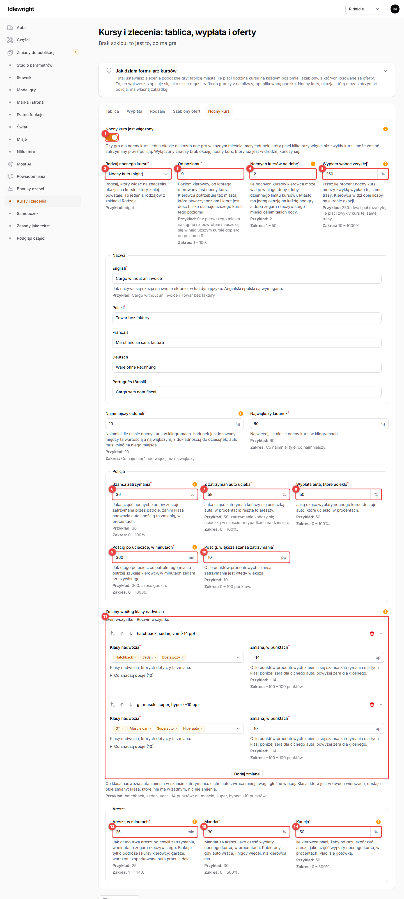

<!-- legenda:zlecenia-noc -->
1. **Nocny kurs jest włączony.** Czy gra ma nocny kurs: jedną okazję na każdą noc gry w każdym mieście, mały ładunek, który płaci kilka razy więcej niż zwykły kurs i może zostać zatrzymany przez policję. Wyłączony znaczy brak okazji; nocny kurs, który już jest w drodze, kończy się. Wskazówka: Bramka publikacji mierzy, ile godzina nocnego kursu płaci średnio po wszystkich jego zakończeniach, z własną granicą.
2. **Rodzaj nocnego kursu.** Rodzaj, który widać na znaczniku okazji i na kursie, który z niej powstaje. To jeden z rodzajów z zakładki Rodzaje. Przykład: night.
3. **Od poziomu.** Poziom kierowcy, od którego oferowany jest nocny kurs. Kierowca potrzebuje też miasta, które otworzył poziom i które jest dość blisko dla najdłuższego kursu tego poziomu. Zakres: 1 – 100. Przykład: 9: z pierwszego miasta następne i z powrotem mieszczą się w najdłuższym kursie dopiero od poziomu 9.
4. **Nocnych kursów na dobę.** Ile nocnych kursów kierowca może wziąć w ciągu doby (doby dziennego limitu kursów). Miasto ma jedną okazję na każdą noc gry, a doba zegara rzeczywistego mieści osiem takich nocy. Zakres: 1 – 50. Przykład: 2. Wskazówka: Nocne kursy liczą się też do dziennego limitu kursów.
5. **Wypłata wobec zwykłej.** Przez ile procent nocny kurs mnoży zwykłą wypłatę tej samej trasy. Kierowca widzi obie liczby na ekranie okazji. Zakres: 10 – 1000%. Przykład: 250: dwa i pół raza tyle, ile płaci zwykły kurs tej samej trasy. Wskazówka: To wypłata, gdy nikt nie zatrzyma auta. Ile nocny kurs jest wart średnio, jest w raporcie pod formularzem.
6. **Szansa zatrzymania.** Jaka część nocnych kursów zostaje zatrzymana przez patrole, zanim klasa nadwozia auta i pościg to zmienią, w procentach. Zakres: 0 – 100%. Przykład: 36. Wskazówka: Ta liczba i zmiany poniżej decydują, jak ryzykowny jest nocny kurs; kierowca widzi wynik przed wzięciem.
7. **Z zatrzymań auto ucieka.** Jaka część zatrzymań kończy się ucieczką auta, w procentach; reszta to areszty. Zakres: 0 – 100%. Przykład: 58: zatrzymanie kończy się ucieczką w sześciu przypadkach na dziesięć.
8. **Wypłata auta, które uciekło.** Jaką część wypłaty nocnego kursu dostaje auto, które uciekło, w procentach. Zakres: 0 – 100%. Przykład: 50.
9. **Pościg po ucieczce, w minutach.** Jak długo po ucieczce patrole tego miasta ostrzej szukają kierowcy, w minutach zegara rzeczywistego. Zakres: 0 – 10080. Przykład: 360: sześć godzin. Wskazówka: Ustaw pościg na 0, żeby go wyłączyć.
10. **Pościg: większa szansa zatrzymania.** O ile punktów procentowych szansa zatrzymania jest wtedy większa. Zakres: 0 – 100 punktów. Przykład: 10.
11. **Zmiany według klasy nadwozia.** Co klasa nadwozia auta zmienia w szansie zatrzymania: ciche auto zwraca mniej uwagi, głośne więcej. Klasa, która jest w dwóch wierszach, dostaje obie zmiany; klasa, której nie ma w żadnym, nic nie zmienia. Przykład: hatchback, sedan, van: −14 punktów; gt, muscle, super, hyper: +10 punktów. Wskazówka: Auta paczki nie mają liczby hałasu, więc zastępuje ją klasa.
12. **Areszt, w minutach.** Jak długo trwa areszt od chwili zatrzymania, w minutach zegara rzeczywistego. Blokuje tylko podróże i kursy kierowcy: garaże, warsztat i zaparkowane auta pracują dalej. Zakres: 1 – 1440. Przykład: 25. Wskazówka: Areszt zaczyna się w chwili zatrzymania, w połowie trasy, więc kierowca, który wraca po kilku godzinach, zastaje go skończony.
13. **Mandat.** Mandat za areszt, jako część wypłaty nocnego kursu, w procentach. Pobierany, gdy auto wraca, i nigdy więcej, niż kierowca ma. Zakres: 0 – 500%. Przykład: 30.
14. **Kaucja.** Ile kierowca płaci, żeby od razu skończyć areszt, jako część wypłaty nocnego kursu, w procentach. Płaci się gotówką. Zakres: 0 – 500%. Przykład: 50. Wskazówka: Kaucja wyższa niż wypłata robi z aresztu mur; kaucja 0 pozwala go ominąć za darmo.
<!-- /legenda -->

W panelu zakładka **Nocny kurs** ma trzy bloki: ogólne (włączenie, rodzaj, od którego poziomu, ile na dobę, wypłata wobec zwykłej, nazwa w pięciu językach, ładunek od-do), **Policja** (szansa zatrzymania, ile zatrzymań kończy się ucieczką, wypłata auta, które uciekło, czas pościgu i jego wpływ na szansę), **Zmiany według klasy nadwozia** (lista: które klasy i o ile punktów zmieniają szansę; klasa, której nie ma w żadnym wierszu, niczego nie zmienia, a klasa w dwóch wierszach dostaje obie zmiany) i **Areszt** (czas, mandat, kaucja). Wypłaty wpisuje się w procentach.

**Bramka.** Raport wypłaty (`gigs:report`, przycisk „Policz wypłatę”) ma też wiersz „night” dla każdego auta, które może wziąć ładunek: godzina po paliwie, uśredniona po zakończeniach (pełna wypłata, połowa, mandat), wobec szczebla drabiny, z własną granicą (domyślnie 1,9) i bez granicy R2, bo nocny kurs płaci więcej niż okrążenia z założenia, za ryzyko. Granica 1,9 to zasada autora etapu, nie liczba właściciela gry.

**Nie sprawdzono:** prawdziwego upływu czasu: zegar serwera był w testach w nocy zamrożony, więc zatrzymanie i koniec aresztu oglądano na wierszu ustawionym w bazie, a nie na prawdziwej trasie. Nie ma też wyboru przy zatrzymaniu (mandat, łapówka, adwokat za monety), powiadomienia o końcu aresztu ani nocnego kursu w misjach.

**Co się stanie w grze i kiedy:** po uruchomieniu paczki nowe fale na tablicach losują z nowych szablonów; kursy, które kierowcy już wzięli, kończą się i wypłacają po staremu.

**Co sprawdzić po zapisaniu:** „Policz wypłatę” pokazuje zielone „Bramka publikacji przepuści te liczby”, a każdy szablon w tabeli ma co najmniej jedno auto, które może go wziąć (szablon, którego nie może wziąć żadne auto, jest odrzucany).

---

## 14. Bonusy części

**Cel:** wiedzieć, jakie bonusy kierowca może włożyć w warsztacie w części, i sprawdzić, czy najlepszy możliwy zestaw nie psuje balansu.

Menu Treść → Bonusy części. To strona **tylko do odczytu**: pokazuje bonusy, a liczby zmienia się w Studiu parametrów (przycisk „Zmień liczby w studiu” prowadzi do Studia; bonusy mają tam sekcję „Bonusy części (dostrajanie)”) i wchodzą do gry z paczką. Ile miejsc na bonusy ma konkretna część, ustawia pole „Miejsca na bonusy” w formularzu części (rozdział 4).

Jak działają bonusy: kierowca w warsztacie „próbuje” bonus; próba losuje wartość z dzwonu wokół średniej bonusu, a ponowna próba bonusu, który miejsce już ma, zostawia lepszą wartość. Na zrzucie: 3 miejsca na część, od poziomu 3, próba kosztuje 3% ceny modelu, wybranie bonusu 10%; jeden bonus daje najwyżej 8% wszędzie albo 12% na niektórych torach, a bonusy wszystkich części razem dają najwyżej 25% jednej statystyki auta.

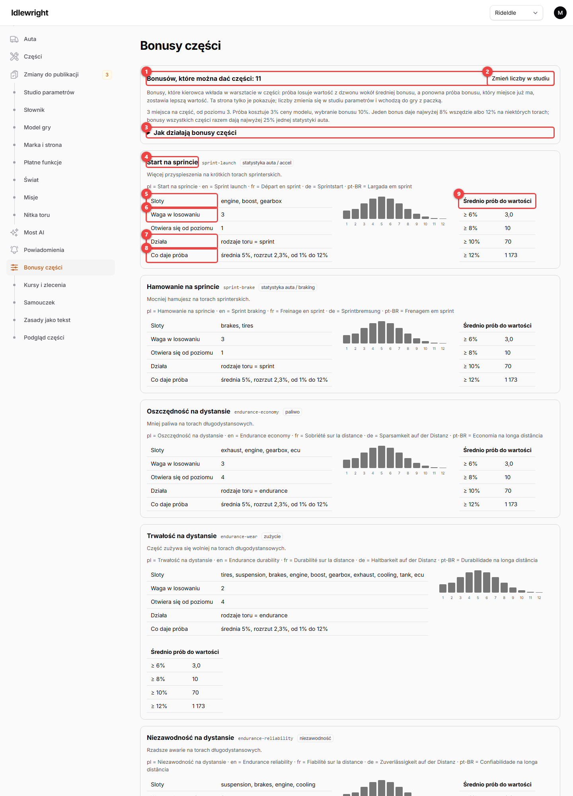

<!-- legenda:bonusy-czesci -->
1. **Podsumowanie.** Bonusy, które kierowca wkłada w warsztacie w części: próba losuje wartość z dzwonu wokół średniej bonusu, a ponowna próba bonusu, który miejsce już ma, zostawia lepszą wartość. Ta strona tylko je pokazuje; liczby zmienia się w studiu parametrów i wchodzą do gry z paczką.
2. **Zmień liczby w studiu.** Prowadzi do Studia parametrów; ta strona tylko pokazuje bonusy, liczby zmienia się w Studiu.
3. **Jak działają bonusy części.** Rozwijany opis działania bonusów.
4. **Bonus.** Nazwa bonusu, jego klucz i to, co zmienia (tu: statystykę auta „accel”); niżej nazwy w pięciu językach.
5. **Sloty.** W które sloty części można go wylosować.
6. **Waga w losowaniu.** Szansa bonusu wobec pozostałych.
7. **Działa.** Na każdym torze albo tylko na wskazanych rodzajach toru, nawierzchniach lub pogodach.
8. **Co daje próba.** Średnia, rozrzut oraz najmniejsza i największa wartość jednej próby.
9. **Średnio prób do wartości.** Ile prób średnio trzeba, żeby trafić co najmniej taką wartość.
<!-- /legenda -->

### Ile jest warty najlepszy zestaw

Na dole strony przycisk **„Policz”** pokazuje, dla aut wzorcowych na torze każdego rodzaju i nawierzchni, ile najlepsze bonusy tych reguł (każdy w największej wartości, jaką da próba, we wszystkich miejscach zestawu ze sklepu) zdejmują z okrążenia w porównaniu z tym samym zestawem bez nich. To liczba, którą ocenia bramka `tuning:budget --strict` przed publikacją paczki.

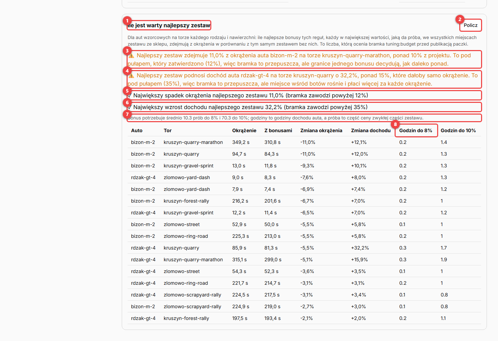

<!-- legenda:bonusy-budzet -->
1. **Ile jest warty najlepszy zestaw.** Dla aut wzorcowych na torze każdego rodzaju i nawierzchni: ile najlepsze bonusy tych reguł, każdy w największej wartości, jaką da próba, we wszystkich miejscach zestawu ze sklepu, zdejmują z okrążenia w porównaniu z tym samym zestawem bez nich. To liczba, którą ocenia bramka tuning:budget przed publikacją paczki.
2. **Policz.** Liczy wartość najlepszego zestawu bonusów dla aut wzorcowych; to samo mierzy bramka tuning:budget przed publikacją.
3. **Ostrzeżenie o okrążeniu.** Ile najlepszy zestaw zdejmuje z okrążenia i na którym aucie i torze; ostrzeżenie jest między celem z projektu a pułapem, a powyżej pułapu bramka zatrzymuje paczkę.
4. **Ostrzeżenie o dochodzie.** O ile najlepszy zestaw podnosi dochód auta; awans o jedno miejsce wśród botów daje więcej za każde okrążenie, więc dochód rośnie skokowo; ma własny cel i własny pułap.
5. **Sprawdzenie okrążenia.** Największy spadek okrążenia najlepszego zestawu i granica, powyżej której bramka zawodzi.
6. **Sprawdzenie dochodu.** Największy wzrost dochodu najlepszego zestawu i granica, powyżej której bramka zawodzi.
7. **Cena próby.** Ile prób średnio trzeba, żeby dojść do 8% i do 10% jednego bonusu; godziny to godziny dochodu auta, a próba kosztuje część ceny zwykłej części zestawu.
8. **Godzin do 8%.** Ile godzin dochodu auta zabiera dojście jednego miejsca do 8%.
<!-- /legenda -->

**Jak czytać wynik:** są **dwie oceny**, okrążenia i dochodu, i każda ma cel z projektu i pułap, powyżej którego bramka zawodzi. Pomarańczowe ostrzeżenie o okrążeniu mówi, ile najlepszy zestaw zdejmuje z okrążenia i na którym aucie i torze (na zrzucie 11,0% dla `bizon-m-2` na `kruszyn-quarry-marathon`, ponad cel 10%, ale pod zatwierdzonym pułapem 12%, więc bramka to przepuszcza). Ostrzeżenie o dochodzie mówi, o ile najlepszy zestaw podnosi dochód auta (na zrzucie +32,2% dla `rdzak-gt-4` w Kruszynie, ponad cel 15%, ale pod pułapem 35%). Dwie linie z haczykiem podają największy spadek okrążenia i największy wzrost dochodu oraz granice, powyżej których bramka zawodzi. Pod nimi jest cena próby (ile prób średnio trzeba do 8% i do 10% jednego bonusu), a tabela pokazuje dla każdej pary auto i tor okrążenie bez bonusów i z nimi, zmianę okrążenia i dochodu oraz godziny dochodu do 8% i 10%. Gdy bramka zatrzymała paczkę, zmniejsz w Studiu granice jednego bonusu i policz jeszcze raz.

**Co sprawdzić po zmianie liczb:** „Policz” po każdej zmianie w Studiu i zapisaniu szkicu.

### Dlaczego dochód rośnie skokowo, cena próby i brak ochrony przed pechem

- **Dochód jest oceniany jak okrążenie.** Najgorszy zmierzony przypadek to Rdzak GT-4 w Kruszynie: +32,2% dochodu przy −5,5% okrążenia. To nie siła bonusu, tylko skok progu nagrody: auto awansuje o jedno miejsce wśród botów, a nagroda za miejsce rośnie z ×1,25 do ×1,5. Pułap 35% leży tuż nad zmierzonym; właściciel gry go zatwierdził (2026-11-03) i jest to **pierwsza liczba do przesunięcia przy balansie**.
- **Cena próby wobec dochodu.** Próba kosztuje 3% ceny modelu części, wybranie bonusu 10% (te liczby zostają, nie ma powodu ich ruszać). Raport mówi, że próba to 0,7–1,6 minuty dochodu auta, a dojście jednego miejsca do 8% zabiera średnio 10 prób (0,1–0,3 godziny dochodu), do 10% średnio 70 prób (0,8–1,9 godziny). Pełny zestaw 15 miejsc na 8% to około 3 godziny dochodu, na 10% około 18 godzin, a zysk to 3–11% okrążenia i do 12% dochodu, czyli zwrot po dziesiątkach godzin.
- **Ochrona przed pechem jest wyłączona** (decyzja właściciela, 2026-11-03). Z pomiaru: bez ochrony 8% to średnio 10 prób, 10% to 71, 11% to 261, a 12% ponad tysiąc. Gdyby właściciel kiedyś chciał łagodzić pech, autor etapu poleca krok 0,02σ do 1σ (`tuning.pity_step_ppm` 20 000 i `tuning.pity_max_ppm` 1 000 000): pech do 10% spadłby z 216 do 88 prób, ale „marzenie” 12% stałoby się celem osiągalnym w kilkuset próbach.
- **Klasa i PI na rajdach.** PI liczy się bez toru, więc ani rajdy, ani bonus kontekstowy (działający tylko na niektórych torach) nie zmieniają klasy auta; bonus, który działa wszędzie, ją zmienia.

---

## 15. Klasy aut (F–SS) i PI

**Cel:** wiedzieć, jak gra mierzy siłę auta (PI), z jakich klas składa się rywalizacja i gdzie to zmienić.

**PI (indeks osiągów)** to liczba z samych statystyk auta: średnia ważona jego statystyk względem statystyk auta odniesienia, razy PI auta odniesienia. Nie bierze się z czasu okrążenia, więc nie zależy od toru ani od tego, jak gra liczy bieg. **Klasa** to pierwsza klasa, której górny próg jest nie niższy od PI auta; auta powyżej ostatniego progu są w klasie najwyższej. Auto pokazuje się jako klasa i PI, od F0 do SS999.

W dostarczonej grze: auto odniesienia (seryjny Rdzak GT-4) ma PI 300, więc jest w klasie D. Górne progi klas to F 199, E 299, D 399, C 499, B 599, A 699 i S 799; powyżej jest SS, a najwyższe pokazywane PI to 999.

### Gdzie to ustawić

Studio parametrów, sekcja **Rywalizacja** (wyłącz „Tryb prosty”, bo te liczby nie są w nim). Dla klas i PI ważne są: PI auta odniesienia, sufit jednej statystyki w PI, najwyższe pokazywane PI, wagi statystyk w PI (razem 100%, dotyczą statystyk modelu gry) i górne progi klas.

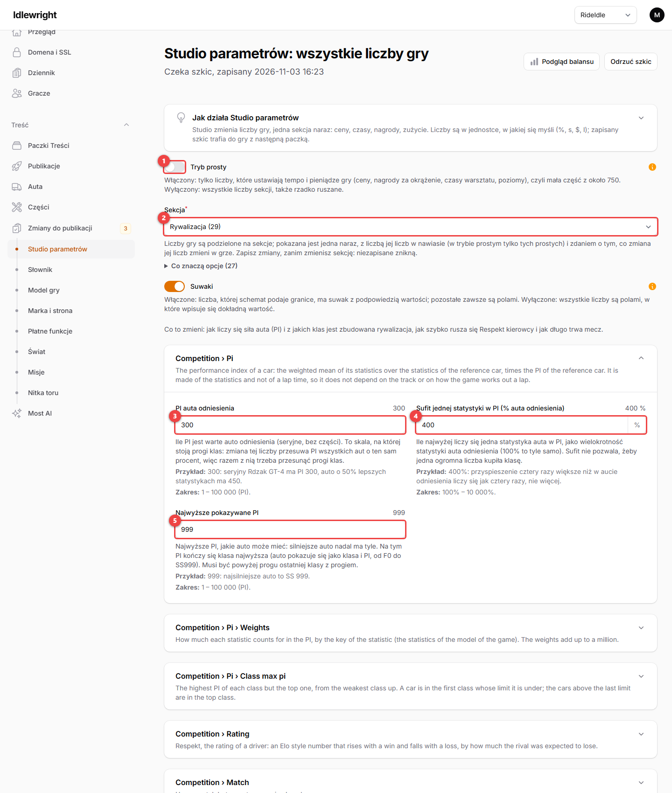

<!-- legenda:studio-rywalizacja -->
1. **Tryb prosty.** Włączony: tylko liczby, które ustawiają tempo i pieniądze gry (ceny, nagrody za okrążenie, czasy warsztatu, poziomy), czyli mała część z około 750. Wyłączony: wszystkie liczby sekcji, także rzadko ruszane. Wskazówka: Tryb prosty jest włączony na starcie. Przełączenie odświeża formularz z zapisanego szkicu, więc zapisz zmiany przed przełączeniem.
2. **Sekcja.** Liczby gry są podzielone na sekcje; pokazana jest jedna naraz, z liczbą jej liczb w nawiasie (w trybie prostym tylko tych prostych) i zdaniem o tym, co zmiana jej liczb zmieni w grze. Zapisz zmiany, zanim zmienisz sekcję: niezapisane znikną.
3. **PI auta odniesienia.** Ile PI jest warte auto odniesienia (seryjne, bez części). To skala, na której stoją progi klas: zmiana tej liczby przesuwa PI wszystkich aut o ten sam procent, więc razem z nią trzeba przesunąć progi klas. Zakres: 1 – 100 000 (PI). Przykład: 300: seryjny Rdzak GT-4 ma PI 300, auto o 50% lepszych statystykach ma 450.
4. **Sufit jednej statystyki w PI (% auta odniesienia).** Ile najwyżej liczy się jedna statystyka auta w PI, jako wielokrotność statystyki auta odniesienia (100% to tyle samo). Sufit nie pozwala, żeby jedna ogromna liczba kupiła klasę. Zakres: 100% – 10 000%. Przykład: 400%: przyspieszenie cztery razy większe niż w aucie odniesienia liczy się jak cztery razy, nie więcej.
5. **Najwyższe pokazywane PI.** Najwyższe PI, jakie auto może mieć: silniejsze auto nadal ma tyle. Na tym PI kończy się klasa najwyższa (auto pokazuje się jako klasa i PI, od F0 do SS999). Musi być powyżej progu ostatniej klasy z progiem. Zakres: 1 – 100 000 (PI). Przykład: 999: najsilniejsze auto to SS 999.
<!-- /legenda -->

**Uwaga o skali:** zmiana PI auta odniesienia przesuwa PI wszystkich aut o ten sam procent, więc razem z nią trzeba przesunąć progi klas. **Uwaga o tekstach:** tytuły grup i ich krótkie opisy w sekcjach Studia o rywalizacji i powiadomieniach są dziś po angielsku (na przykład „Competition › Pi”, „Push › Ttl”); opisy pól pod nimi są po polsku. Sekcja „Rywalizacja” ma też liczby, których gra jeszcze nie używa: zostaw je bez zmian.

### Nazwy klas ze Słownika

Aplikacja nazywa klasę wiadomością `car.className.{klasa}` (F, E, D, C, B, A, S, SS). **Domyślnie to same litery**, a gra może je przemianować w Słowniku bez zmiany kodu: na przykład `car.className.SS` jako „Legenda”. Odznaka klasy (nagłówek gry, karta auta, flota, dealer, giełda), porównanie części i wybór toru czytają te nazwy.

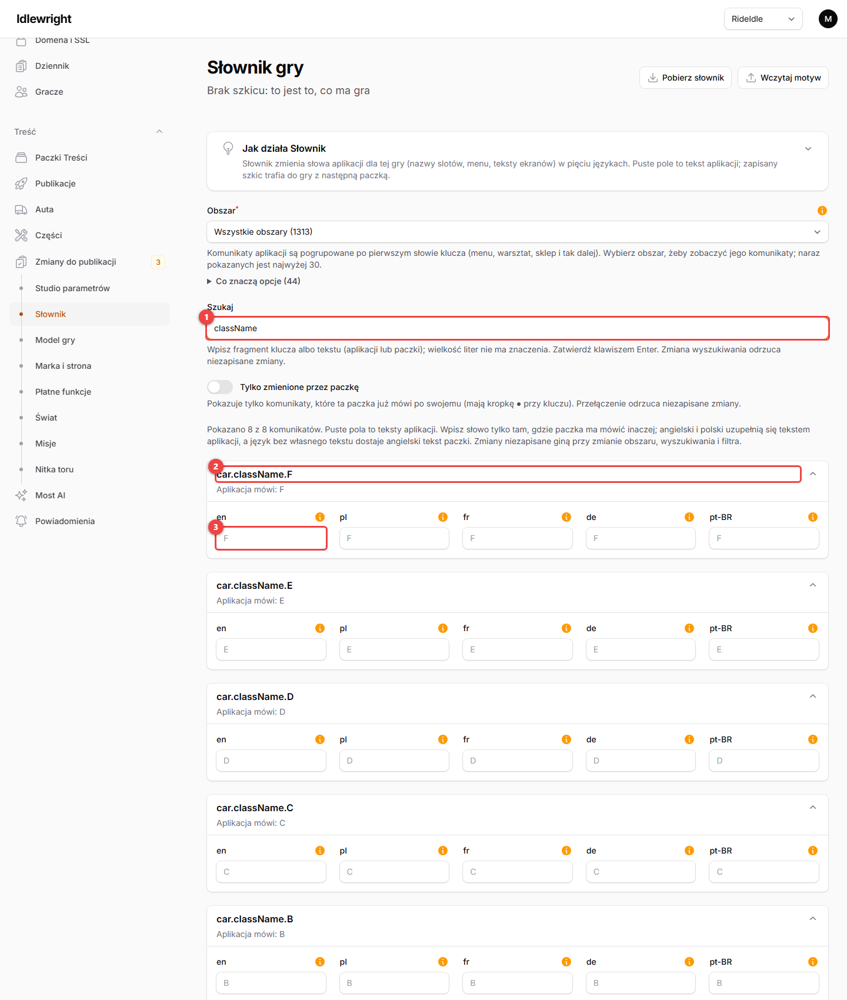

<!-- legenda:slownik-klasy -->
1. **Szukaj.** Wpisz fragment klucza albo tekstu (aplikacji lub paczki); wielkość liter nie ma znaczenia. Zatwierdź klawiszem Enter. Zmiana wyszukiwania odrzuca niezapisane zmiany.
2. **Klucz klasy.** Nazwa klasy auta w aplikacji: car.className.F do car.className.SS; puste pole zostawia samą literę klasy.
3. **Tekst w danym języku.** Puste pole to tekst aplikacji, widoczny w polu jako podpowiedź. Wpisz tekst tylko tam, gdzie paczka ma mówić inaczej. Zakres: Do 400 znaków w każdym języku. Wskazówka: Zostaw nazwy w klamrach, np. {name}, dokładnie jak w oryginale (w tekstach serwera nazwa ma dwukropek na początku), tyle samo form liczby mnogiej oddzielonych znakiem |, bez innych klamer i bez linków @:. Język z pustym polem dostaje angielski tekst paczki, a nie tekst aplikacji w tym języku.
<!-- /legenda -->

### Rywale w wyższej klasie

Studio, sekcja **Boty**, pole **Krok rywali na klasę**: o ile szybsze są boty za każdą klasę, o którą auto jest wyżej niż klasa najlepszego seryjnego auta jego tieru (klasa natywna tieru), jako część czasu okrążenia. Seryjne auta nigdy nie są powyżej klasy natywnej, więc spotykają tych samych rywali co zawsze, a auto dotuningowane do wyższej klasy trafia na rywali tej klasy. **0 wyłącza**, a **w dostarczonej grze jest 0**, czyli klasy nie zmieniają rywali. Uwaga: włączenie zmienia rywali w wyścigach graczy, którzy dotuningowali auto do wyższej klasy, więc najpierw policz skutek poleceniem `php artisan competition:class-jump` (administrator serwera). Zakres 0–30% okrążenia; przy 8% auto o klasę wyżej ma boty szybsze o 8%, o dwie klasy wyżej o 16%.

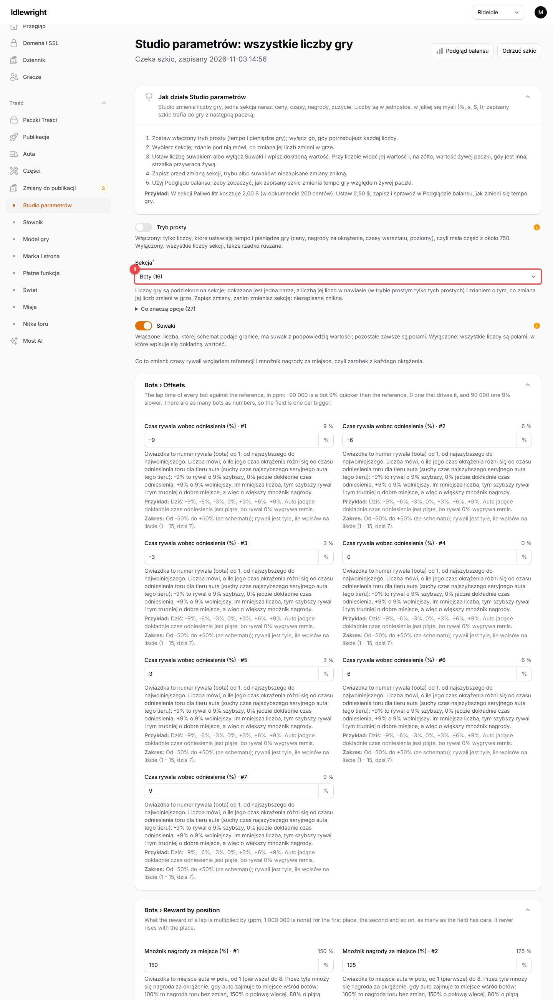

<!-- legenda:studio-boty -->
1. **Krok rywali na klasę (% okrążenia).** O ile szybsze są boty za każdą klasę, o którą auto jest wyżej niż klasa najlepszego seryjnego auta jego tieru (klasa natywna tieru), jako część czasu okrążenia. Seryjne auta nigdy nie są powyżej klasy natywnej, więc spotykają tych samych rywali co zawsze, a auto dotuningowane do wyższej klasy trafia na rywali tej klasy: przeskok klasy nie zawsze się opłaca. Zero (albo gra bez rywalizacji) zostawia boty bez zmian. Zakres: 0% – 30% okrążenia; 0 wyłącza. Przykład: 8%: auto o klasę wyżej niż klasa natywna ma boty szybsze o 8%, o dwie klasy wyżej o 16%. Dla Rdzaka GT-4 przeskok z D do C przy 10% kosztuje 24 – 32% dochodu na czterech torach z pięciu.
<!-- /legenda -->

### Jak klasa widać w grze

Przy aucie gracz widzi odznakę klasy i PI (na przykład „B 612”: nagłówek gry, karta auta, dealer, giełda i flota) oraz na liście torów obok tytułu „Tory w tym mieście”. Klasa i PI są też w sklepie: karta części porównuje ją z założoną i, gdy część wchodzi na auto, mówi, jaką klasę i PI auto pokaże po jej założeniu (liczone dla nowej części, o zwykłej rzadkości i bez ulepszeń). W porównaniu części w warsztacie jest jedna linia o klasie: „Klasa się zmienia: C 480 → B 520” (na bursztynowo), gdy część przenosi auto do innej klasy, albo „Klasa B bez zmian: 512 → 520 PI”. Dzięki temu gracz wie, że tuning, który podnosi klasę, przeniesie go do rywali wyższej klasy (gdy krok rywali jest większy od zera). Polecenie `php artisan competition:pi-report` pokazuje klasy i PI aut paczki.

**Co sprawdzić po zmianie progów:** odznaki klasy kilku aut w grze zgadzają się z tym, co zamierzałeś (na przykład seryjny Rdzak GT-4 nadal ma klasę D). Most AI (rozdział 17) potrafi zmienić te liczby rozmową: wyłącz „Tylko najważniejsze liczby” i wybierz sekcję „competition”.

---

## 16. Powiadomienia push i powroty graczy

**Cel:** sprawdzić, czy gra może wysyłać powiadomienia push, ile urządzeń i kont się zgodziło i co wysłano w ostatnich siedmiu dniach.

Menu Treść → Powiadomienia. To strona **tylko do odczytu**: nic tu nie zmienia gry. Limity na dobę, ciche godziny i grupa kont, która nigdy nie dostaje powiadomień, to liczby ze Studia (sekcja push); klucze robi administrator serwera poleceniem `php artisan push:keys`, **gdy tekst polityki prywatności jest już wdrożony**. Bez kluczy nic się nie wysyła i nikt nie jest pytany o zgodę.

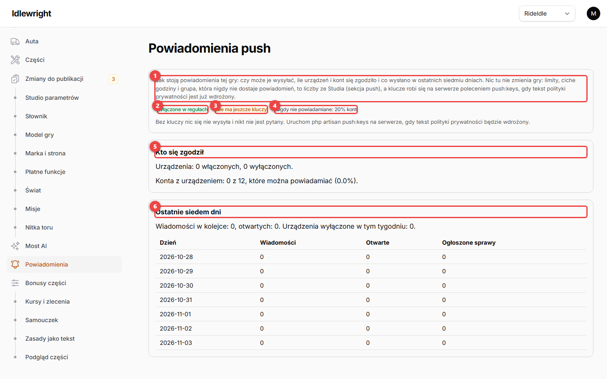

<!-- legenda:push -->
1. **Co pokazuje strona.** Jak stoją powiadomienia tej gry: czy może je wysyłać, ile urządzeń i kont się zgodziło i co wysłano w ostatnich siedmiu dniach. Nic tu nie zmienia gry: limity, ciche godziny i grupa, która nigdy nie dostaje powiadomień, to liczby ze Studia (sekcja push), a klucze robi się na serwerze poleceniem push:keys, gdy tekst polityki prywatności jest już wdrożony.
2. **Stan reguł.** Czy reguły push w Studiu są włączone; gdy wyłączone, nic się nie wysyła.
3. **Klucze.** Bez kluczy nic się nie wysyła i nikt nie jest pytany. Uruchom php artisan push:keys na serwerze, gdy tekst polityki prywatności będzie wdrożony.
4. **Grupa, która nie dostaje powiadomień.** Odsetek kont, które nigdy nie dostają powiadomień; to liczba ze Studia (sekcja push).
5. **Kto się zgodził.** Urządzenia z włączonymi powiadomieniami i konta, które można powiadamiać.
6. **Ostatnie siedem dni.** Po dniach: wiadomości w kolejce, otwarte i ogłoszone sprawy, a gdy coś pominięto, to z powodem (gracz to wyłączył, limit na dobę i inne).
<!-- /legenda -->

Kolumny tabeli z ostatnich siedmiu dni: wiadomości w kolejce, otwarte i ogłoszone sprawy. Gdy coś pominięto, strona podaje powód: gracz to wyłączył, gracz sam to widział, limit na dobę, wstrzymane do powrotu gracza, brak urządzenia albo inne.

**Co sprawdzić:** „Włączone w regułach” i „Klucze są” to dwa warunki, żeby cokolwiek zostało wysłane. Zielone „Włączone w regułach” przy braku kluczy („Nie ma jeszcze kluczy”) znaczy, że trzeba poprosić administratora serwera o `push:keys` (po wdrożeniu polityki prywatności).

**Nie sprawdzono:** prawdziwej wysyłki do przeglądarek (panel pokazuje liczby, ale wysyłka na prawdziwe urządzenia nie była próbowana).

### Prośba o zgodę i wieczorne przypomnienie o serii

Liczby, które ustawiają, jak i kiedy gracz jest pytany i powiadamiany, są w Studiu parametrów, sekcja **Push** (nazwa sekcji i tytuły jej grup są po angielsku, opisy pól po polsku).

- **Licznik próśb.** Serwer liczy, ile razy gracz odłożył („nie teraz”) kartę, która pyta o powiadomienia. Karta może się pokazać, gdy odłożeń jest mniej niż **`push.ask_max`** (domyślnie 3) i minęło co najmniej **`push.ask_after_ms`** od ostatniego (domyślnie tydzień). Decyduje serwer, więc gracz jest pytany tak samo na każdym urządzeniu, a konto z grupy kontrolnej nigdy nie dostaje prośby.
- **Wieczorne przypomnienie o serii (`streak_risk`).** To czwarty rodzaj wiadomości, **domyślnie wyłączony**: gracz włącza go w ustawieniach konta. Gracz z serią co najmniej **`push.streak_risk_min_days`** dni (3) dostaje **raz na dobę**, od **`push.streak_risk_from_min`** (19:00 w strefie urządzenia), przypomnienie, jeśli cel dnia nie jest zrobiony; czy jest zrobiony, sprawdza się w chwili wysyłki. Przypomnienie, które nie może wyjść w ciągu trzech godzin od swojej pory (ciche godziny, odstęp po innej wiadomości, przerwa po nieodpowiedzianych), nie jest wysyłane, bo dotyczyłoby dnia, który się skończył.

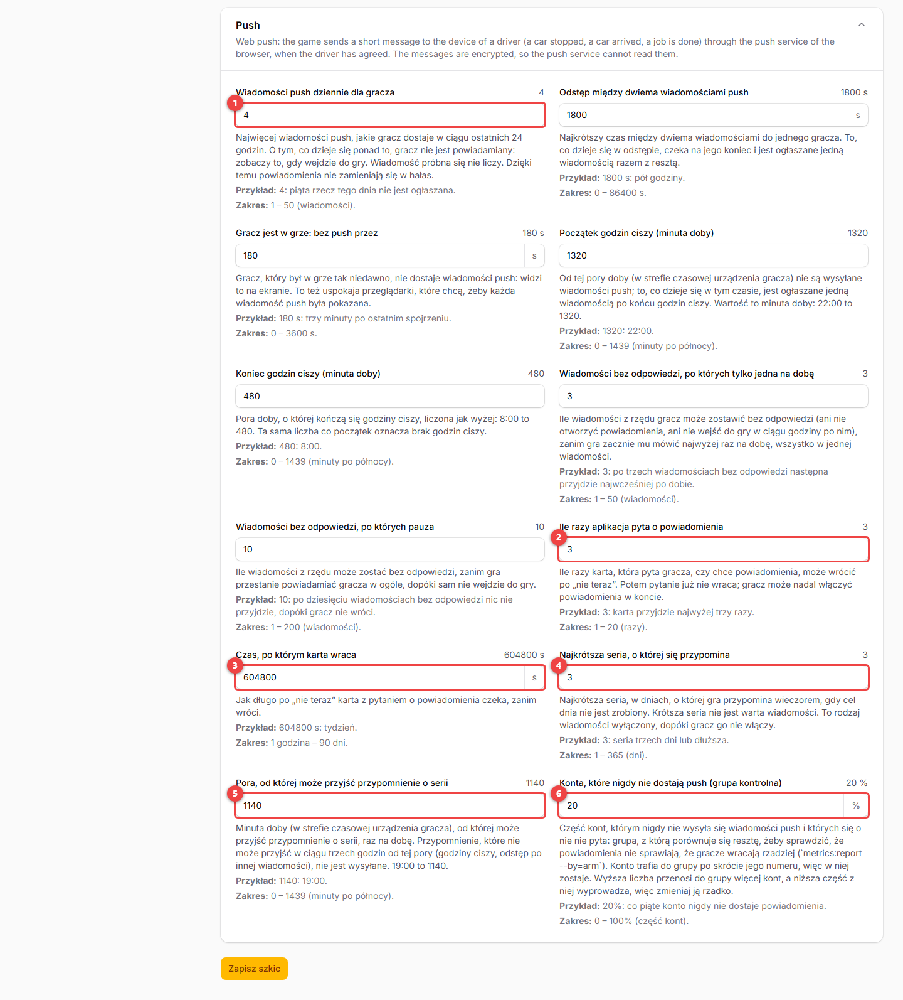

<!-- legenda:studio-push -->
1. **Wiadomości push dziennie dla gracza.** Najwięcej wiadomości push, jakie gracz dostaje w ciągu ostatnich 24 godzin. O tym, co dzieje się ponad to, gracz nie jest powiadamiany: zobaczy to, gdy wejdzie do gry. Wiadomość próbna się nie liczy. Dzięki temu powiadomienia nie zamieniają się w hałas. Zakres: 1 – 50 (wiadomości). Przykład: 4: piąta rzecz tego dnia nie jest ogłaszana. Wskazówka: Więcej niż kilka dziennie skłania graczy do wyłączenia powiadomień.
2. **Ile razy aplikacja pyta o powiadomienia.** Ile razy karta, która pyta gracza, czy chce powiadomienia, może wrócić po „nie teraz”. Potem pytanie już nie wraca; gracz może nadal włączyć powiadomienia w koncie. Zakres: 1 – 20 (razy). Przykład: 3: karta przyjdzie najwyżej trzy razy.
3. **Czas, po którym karta wraca.** Jak długo po „nie teraz” karta z pytaniem o powiadomienia czeka, zanim wróci. Zakres: 1 godzina – 90 dni. Przykład: 604800 s: tydzień.
4. **Najkrótsza seria, o której się przypomina.** Najkrótsza seria, w dniach, o której gra przypomina wieczorem, gdy cel dnia nie jest zrobiony. Krótsza seria nie jest warta wiadomości. To rodzaj wiadomości wyłączony, dopóki gracz go nie włączy. Zakres: 1 – 365 (dni). Przykład: 3: seria trzech dni lub dłuższa.
5. **Pora, od której może przyjść przypomnienie o serii.** Minuta doby (w strefie czasowej urządzenia gracza), od której może przyjść przypomnienie o serii, raz na dobę. Przypomnienie, które nie może przyjść w ciągu trzech godzin od tej pory (godziny ciszy, odstęp po innej wiadomości), nie jest wysyłane. 19:00 to 1140. Zakres: 0 – 1439 (minuty po północy). Przykład: 1140: 19:00.
6. **Konta, które nigdy nie dostają push (grupa kontrolna).** Część kont, którym nigdy nie wysyła się wiadomości push i których się o nie nie pyta: grupa, z którą porównuje się resztę, żeby sprawdzić, że powiadomienia nie sprawiają, że gracze wracają rzadziej (`metrics:report --by=arm`). Konto trafia do grupy po skrócie jego numeru, więc w niej zostaje. Wyższa liczba przenosi do grupy więcej kont, a niższa część z niej wyprowadza, więc zmieniaj ją rzadko. Zakres: 0 – 100% (część kont). Przykład: 20%: co piąte konto nigdy nie dostaje powiadomienia. Wskazówka: Przy niewielu graczach porównanie pokazuje tylko kierunek: żeby zobaczyć różnicę pięciu punktów, trzeba około tysiąca kont w grupie. 0% powiadamia wszystkich.
<!-- /legenda -->

### Seria dni i transmutacja

W tym samym Studium są sekcje **Streaks** (seria dni: cel dnia, tarcza, nagrody cyklu i kamienie milowe) i **Transmute** (transmutacja części: od którego poziomu, ile na dobę, koszty). Opisują je pola, bez osobnego zrzutu; zmiana ich liczb wymaga uruchomienia symulatora poniżej.

### Ile zarabia auto w danym slocie (`slots.yield_ppm`)

Studio, sekcja **Slots**: lista po jednej liczbie na slot aktywnego auta (pierwsza dla pierwszego), **domyślnie 100% dla pięciu slotów, czyli nic się nie zmienia**. To dźwignia na wypadek, gdyby konto VIP z wieloma autami okazało się za mocne: wariant, w którym czwarte i piąte auto zarabia po 70%, to `[1000000, 1000000, 1000000, 700000, 700000]`. Dźwignia działa w rozliczaniu, okrążenie po okrążeniu (gotówka i XP), a premia VIP jest doliczana od tego, co zostało. W badaniu floty wariant z 70% zmniejsza przewagę konta VIP z 3,0× do około 2,7× dla graczy z największą flotą.

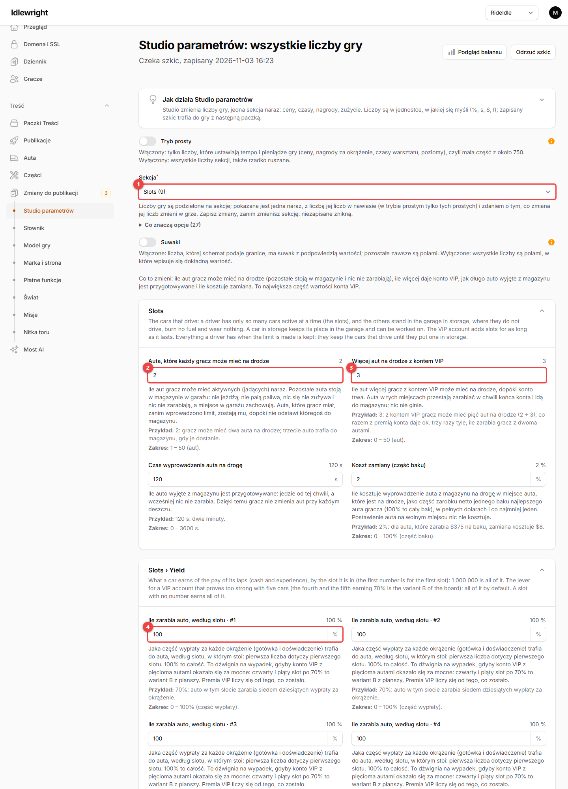

<!-- legenda:studio-sloty -->
1. **Sekcja.** Liczby gry są podzielone na sekcje; pokazana jest jedna naraz, z liczbą jej liczb w nawiasie (w trybie prostym tylko tych prostych) i zdaniem o tym, co zmiana jej liczb zmieni w grze. Zapisz zmiany, zanim zmienisz sekcję: niezapisane znikną.
2. **Auta, które każdy gracz może mieć na drodze.** Ile aut gracz może mieć aktywnych (jadących) naraz. Pozostałe auta stoją w magazynie w garażu: nie jeżdżą, nie palą paliwa, nic się nie zużywa i nic nie zarabiają, a miejsce w garażu zachowują. Auta, które gracz miał, zanim wprowadzono limit, zostają mu, dopóki nie odstawi któregoś do magazynu. Zakres: 1 – 50 (aut). Przykład: 2: gracz może mieć dwa auta na drodze; trzecie auto trafia do magazynu, gdy je dostanie. Wskazówka: Symulator ekonomii zakłada ok. 1,7 auta na drodze dla zwykłego gracza, więc 2 nie zmienia tempa graczy, którzy nie płacą. Sprawdź to poleceniem economy:simulate po zmianie.
3. **Więcej aut na drodze z kontem VIP.** Ile aut więcej gracz z kontem VIP może mieć na drodze, dopóki konto trwa. Auta w tych miejscach przestają zarabiać w chwili końca konta i idą do magazynu; nic nie ginie. Zakres: 0 – 50 (aut). Przykład: 3: z kontem VIP gracz może mieć pięć aut na drodze (2 + 3), co razem z premią konta daje ok. trzy razy tyle, ile zarabia gracz z dwoma autami. Wskazówka: To największa część wartości konta VIP: więcej aut zarabia więcej niż premia do gotówki i XP. Sprawdź przewagę w symulatorze ekonomii, zanim ją podniesiesz.
4. **Ile zarabia auto, według slotu.** Jaka część wypłaty za każde okrążenie (gotówka i doświadczenie) trafia do auta, według slotu, w którym stoi: pierwsza liczba dotyczy pierwszego slotu. 100% to całość. To dźwignia na wypadek, gdyby konto VIP z pięcioma autami okazało się za mocne: czwarty i piąty slot po 70% to wariant B z planszy. Premia VIP liczy się od tego, co zostało. Zakres: 0 – 100% (część wypłaty). Przykład: 70%: auto w tym slocie zarabia siedem dziesiątych wypłaty za okrążenie. Wskazówka: Sprawdź poleceniem economy:fleet, co zmiana robi z przewagą konta VIP, zanim ją opublikujesz.
<!-- /legenda -->

### Symulator serii i transmutacji (dla administratora serwera)

Dwa polecenia puszczają symulator na regułach gry i mówią, czy nowe liczby przesuwają tempo gry bardziej, niż wolno. **To nie są bramki paczki**: administrator uruchamia je ręcznie.

- `php artisan streaks:budget --simulate` gra serię (gracz, który jej nie zrywa, darmowa skrzynka wyceniona na swoją cenę) z trzema typami graczy i sprawdza, o ile dni wcześniej gracz kupuje kolejne auta wobec gry bez serii, z tolerancją 5%.
- `php artisan economy:transmute --simulate` gra gracza z monetami, który po otwarciu tieru zamienia opony, zawieszenie i hamulce na epickie, gdy ma gotówkę, z zyskiem z tabeli tempa rzadkości i tolerancją bramki tempa (25%).

Zmierzone na regułach, które idą z grą (według dokumentacji etapu): seria dodaje do gotówki pierwszych 30 dni 2,3% (gracz A), 8,8% (B) i 4,4% (C); **gracz B kupuje auto L3 dnia 19 zamiast 21, czyli o 2 dni (około 9,5%) wcześniej, ponad dopuszczalne 5%**, więc test serii dla B **nie przechodzi**, głównie przez darmową skrzynkę tygodniowo. To wynik dla właściciela, nie błąd: albo skrzynka z serii jest mniejsza (`streaks.cycle`), albo tolerancja 5% jest za ostra dla dnia 21 (to około dnia rozdzielczości modelu). Transmutacja daje +31,7% dochodu z tabeli tempa i nie przesuwa żadnego zakupu o więcej niż 25%. Założenia (bez danych z gry): gracz serii nigdy jej nie zrywa, darmowa skrzynka jest warta swoją cenę, gracz z monetami zamienia od razu, gdy ma gotówkę.

---

## 17. Most AI: zmiany rozmową z asystentem

**Cel:** zmienić wiele rzeczy naraz rozmową z asystentem AI zamiast klikania po formularzach, na przykład „wszystkie silniki tieru 3 mają mieć 12% więcej mocy” albo „zmień cenę VIP”.

Most składa się z dwóch przepływów: panel **przygotowuje instrukcję** dla czatu, a po rozmowie **sprawdza i wprowadza odpowiedź jako szkice**. **Nic nie jest publikowane**: wynik to zwykłe szkice, które potem przechodzą zwykłą drogę (rozdział 9).

### 17.1. Przygotuj instrukcję

Menu Treść → Most AI, karta „1. Przygotuj instrukcję”. Wybierz, co dołączyć: auta, części, liczby reguł (tryb prosty albo wszystkie), samouczek (kroki po kluczach, urządzenie, nadawcy, słowa i historia), sekcje, teksty (przełącznik „Dołącz teksty”), a także tryb „zaprojektuj tę grę od nowa”. Panel pokazuje **rozmiar instrukcji w tokenach** (to szacunek) i kolor: do 30 tysięcy zielony, do 80 tysięcy żółty, powyżej czerwony (zmniejsz wybór, bo instrukcja może się nie zmieścić w oknie czatu).

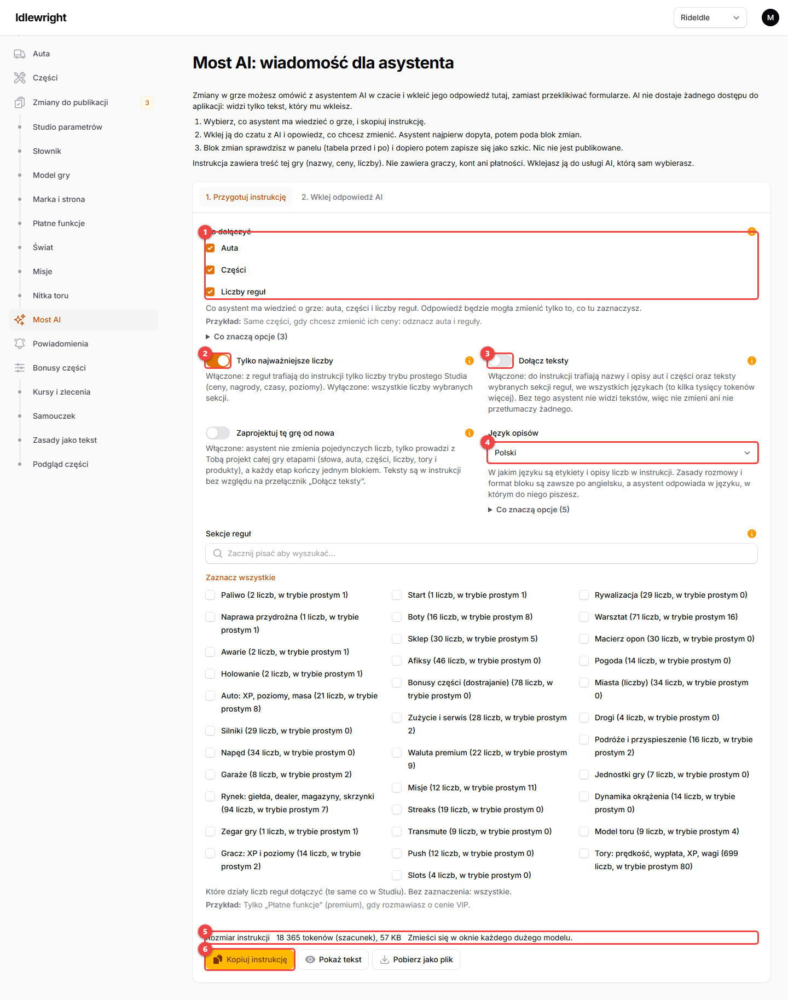

<!-- legenda:most-ai-instrukcja -->
1. **Co dołączyć.** Co asystent ma wiedzieć o grze: auta, części, liczby reguł i samouczek. Odpowiedź będzie mogła zmienić tylko to, co tu zaznaczysz. Przykład: Same części, gdy chcesz zmienić ich ceny: odznacz auta i reguły. Wskazówka: Im mniej zaznaczysz, tym krótsza instrukcja i tym dokładniejsza rozmowa.
2. **Tylko najważniejsze liczby.** Włączone: z reguł trafiają do instrukcji tylko liczby trybu prostego Studia (ceny, nagrody, czasy, poziomy). Wyłączone: wszystkie liczby wybranych sekcji. Wskazówka: Instrukcja ze wszystkimi liczbami jest kilka razy dłuższa.
3. **Dołącz teksty.** Włączone: do instrukcji trafiają nazwy i opisy aut i części oraz teksty wybranych sekcji reguł, we wszystkich językach (to kilka tysięcy tokenów więcej). Bez tego asystent nie widzi tekstów, więc nie zmieni ani nie przetłumaczy żadnego. Wskazówka: Włącz, gdy chcesz zmieniać nazwy albo tłumaczyć.
4. **Język opisów.** W jakim języku są etykiety i opisy liczb w instrukcji. Zasady rozmowy i format bloku są zawsze po angielsku, a asystent odpowiada w języku, w którym do niego piszesz.
5. **Rozmiar instrukcji.** Szacunek w tokenach: do 30 tysięcy zielony, do 80 tysięcy żółty, powyżej czerwony.
6. **Kopiuj instrukcję.** Robi instrukcję i wkłada ją do schowka; gdy przeglądarka zablokuje schowek, pokazuje pole do zaznaczenia.
<!-- /legenda -->

Kliknij „Kopiuj instrukcję”. Gdy przeglądarka blokuje schowek, panel pokazuje tekst w polu do zaznaczenia („Pokaż tekst”), skopiuj go ręcznie. Wklej instrukcję jako **pierwszą wiadomość** do czatu z asystentem.

### 17.2. Rozmowa w czacie

Czego się spodziewać: asystent się przywita i zapyta, co zmienić (**bez bloku**), potem dopyta, streści i **poczeka na twoje „tak”**. Dopiero wtedy da **jeden blok** w ramce `ride-changes`. Zgłoś (poprawką w rozmowie), gdy asystent **zgaduje zamiast pytać**, wymyśla nazwy, ścieżki albo liczby, myli jednostki albo daje blok razem z pytaniami.

### 17.3. Wklej odpowiedź AI i sprawdź

Karta „2. Wklej odpowiedź AI”. Wklej całą odpowiedź asystenta (z tekstem wokół bloku też może być) i kliknij „Sprawdź odpowiedź”. Panel pokazuje **werdykt** i tabelę zmian: „na żywo / teraz / będzie” oraz opis liczby. Uwagi przy wierszu: „zaokrąglone”, „dokłada się do szkicu”, „tłumaczenie AI, nieprzejrzane”, „nowe”.

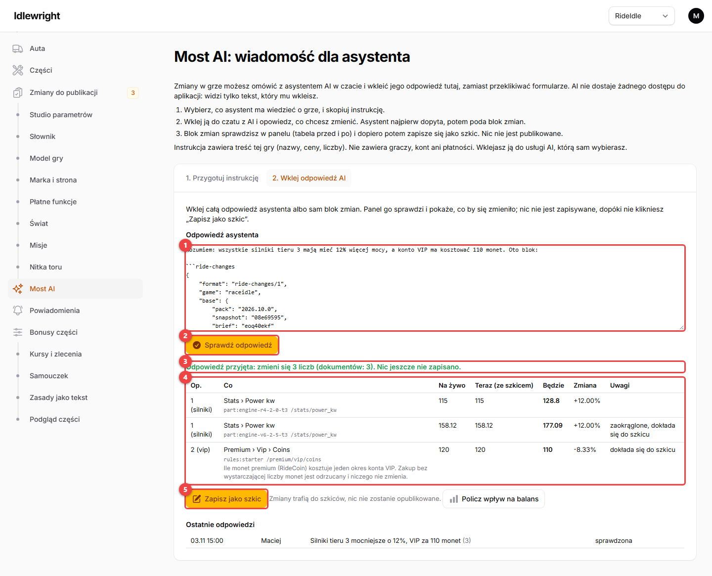

<!-- legenda:most-ai-odpowiedz -->
1. **Odpowiedź asystenta.** Tu wkleja się całą odpowiedź AI albo sam blok zmian.
2. **Sprawdź odpowiedź.** Pokazuje, co by się zmieniło; nic nie jest zapisywane.
3. **Werdykt.** Odpowiedź przyjęta („zmieni się N liczb (dokumentów: M)”, nic jeszcze nie zapisano) albo nieprzyjęta (liczba błędów, nic nie zostało zmienione).
4. **Tabela zmian.** Na żywo, teraz (ze szkicem) i będzie, dla każdej zmienianej liczby.
5. **Zapisz jako szkic.** Dopiero ten przycisk zapisuje zmiany, i tylko jako szkice.
<!-- /legenda -->

Gdy odpowiedź ma **problemy**, panel opisuje je po ludzku (które pole, co jest nie tak) i daje przycisk **„Kopiuj błędy dla AI”**. To pętla naprawcza: wklej błędy do czatu, weź poprawiony blok, wklej go ponownie i sprawdź.

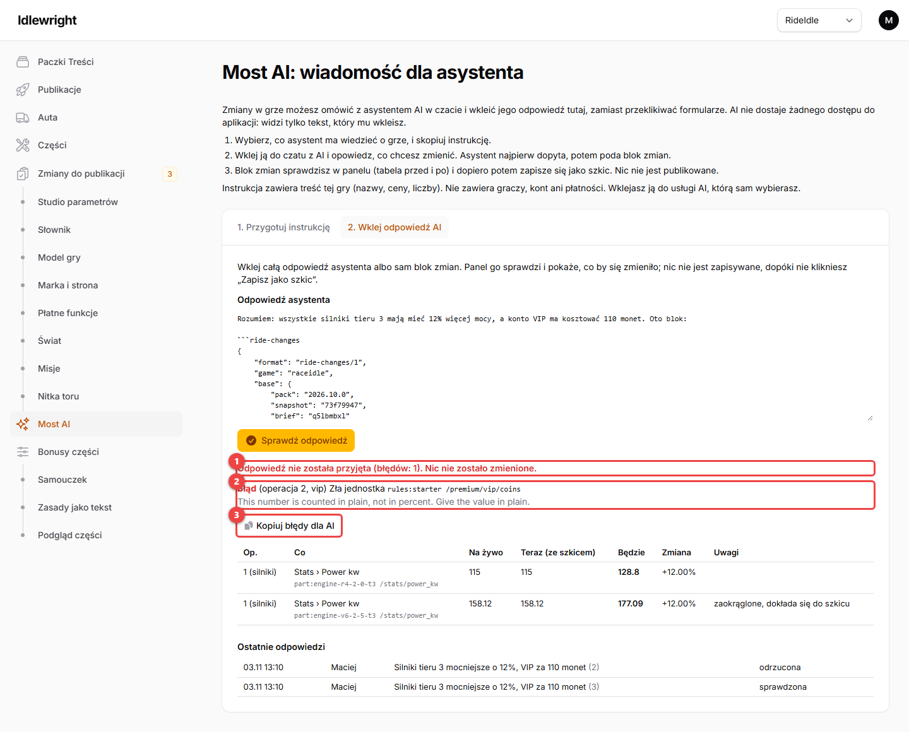

<!-- legenda:most-ai-blad -->
1. **Werdykt.** Odpowiedź nie została przyjęta i nic nie zostało zmienione.
2. **Problemy.** Każdy ma nazwę, numer operacji i komunikat serwera.
3. **Kopiuj błędy dla AI.** Daje numerowaną listę do wklejenia z powrotem do czatu; asystent poprawia tylko to i wysyła cały blok jeszcze raz.
<!-- /legenda -->

### 17.4. Policz wpływ na balans, zapisz jako szkic, cofnij

- **„Policz wpływ na balans”** puszcza bramki publikacji i symulator na treści z odpowiedzią, obok żywej paczki: widzisz skutek, zanim cokolwiek zapiszesz.
- **„Zapisz jako szkic”** wprowadza zmiany jako szkice (w jednej transakcji: albo wszystkie, albo żadna). Potem: „Zmiany do publikacji” i zwykła publikacja przez bramki.
- **Historia ostatnich odpowiedzi** (dziesięć ostatnich) i **„Cofnij”**: przywraca szkice sprzed zapisu, ale **tylko dopóki nikt nie pracował nad tymi szkicami**; inaczej panel pokazuje listę konfliktów.

### 17.5. Jeden rekord

Przy zmianie tylko jednego auta albo jednej części użyj przycisku **„Przygotuj dla AI (ten rekord)”** na formularzu: instrukcja dotyczy tylko tego rekordu i jest znacznie krótsza.

### 17.6. Przykładowe rozmowy

1. **„Wszystkie silniki T3 +12% mocy.”** Asystent powinien zapytać, czy dotyczy to też turbosprężarek (to inny slot), streścić („zmieniam moc silników tieru 3 o +12%, turbosprężarki zostają”) i dopiero po „tak” dać blok z operacją skali.
2. **„Zmień cenę VIP.”** Cena VIP jest w **monetach**, więc asystent pyta o nową liczbę monet i podaje ją w jednostkach Studia. Ceny w prawdziwych pieniądzach most pomija (rozdział 12).
3. **„Dodaj nowe auto na wzór Rdzaka GT-4.”** Asystent kopiuje istniejące auto, zmienia pola i prosi o nowy slug, którego gra jeszcze nie użyła.
4. **„Przemianuj Rdzaka GT-4 w tej grze.”** Operacja tekstu w jednym języku; inne języki (francuski, niemiecki, portugalski) są oznaczone jako tłumaczenie AI, nieprzejrzane.
5. **„W grze o statkach mentor ma pisać listy od kapitanatu portu.”** Zaznacz w instrukcji **Samouczek**. Asystent pyta, czy wszystkie kroki mają pisać od tego samego nadawcy i czy zmienić też słowa (na przykład „Wyślij” na „Nadaj list”), streszcza i dopiero potem daje blok: wybór urządzenia (`/messenger/device` = `letter`), nadawcę (`/messenger/sender`) i słowa (`/messenger/labels/send`). Kroki wskazuje **kluczem**, nie numerem (`/steps/refuel/sms/0`), bo numery przesuwają się po dodaniu kroku.
6. **„Dodaj krok po tankowaniu, w którym mentor przypomina o serwisie.”** Asystent wstawia nowy krok operacją `insert` po kroku `refuel`, z nowym kluczem i tekstami w pięciu językach. Panel sprawdza cały samouczek tak jak przy zapisie strony (klucz wolny, warunki z listy, nadawca, długość wiadomości).

### 17.7. Czego most nie robi

Most **nie publikuje**, nie zakłada gier, nie zmienia cen w prawdziwych pieniądzach, nie wysyła obrazków (także ramki urządzenia, ikony i obrazu historii samouczka), nie kasuje, nie wycofuje i nie archiwizuje. W samouczku nie usuwa kroków i nie zmienia ich kolejności: to robi się na stronie Samouczek. Zmienia wyłącznie to, co objęła instrukcja. Mapa liczb, które most potrafi zmienić, jest ta sama co w Studiu, więc obejmuje też klasy aut i PI (sekcja „competition”, przy wyłączonym „Tylko najważniejsze liczby”; rozdział 15).

### 17.8. Jak wypróbować most po raz pierwszy

1. Menu Treść → Most AI, zostaw domyślne wybory i kliknij „Kopiuj instrukcję” (albo „Pokaż tekst”).
2. Wklej ją jako pierwszą wiadomość do czatu. Asystent ma się przywitać i zapytać, co zmienić, **bez bloku**.
3. Opisz zmianę jednym zdaniem i sprawdź, czy dopytuje, streszcza i czeka na zgodę.
4. Weź blok, wklej na karcie „2. Wklej odpowiedź AI” i kliknij „Sprawdź odpowiedź”; przy błędzie „Kopiuj błędy dla AI”.

**Nie sprawdzono:** żadnego prawdziwego modelu (testy używają gotowych odpowiedzi) ani prawdziwego schowka w przeglądarce. Dlatego do zgłoszenia jest: czy asystent zgaduje zamiast pytać, czy wymyśla slugi, ścieżki i liczby, czy myli jednostki i czy cała instrukcja mieściła się w oknie czatu.

---

## 18. Co robić, gdy coś nie działa

| Objaw | Co znaczy i co zrobić |
|---|---|
| Nie mogę się zalogować, panel każe czekać | Za dużo nieudanych prób z rzędu; poczekaj chwilę. Zgubiony telefon: kod odzyskiwania, a gdy go nie ma, administrator serwera robi `admin:update ADRES --reset-mfa`. |
| Nie widzę przycisku „Zrób paczkę”, „Uruchom”, „Pobierz CSV” albo Dziennika | Masz rolę edytora. Prosi się o rolę wydawcy administratora serwera (`admin:update ADRES --role=publisher`). |
| Edytuję, ale to nie ta gra | Sprawdź przełącznik gry w prawym górnym rogu. Szkice są osobne w każdej grze. |
| Zapis formularza odrzucony czerwonym polem | Szkic jest sprawdzany schematem. Przeczytaj komunikat pod polem: mówi, co jest poza zakresem. |
| Paczka nie powstaje i raport wskazuje bramkę | To bramka symulatora (rozdział 9). Raport mówi, który tor, auto albo dzień. Popraw liczbę i zrób paczkę jeszcze raz. |
| Paczka stoi na „Czeka” | Nie działa kolejka na serwerze (`rideidle-queue`). Poproś administratora serwera. |
| Zmieniłem liczbę, a w grze nic się nie zmieniło | Szkic nie jest jeszcze w paczce uruchomionej. Sprawdź „Zmiany do publikacji” i Paczki Treści. |
| „Zarchiwizuj” odmawia | Przedmiot ktoś używa; wycofaj go z oferty zamiast archiwizować. |
| Domena się nie ustawia | Sprawdź DNS (rekord A), potem log zlecenia na stronie „Domena i SSL” (rozdział 2). Gdy log pokazuje błąd certbota albo nginx, napisz do administratora serwera z treścią loga. |
| Strona „Domena i SSL” nic nie robi po kliknięciu | Zlecenia wykonuje worker na serwerze raz na minutę. Poczekaj minutę; gdy nadal nic, administrator serwera sprawdza `systemctl list-timers rideidle-domains.timer`. |
| Paczkę zatrzymała bramka kursów (`gigs:report --strict`) | Strona „Kursy i zlecenia”, zakładka Wypłata, „Policz wypłatę”: wiersze poza granicami (R1 i R2) mówią, który szablon. Popraw wypłatę szablonu, kotwice drabiny albo przedziały poziomów i policz jeszcze raz (rozdział 13). |
| Paczkę zatrzymała bramka bonusów części (`tuning:budget --strict`) | Strona „Bonusy części”, przycisk „Policz”: najlepszy zestaw zdejmuje z okrążenia więcej niż pułap. Zmniejsz granice jednego bonusu w Studiu i policz jeszcze raz (rozdział 14). |
| Powiadomienia push: „Nie ma jeszcze kluczy” | Administrator serwera uruchamia `php artisan push:keys`, gdy tekst polityki prywatności jest wdrożony (rozdział 16). |
| Most AI: odpowiedź odrzucona | Przeczytaj „Problemy”, kliknij „Kopiuj błędy dla AI” i wklej do czatu (rozdział 17). |

**Kiedy pisać do administratora serwera:** gdy paczka stoi na „Czeka”, gdy domena lub certyfikat się nie ustawia po sprawdzeniu DNS, gdy panel zwraca błąd serwera (502 albo 500) albo gdy trzeba zmienić rolę, zresetować kod z aplikacji lub założyć konto administratora.

---

## Dodatek A. Jak odtworzyć zrzuty tego podręcznika

Zrzuty i listy pod nimi nie są robione ręcznie. Skrypt w `docs/podrecznik/zrzuty/` odtwarza wszystkie po zmianie wyglądu panelu albo po zmianie opisów pól: przygotowuje pustą bazę z danymi demonstracyjnymi, uruchamia panel, loguje się z kodem z aplikacji, na każdej stronie wstrzykuje numerowane ramki przy opisanych polach, robi zrzut do `docs/img/podrecznik-<nazwa>.png` i wpisuje legendy z katalogu pomocy do tego pliku (między znacznikami `<!-- legenda:nazwa -->` i `<!-- /legenda -->`). Szczegóły i polecenia są w [`docs/podrecznik/zrzuty/README.md`](podrecznik/zrzuty/README.md).

```bash
node docs/podrecznik/zrzuty/zrzuty.mjs
```
